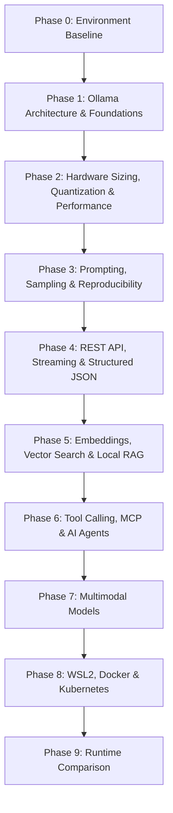

# Local AI & Ollama Learning Lab: Master Implementation Roadmap

> **Target Audience:** Senior DevOps / Platform Engineer (Kubernetes, Helm, Argo CD, GitOps, Terraform)  
> **Technical Role:** Senior AI Infrastructure Engineer & Technical Mentor  
> **Hardware Profile:** Intel Core i7-10700K (8C/16T) | 64 GB RAM | NVIDIA GeForce RTX 3080 (10 GB VRAM)  
> **Runtime Baseline:** Windows 11 Home | WSL2 (Ubuntu 24.04.5) | Docker Desktop (not starting) | Ollama v0.40.2 (127.0.0.1:11434)  
> **Document Status:** Accepted — revision 2 (2026-10-10). See the decision log in §7.

---

## 1. Executive Summary & Vision

The objective of this learning lab is to build an in-depth, hands-on, and architectural understanding of **local Large Language Model (LLM) inference, runtime orchestration, and integration using Ollama**.

Rather than treating local AI as a black-box consumer application, this curriculum treats local LLMs as **stateful services with strict hardware and compute constraints**. AI concepts are mapped to familiar DevOps and cloud-native primitives:

| AI / Inference Concept | Platform / DevOps Equivalent | Key Engineering Consideration |
| :--- | :--- | :--- |
| **Model Weights (GGUF)** | Read-only container base image | Size on disk, memory-mapped I/O (`mmap`), cold boot time |
| **Model store (manifests + blobs)** | Local OCI image cache (content-addressed layers) | Digests, deduplication, disk usage |
| **Inference Engine (Ollama)** | Container runtime (`containerd` / CRI) | API lifecycle, scheduling, GPU offloading |
| **`ollama list` vs `ollama ps`** | `crictl images` vs `kubectl get pods` | Stored on disk vs loaded in memory |
| **`keep_alive` unload** | Scale-to-zero after idle | Cold start (load time) vs memory held idle |
| **Context Window ($N_{ctx}$)** | Maximum request payload buffer | VRAM footprint grows with context length |
| **KV Cache** | Per-session in-memory cache | Retains attention state for processed tokens; consumes VRAM |
| **Quantization (Q4, Q8, FP16)** | Lossy image compression | Precision vs memory trade-off; quality vs tok/s |
| **GPU Offloading (layers on GPU)** | Resource requests (`nvidia.com/gpu`) | Spillover to CPU RAM sharply degrades throughput |
| **Prompt Template / System Prompt** | Runtime config & env vars | Sets operational boundaries and behavior |
| **Embeddings & Vector Store** | Search index | Dense vector indexing and cosine similarity |
| **Tool / Function Calling** | Webhooks / RPC with a JSON contract | Validation and safety gates before execution |
| **Model Context Protocol (MCP)** | Standard plugin / sidecar API | Decoupled client-server architecture for AI tools |

---

## 2. Environment Baseline & Hardware Budget

### 2.1 Verified Baseline (2026-10-10)

Every value below was observed on this machine; see `docs/environment.md` for commands and raw output.

```text
OS:                 Windows 11 Home
WSL2:               Ubuntu 24.04.5 LTS (NAT networking, no .wslconfig); GPU visible via nvidia-smi
Docker Desktop:     CLI 29.8.1 installed; engine fails: "Docker Desktop is unable to start"
CPU:                Intel Core i7-10700K @ 3.80GHz (8 cores, 16 threads)
System Memory:      64 GB (≈44 GB free at idle)
GPU:                NVIDIA GeForce RTX 3080, 10,240 MiB, compute capability 8.6
NVIDIA Driver:      610.88 (Phase 2); 617.42 on 2026-10-12; 591.86 since ≤ 2026-10-22 (deliberate rollback, known NVIDIA issue)
Inference Engine:   Ollama v0.40.2 (0.40.5 by 2026-10-22; 0.40.8 on 2026-10-23; 0.40.10 on 2026-10-27), user-level process started by the tray app (not a Windows service)
                    Listening on 127.0.0.1:11434 only
Ollama GPU detect:  library=CUDA compute=8.6 total="10.0 GiB" available="8.9 GiB" (server.log)
VRAM in use idle:   ≈1,650 MiB (Windows desktop, virtual display adapters)
Installed models:   0
WSL → Ollama:       Unreachable (127.0.0.1 bind + WSL NAT) — expected
```

### 2.2 The 10 GB VRAM Budget

Total GPU memory used by a loaded model is approximately:

$$\text{VRAM}_{\text{total}} \approx \text{VRAM}_{\text{weights}} + \text{VRAM}_{\text{KV\_cache}}(N_{ctx}) + \text{VRAM}_{\text{compute\_buffers}} + \text{VRAM}_{\text{OS\_reserved}} \le 10\,240\text{ MiB}$$

* **Working ceiling:** **$\le 8{,}500\text{ MiB}$** for Ollama allocations (outside deliberate overflow experiments).
* **Operating margin:** ≈1,300–2,400 MiB is already used by the Windows desktop at idle (measured; it varies).
* **Measured in Phase 2** (details and formulas: `docs/vram-calculator.md`):
  * **qwen3.5:4b Q4_K_M:** ≈3,860 MiB at 4K context, ≈5,870 MiB at 64K; ≈120 tok/s.
  * **qwen3.5:9b Q4_K_M:** ≈6,450 MiB at 4K, ≈8,410 MiB at 64K (fits, but with only ≈475 MiB spare); ≈85 tok/s.
  * **KV cache:** 32 KiB per token for qwen3.5 (hybrid); a full-attention 8B like Llama 3 needs 128 KiB.
  * **Partial CPU offload:** 27% of layers on the CPU cost ≈80% of generation speed.

---

## 3. Evaluated Model Matrix & Sizing Strategy

Sizes are download sizes from the ollama.com library (checked 2026-10-10). VRAM is **not** listed here on purpose — it depends on context length and is measured in Phase 2. Capabilities marked "verify" must be confirmed with `ollama show <model>` after pulling.

| Model | Download | Max Context | Input | Phase(s) | Purpose |
| :--- | :---: | :---: | :---: | :---: | :--- |
| **`qwen3.5:4b`** | 3.3 GB (Q4_K_M, pulled) | 256K | text + image | 1–7 | **First model.** Verified via `ollama show`: 4.2B params, completion, vision, tools, thinking (on by default) |
| `qwen3.5:9b` | 6.6–7.6 GB | 256K | text + image | 2, 3, 6 | Same family, larger: clean size comparison and CPU-spill experiments |
| `qwen2.5-coder:7b` | 4.7 GB (Q4_K_M) | 32K | text | 6 | Older code-specialized model; compare against qwen3.5 for DevOps code tasks |
| Embedding model (e.g. `nomic-embed-text`) | verify | verify | text | 5 | Embeddings for RAG — confirm availability and size before Phase 5 |

Notes:

* Prefer comparing **within one family** (qwen3.5 4b vs 9b) so size is the only variable.
* No separate vision model is planned: `qwen3.5:4b` accepts images and fits the budget. A larger vision model is only added if Phase 7 shows a real gap, and only within the 8.5 GB ceiling.
* Downloads are always confirmed before pulling.

---

## 4. Repository Structure & Lab Standards

Directories and docs are created **when the phase that needs them starts**, not up front.

```text
ollama-lab/
├── CLAUDE.md                           # Claude Code entry point (imports the brief + this roadmap)
├── AGENTS.md                           # Codex entry point (points to the same files)
├── ollama-roadmap-claude.md            # Original learning brief (role, goals, rules)
├── README.md                           # Lab overview and progress
├── RoadMap.md                          # This roadmap (source of truth)
├── docs/
│   ├── environment.md                  # Verified environment assessment
│   ├── architecture.md                 # (Phase 1) Ollama runtime & memory architecture
│   ├── glossary.md                     # (Phase 1+) LLM terms mapped to DevOps concepts
│   └── vram-calculator.md              # (Phase 2) Context and KV cache sizing
├── labs/
│   ├── 00-environment-baseline/        # Health checks, GPU telemetry, CLI/API inspection
│   ├── 01-foundations/                 # First model pull, manifests, Modelfile, lifecycle
│   ├── 02-performance-hardware/        # Quantization, VRAM vs context, tok/s, CPU spill
│   ├── 03-prompting-behavior/          # System prompts, sampling, reproducibility
│   ├── 04-apis-structured-output/      # REST API, streaming, JSON schemas
│   ├── 05-embeddings-rag/              # Vector search, chunking, local docs Q&A
│   ├── 06-tools-mcp-agents/            # Tool calling, MCP, safe agents, Codex + Ollama
│   ├── 07-multimodal/                  # Vision for dashboards & diagrams
│   ├── 08-operations-containers/       # WSL2 networking, Docker, Kubernetes GPU scheduling
│   └── 09-runtime-comparison/          # Ollama vs llama.cpp vs LM Studio
├── scripts/                            # check-vram.ps1, benchmark scripts (built in-lab)
└── results/                            # Summaries committed; results/raw/ gitignored
```

### Standard Lab README Template

Every lab (`labs/XX-*/README.md`) contains:

1. **Core Concept & DevOps Analogy** (why it matters in infrastructure).
2. **Prerequisites & Hardware Budget** (VRAM and RAM allocation).
3. **Architecture & Data Flow** (Mermaid diagram where useful).
4. **Step-by-Step Execution Guide** (commands, scripts, parameters).
5. **Hypotheses → Observed Metrics** (state the expectation first, then record actual VRAM, tok/s, TTFT, quality).
6. **Troubleshooting & Failure Modes**.
7. **Cleanup Steps** (unload models, free VRAM).
8. **Check Your Understanding** (3–4 questions).

---

## 5. Detailed Implementation Phases



---

### Phase 0: Environment Baseline & Verification

* **Goal:** Understand Ollama as a local HTTP service and establish a measured baseline, with no state changes.
* **Key Topics:**
  * Ollama on Windows: tray app (`ollama app.exe`) supervising the server (`ollama.exe`) on `127.0.0.1:11434`.
  * The CLI as an API client (`ollama list` ⇔ `GET /api/tags`, `ollama ps` ⇔ `GET /api/ps`).
  * GPU discovery: what Ollama logs in `%LOCALAPPDATA%\Ollama\server.log`.
  * Why WSL2 (NAT) cannot reach a `127.0.0.1` listener on Windows.
* **Hands-on Experiment:**
  * Read-only queries against `/api/version`, `/api/tags`, `/api/ps`.
  * Baseline VRAM with `nvidia-smi`.
  * Build a VRAM monitoring script (`scripts/check-vram.ps1`) for later labs.
* **Verification Criteria:**
  * API responds with version `0.40.2`.
  * Ollama's reported available VRAM and `nvidia-smi` numbers recorded and explained.

---

### Phase 1: Foundations & Ollama Architecture

* **Goal:** Understand model lifecycle, storage format, and basic inference.
* **Key Topics:**
  * Models vs runtimes: GGUF and the llama.cpp-derived engine inside Ollama.
  * Model store: `%USERPROFILE%\.ollama\models` on Windows (`/usr/share/ollama/.ollama` for the Linux systemd install).
  * Manifests, layers, digests — compared with OCI images.
  * Custom models with a `Modelfile` (base model, parameters, system prompt).
  * Model lifecycle: load, `keep_alive` (default 5 minutes), unload.
* **Hands-on Experiment:**
  * Pull `qwen3.5:4b` (≈3.3–4.0 GB, confirmed before download).
  * Inspect manifest and blobs on disk; `ollama show` and `ollama show --modelfile`.
  * Create a `devops-assistant` model from a Modelfile.
  * Run `ollama run --verbose`; watch `ollama ps` and `nvidia-smi` during load, generation, and unload.
* **Verification Criteria:**
  * `ollama ps` shows `100% GPU` for the model.
  * Model unloads after the idle timeout and VRAM returns to baseline.

---

### Phase 2: Hardware Sizing, Quantization & Performance Profiling

* **Goal:** Understand memory math, token-generation economics, and hardware trade-offs through measurement.
* **Key Topics:**
  * Quantization: FP16 → Q8_0 → Q4_K_M → Q2_K and their quality/size trade-offs.
  * KV cache size per sequence:
    $\text{KV} = 2 \times n_{\text{layers}} \times n_{\text{kv\_heads}} \times d_{\text{head}} \times n_{\text{ctx}} \times \text{bytes\_per\_element}$
    (use **KV heads**, not attention heads — grouped-query attention shares K/V across query heads. qwen3.5 is **confirmed hybrid** in Lab 01: at 4,096 context the log shows a 128 MiB KV cache plus a 50 MiB fixed recurrent-state buffer, so only the full-attention layers grow with context.)
  * Ollama knobs (documented in the FAQ): `OLLAMA_CONTEXT_LENGTH` / `num_ctx` (default 4096 per FAQ — verify in `ollama ps`), `OLLAMA_KV_CACHE_TYPE` (`f16` default, `q8_0`, `q4_0`), `OLLAMA_FLASH_ATTENTION`.
  * Metrics: load time, Time to First Token (TTFT), prompt evaluation rate (`prompt_eval_count / prompt_eval_duration`), generation rate (`eval_count / eval_duration`).
* **Hands-on Experiment:**
  * Benchmark `qwen3.5:4b` vs `qwen3.5:9b` with identical prompts and settings.
  * Measure VRAM vs context length (e.g. 2,048 → 4,096 → 8,192 → 16,384 → 32,768).
  * Deliberately exceed VRAM (large context on 9b) and observe the `ollama ps` CPU/GPU split and tok/s drop.
  * Force CPU-only inference using a **documented** method — to be identified and verified against 0.40.2 in-lab (candidate: hiding the GPU via `CUDA_VISIBLE_DEVICES`).
* **Verification Criteria:**
  * Measured tok/s and VRAM for each configuration recorded in `results/`.
  * An empirical VRAM-vs-context curve for this RTX 3080, compared against the KV formula.

---

### Phase 3: Prompt Engineering, Context Windows & Reproducibility

* **Goal:** Control model behavior and understand when outputs are (and are not) reproducible.
* **Key Topics:**
  * System vs user vs assistant messages; chat templates.
  * Sampling: `temperature`, `top_p`, `top_k`, `min_p`, `repeat_penalty`, `seed`.
  * Context overflow: what happens when input exceeds `num_ctx`.
  * Hallucination and model limitations.
* **Hands-on Experiment:**
  * Run an identical prompt 20 times at `temperature=0` + fixed `seed` vs `temperature=0.8`; diff the outputs.
  * Feed a Kubernetes manifest/log larger than `num_ctx` and observe what the model actually "saw".
* **Hypotheses to test (not assumed):**
  * Fixed seed + temperature 0 gives identical output on the same hardware and settings — check whether it holds, and what breaks it (parallel requests, different context size).
  * Over-long input is truncated silently — find where and how.

---

### Phase 4: Local APIs, Streaming & Structured Outputs

* **Goal:** Integrate Ollama into automation using REST and structured JSON.
* **Key Topics:**
  * Endpoints: `/api/generate`, `/api/chat`, `/api/embed`, `/api/ps`; the OpenAI-compatible API.
  * Streaming (newline-delimited JSON) in PowerShell and Python.
  * Structured outputs with a JSON schema (`format`).
  * Timeouts, error handling, concurrency (`OLLAMA_NUM_PARALLEL`, default 1).
* **Hands-on Experiment:**
  * Python script using the official `ollama` library and Pydantic.
  * Extract Kubernetes incident data from raw logs into an `IncidentReport` schema.
  * Feed invalid/corrupt logs and measure behavior.
* **Hypotheses to test:**
  * Schema-constrained output always parses as JSON — measure the parse rate over 50 runs, including truncation by `num_predict`.
  * Valid JSON is not the same as correct values — measure field-level accuracy separately.

---

### Phase 5: Embeddings, Vector Search & Local RAG

* **Goal:** Build a fully private, offline RAG pipeline for engineering documentation.
* **Prerequisite:** Decide where Python runs (Windows, or WSL2 with mirrored networking — approval required for `.wslconfig` change).
* **Key Topics:**
  * Dense embeddings vs keyword search (BM25).
  * Dedicated embedding models vs general LLMs.
  * Chunking strategies (fixed size, Markdown headers) and overlap.
  * Similarity metrics (cosine, dot product, Euclidean).
  * Local vector stores (ChromaDB or SQLite-vec, embedded in Python).
* **Hands-on Experiment:**
  * Ingest sample Kubernetes manifests, Helm charts, and runbooks (no private documents in Git).
  * Embed and index; build a CLI Q&A tool that retrieves top-$k$ chunks and augments the prompt.
* **Verification Criteria:**
  * A small labeled question set: measure retrieval hit rate and whether answers cite the right runbook section.

---

### Phase 6: Tool Calling, Model Context Protocol (MCP) & AI Agents

* **Goal:** Let models interact with systems safely, with strict guardrails.
* **Key Topics:**
  * Tool-calling loop: tools definition → model tool call → execution → tool result → answer.
  * MCP architecture: hosts, clients, servers.
  * Safety: read-only vs mutating tools; human-in-the-loop approval.
  * Local coding agents: configuring Codex to use Ollama models (Codex is not configured for Ollama today).
  * `ollama launch <integration>` (listed in `ollama launch --help` on 0.40.8): starts a coding agent (`claude`, `codex`, `opencode`, …) wired to local Ollama. For `claude` it points Claude Code at Ollama's Anthropic-compatible API (`/v1/messages`) — mechanism from docs, verify in-lab.
* **Hands-on Experiment:**
  * Agent with two mock, read-only tools: `get_cluster_nodes()` and `get_pod_logs(namespace, pod_name)`.
  * Approval gate that requires console confirmation before any mutating tool runs.
  * Compare `qwen3.5:4b`, `qwen3.5:9b`, and `qwen2.5-coder:7b` on tool-call accuracy.
  * Claude Code on a local model via `ollama launch claude`:
    * First run `ollama launch claude --config` and record exactly what it changes (env vars only, or config files?) and how `--restore` undoes it.
    * Short session with `qwen3.5:4b` at 64K context on a throwaway sandbox repo; watch `ollama ps` and `scripts/check-vram.ps1`. Try `qwen3.5:9b` at 64K only if it stays within the 8.5 GB ceiling.
    * Local models only — do not select `:cloud` models from the launch menu without explicit approval.
* **Hypotheses to test:**
  * Claude Code's system prompt + tool definitions need a large context (≈64K); at the 4,096 default the session degrades or fails — measure the actual prompt token count.
  * A 4b–9b local model can drive simple agent tasks (read a file, run a read-only command) but makes more tool-call errors than it does in the mock-tool agent — count them.
* **Verification Criteria:**
  * Tool calls are valid and use correct arguments; agent synthesizes a root cause from tool output.
  * `ollama launch claude` session runs `100% GPU` within the VRAM ceiling, and the integration is restored to defaults afterwards.

---

### Phase 7: Multimodal Models & Visual Operations

* **Goal:** Use vision-language models to read infrastructure visuals.
* **Key Topics:**
  * Vision encoders and projection into the language model.
  * Image tokens: how image resolution consumes context and VRAM.
  * Limits of small vision models.
* **Hands-on Experiment:**
  * Screenshots of a Kubernetes/AWS topology diagram and a Grafana dashboard (synthetic or sanitized).
  * Evaluate extraction of metrics, pod names, and trends with `qwen3.5:4b` (then 9b, if it fits).
* **Verification Criteria:**
  * Answers checked against a ground-truth list of what each image contains.

---

### Phase 8: Operations, Containerization & Kubernetes

* **Goal:** Run Ollama in containers with GPU passthrough and prepare Kubernetes manifests.
* **Prerequisite:** Diagnose and fix Docker Desktop ("unable to start").
* **Key Topics:**
  * WSL2 networking modes (NAT vs mirrored) and `OLLAMA_HOST` exposure risks.
  * Ollama in Docker with the NVIDIA Container Toolkit. Bind to localhost and avoid clashing with the Windows instance:
    `docker run -d --gpus=all -v ollama:/root/.ollama -p 127.0.0.1:11435:11434 --name ollama ollama/ollama`
  * Two Ollama instances competing for one 10 GB GPU.
  * Kubernetes: `resources.limits: nvidia.com/gpu: 1`, PVC model cache, probes on `/api/version`.
* **Hands-on Experiment:**
  * Containerized Ollama with GPU passthrough on Docker Desktop.
  * Local kind/k3s cluster with the NVIDIA device plugin; Ollama with a persistent model cache.
* **Verification Criteria:**
  * Container runs GPU inference (`100% GPU`) and restarts without re-downloading weights.
  * API reachable only from localhost.

---

### Phase 9: Runtime Comparison

* **Goal:** Compare Ollama with alternative local engines to make informed choices.
* **Engines:**
  * **Ollama:** ergonomics, integrated CLI/API, model management.
  * **llama.cpp server:** maximum control, minimal overhead, same GGUF files.
  * **LM Studio:** GUI-first desktop experimentation with a local API.
  * *Optional stretch:* **vLLM** in WSL2 — production serving (PagedAttention, continuous batching); limited by 10 GB VRAM and GGUF support, so not a like-for-like comparison.
* **Hands-on Experiment:**
  * Same GGUF model and quantization across Ollama, llama.cpp, and LM Studio.
  * Measure single-stream latency, concurrent throughput, and peak VRAM.
* **Verification Criteria:**
  * A comparison matrix of measured results with documented test conditions.

---

## 6. Implementation Guardrails & Security Policies

1. **Local by default:** Inference, embeddings, and vector stores run locally. No cloud inference, API keys, or paid services without explicit approval.
2. **VRAM ceiling:** Normal configurations stay within 8,500 MiB. Deliberate overflow experiments (Phase 2) are announced first and cleaned up after.
3. **No unannounced downloads:** Every model pull is confirmed before it starts.
4. **Read-only first:** Agents and scripts default to read-only; mutating actions require human approval.
5. **No API exposure:** Ollama stays bound to localhost; container ports bind to `127.0.0.1`.
6. **System changes need approval:** No changes to Windows, WSL2 (`.wslconfig`), Docker, or environment variables without explanation and approval.
7. **Repository hygiene:** Weights (`*.gguf`), vector DB directories, `.venv/`, secrets, private documents, and raw benchmark output stay out of Git.
8. **No fabricated results:** Every metric in `results/` comes from an actual run, with the command and conditions recorded.

---

## 7. Decision Log

| # | Date | Decision | Rationale |
| :---: | :---: | :--- | :--- |
| D-01 | 2026-10-10 | First model is `qwen3.5:4b`; `qwen3.5:9b` for size comparison | Both verified on ollama.com; same-family comparison; 4b fits easily and supports images |
| D-02 | 2026-10-10 | Drop `llama3.2-vision:11b` and `deepseek-r1:7b` from the plan | Vision model exceeds the 8.5 GB ceiling; qwen3.5 covers vision; avoid unnecessary downloads |
| D-03 | 2026-10-10 | Start on Windows native (PowerShell, localhost); move to WSL2 before Phase 5 | Zero networking changes needed for Phases 0–4 |
| D-04 | 2026-10-10 | Phase 9 compares Ollama, llama.cpp, LM Studio; vLLM optional | Matches the original brief; like-for-like GGUF comparison |
| D-05 | 2026-10-10 | Verification criteria are written as hypotheses to test | No predetermined results; never fabricate benchmarks |
| D-06 | 2026-10-10 | Container ports bind to `127.0.0.1:11435` | Avoids LAN exposure and the port clash with Windows Ollama |
| D-07 | 2026-10-27 | Python 3.12 venv on Windows (`.venv\`, `py -3.12`), pinned `requirements.txt` | Follows D-03; default `python` is a Store 3.9, too old for Pydantic 2.14; project-local, no system changes |

Open decisions (to settle when the phase starts):

* Phase 5: vector store (ChromaDB vs SQLite-vec) and where Python runs.
* Phase 5: embedding model choice.
* Phase 8: kind vs k3s.

---

## 8. Progress

| Phase | Status |
| :--- | :--- |
| 0 — Environment baseline | Done — baseline recorded, `scripts/check-vram.ps1` built |
| 1 — Foundations | Done — see `labs/01-foundations`, `docs/architecture.md` |
| 2 — Performance | Done — see `labs/02-performance-hardware`, `docs/vram-calculator.md` |
| 3 — Prompting | Done — see `labs/03-prompting-behavior` (thinking, reproducibility, chat templates, system prompts, sampling, context overflow, grounding) |
| 4 — APIs | In progress — Steps 1 (streaming) and 3 (Python client, failure modes) done; Step 4 (structured output) done; Step 5 (OpenAI-compatible API) done; Step 6 (concurrency, queueing, cancellation) set up; Python venv ready (D-07) |
| 5–9 | Not started |
