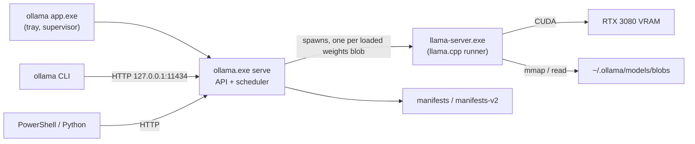

# Ollama Architecture (as observed on this machine)

Everything here was verified in Labs 00–01 on Ollama 0.40.2, Windows 11, RTX 3080. Items not yet verified are marked.

## Components

| Component | Role | Kubernetes analogy |
|---|---|---|
| `ollama app.exe` | Tray app; starts and supervises the server | systemd / node agent |
| `ollama.exe` (server) | HTTP API, model registry client, scheduler, chat renderer | kube-apiserver + scheduler |
| `llama-server.exe` | llama.cpp inference process for one set of weights | the workload pod |
| Model store | Manifests + content-addressed blobs | node image cache |
| `keep_alive` | Idle timeout per loaded runner, reset by each request (default 5 min) | scale-to-zero |

## Model store

* `manifests\registry.ollama.ai\library\<model>\<tag>` — pulled models (legacy layout, plus a v2 index in `manifests-v2\ollama.com\...`).
* `manifests-v2\ollama.com\library\<model>\<tag>` — locally created models (`ollama create`).
* `blobs\sha256-<digest>` — file name = SHA-256 of content; shared across tags.
* Layer types seen: `model` (GGUF weights), `projector` (vision encoder GGUF), `template`, `system`, `params`, `license`.

## Request path

1. Client sends `POST /api/generate` or `/api/chat`.
2. Server resolves the model's manifest and merges params: Modelfile `PARAMETER` overrides base model params (verified); request `options` override both (documented, not yet tested here).
3. Server formats the conversation with a **built-in renderer** for the model family (`renderer=qwen3.5`), not the template layer.
4. If a runner with the **same weights blob** is loaded, the request goes to it (even for a different model name); otherwise the scheduler starts a new `llama-server`. If the same blob is loaded with a **different `num_ctx`**, the scheduler waits until that runner is idle, unloads it and loads it again: two names with one blob were not loaded side by side, although both would have fit (Lab 04 Step 6, one observation).
4a. With `OLLAMA_NUM_PARALLEL` 1 (`n_slots = 1`), requests to one model are served **one at a time** (queued; order not verified) (queue limit `OLLAMA_MAX_QUEUE` 512, then 503 per the FAQ). `total_duration` counts from arrival, so it **includes queue time**; `load_duration` is reported by every request that waited for a load (Lab 04 Step 6).
5. The runner evaluates the prompt (reusing cached prefix tokens: `prompt eval cached`) and generates tokens.
6. A **parser** splits output into thinking / content / tool calls.
7. `keep_alive` expiry is reset.
8. If the client disconnects, the server aborts the load (Lab 04 Step 3) or stops generating (Step 6), and the slot is free within ≈0.3 s.

## Memory of a loaded model (qwen3.5:4b, 4,096 context)

| Consumer | Size | Where |
|---|---|---|
| LLM weights | 2,515 MiB | VRAM |
| Vision projector weights | ≈640 MiB (inferred) | VRAM |
| Compute buffers | 291 MiB | VRAM |
| KV cache | 128 MiB | VRAM |
| Recurrent state (hybrid arch) | 50 MiB | VRAM |
| CUDA runtime overhead | ≈240 MiB (remainder) | VRAM |
| **Total measured** | **≈3,860 MiB** | `nvidia-smi` delta |
| Host-side weights (likely embeddings) | 497 MiB | system RAM |

Ollama's own `SIZE` estimate was 3.1 GB — plan with measured values.

## Context and truncation

* Default `num_ctx` is 4,096. Longer prompts are **silently truncated from the front** (Lab 02: 5,064 → 2,050 tokens, no error).
* Truncation rule (Lab 03 Step 5a, 0.40.10): **kept = 4 + (num_ctx − 4) / 2**: the first 4 tokens plus the end of the prompt, leaving half the context for the answer. Ollama does it itself (`WARN … msg="truncating input prompt" limit=2050 … keep=4 new=2050` in `server.log`); llama-server reports `truncated = 0`. The response is a normal 200.
* Undocumented `truncate: false` (request field, works on both `/api/generate` and `/api/chat`, Lab 03 Steps 5a and 6) returns an error instead: `request (N tokens) exceeds the available context size (4096 tokens), try increasing it`.
* `/api/chat` trims differently (Lab 03 Step 5b): it drops **whole oldest messages** and keeps the system message, filling the context almost completely (3,970 of 4,096). No log line at the default level.
* qwen3.5: context shift is disabled by the runner (`KV cache shifting is not supported for this context`), so generation stops when prompt + output reach `num_ctx` (`done_reason: length` before `num_predict`).
* KV cache is allocated at load for the full `num_ctx`: ≈32 KiB/token for qwen3.5 (hybrid), plus a fixed 50 MiB recurrent state.
* Changing `num_ctx` starts a new runner (≈4–6 s load).

## Networking

* Binds `127.0.0.1:11434` (IPv4 only). Use `127.0.0.1`, not `localhost`: Windows resolves `localhost` to `::1` first, costing ≈2 s per request.
* WSL2 (NAT) cannot reach it; see `docs/environment.md`.

## Not yet verified

* ~~Whether variants with different `num_ctx` can share a runner~~ — **no**: changing `num_ctx` reloads the runner (Lab 02).
* ~~Cause of the 40.7 s first-ever load~~ — one-time CUDA kernel compile cached in `%APPDATA%\NVIDIA\ComputeCache` (Lab 02).
* ~~Scheduler behavior when two models don't fit~~ — evicts and reloads per request (thrashing, Lab 02).
* Why the scheduler predicted "13.2 GiB" for the 9b at 64K when its buffers total ≈8.2 GiB.
* ~~Exact truncation rule when a prompt exceeds `num_ctx`~~: 4 + (num_ctx − 4) / 2, logged by Ollama (Lab 03 Step 5a).
* Whether context shift works for full-attention (non-hybrid) models.
