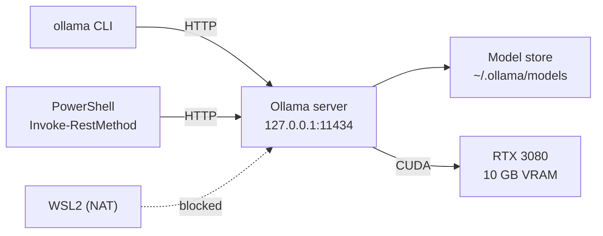

# Lab 00 — Environment Baseline

## 1. Core Concept & DevOps Analogy

Ollama is a **local HTTP API server**. The `ollama` CLI, Python libraries, and coding agents are all clients of that API — the same way `kubectl`, Lens, and Argo CD are all clients of the kube-apiserver.

Most "Ollama problems" are service problems: wrong host, wrong port, nothing listening, model not loaded, not enough VRAM. You already know how to debug those once you see Ollama as a service.

## 2. Prerequisites & Hardware Budget

* Ollama 0.40.2 running on Windows (tray icon visible).
* PowerShell 7.
* No model is loaded; this lab uses **0 MiB** of model VRAM.

## 3. Architecture



## 4. Step-by-Step Guide

### Step 1 — Ollama as an HTTP service (read-only)

```powershell
# 1. Health check — like a readiness probe
Invoke-RestMethod http://127.0.0.1:11434/api/version

# 2. "ollama list" is the same call as GET /api/tags
ollama list
Invoke-RestMethod http://127.0.0.1:11434/api/tags | ConvertTo-Json

# 3. Loaded models — "kubectl get pods" vs. "list images"
ollama ps
Invoke-RestMethod http://127.0.0.1:11434/api/ps | ConvertTo-Json

# 4. Who is listening, and on which interface?
Get-NetTCPConnection -LocalPort 11434 -State Listen |
  Select-Object LocalAddress, LocalPort, @{n='Process';e={(Get-Process -Id $_.OwningProcess).Name}}

# 5. VRAM baseline before any model is loaded
nvidia-smi --query-gpu=memory.used,memory.total,utilization.gpu --format=csv

# 6. How the server sees your hardware
Select-String "$env:LOCALAPPDATA\Ollama\server.log" -Pattern 'inference compute'
```

### Step 2 — VRAM monitor script

Build `scripts/check-vram.ps1`, a small poller around `nvidia-smi` and `/api/ps` that later labs use to watch model load and unload. (Guided in session.)

### Step 3 — Record the baseline

Write your observed values in the table below.

## 5. Hypotheses → Observed Metrics

| Check | Hypothesis | Observed (2026-10-10) |
|---|---|---|
| `/api/version` | `0.40.2` | `0.40.2` ✅ |
| `/api/tags` | empty `models` list | 0 models ✅ |
| `/api/ps` | empty `models` list | 0 models ✅ |
| Listener | `127.0.0.1:11434` only, process `ollama` | `127.0.0.1:11434`, `ollama` ✅ |
| VRAM used (idle) | ≈1.6 GB of 10 GB | **2,284 MiB** of 10,240 MiB ❌ (was 1,647 MiB earlier the same day) |
| Ollama "available" | ≈8.9 GiB, `library=CUDA` | `library=CUDA total="10.0 GiB" available="8.9 GiB"` ✅ |

**Finding:** the idle VRAM baseline is not constant. Other desktop apps take
GPU memory too, so free VRAM moved from ≈8.4 GB to ≈7.8 GB within hours. The
`available="8.9 GiB"` line in `server.log` is a snapshot taken when the
server started, not a live value. The 8,500 MiB working ceiling in
`RoadMap.md` is only safe when the desktop is quiet, so check free VRAM
right before every measurement.

## 6. Troubleshooting & Failure Modes

| Symptom | Likely cause | Check |
|---|---|---|
| `Unable to connect` on 11434 | Server not running | Tray icon; `Get-Process ollama*` |
| `library=cpu` in server.log | GPU not detected | Driver version; `nvidia-smi` |
| Port in use by another process | Second Ollama (e.g. Docker) | `Get-NetTCPConnection -LocalPort 11434` |
| WSL2 cannot connect | NAT + localhost bind (expected) | See `docs/environment.md` |
| Every API call takes ≈2 s | `localhost` resolves to `::1` (IPv6) first; Ollama listens on IPv4 only, so each call waits for the IPv6 attempt to fail | Use `http://127.0.0.1:11434`. Measured: `localhost` 2,103 ms vs `127.0.0.1` 16 ms |

## 7. Cleanup

Nothing to clean up — this lab is read-only.

## 8. Check Your Understanding

**1. `ollama list` and `ollama ps` are both empty. What does each tell you, and what is the Kubernetes equivalent of each?**

<details>
<summary>Answer</summary>

`ollama list` shows models **stored on disk** — like images cached on a node (`crictl images`).
`ollama ps` shows models **loaded in memory** and consuming VRAM/RAM — like running pods (`kubectl get pods`).
A model can be on disk without being loaded; that is the normal idle state.

</details>

**2. Why can't WSL2 reach this API, and why is that a safe default?**

<details>
<summary>Answer</summary>

Ollama binds `127.0.0.1:11434`. WSL2 in NAT mode has its own network namespace, so its `localhost` is its own loopback, and the Windows host IP (`172.25.96.1`) has no listener because Ollama isn't bound there.
It's safe because the Ollama API has **no authentication** — anyone who can reach the port can run models, pull models, or delete them. Binding to loopback is the equivalent of a `ClusterIP` Service with no Ingress.

</details>

**3. Ollama reports 8.9 GiB available while `nvidia-smi` shows ≈1.6 GB used of 10 GB. Where does the difference come from?**

<details>
<summary>Answer</summary>

* **Timing:** `available="8.9 GiB"` was logged once at server start; `nvidia-smi` is a live reading. Desktop apps (browser, Parsec, virtual displays) allocate and free VRAM continuously — this lab saw idle usage move from 1,647 MiB to 2,284 MiB in a few hours.
* **Units:** GiB (1024³) vs MiB vs GB (1000³) make similar numbers look different.
* **Lesson:** treat Ollama's startup figure like a node's allocatable capacity — a scheduling input, not live truth. Check free VRAM right before each experiment.

</details>

**4. If a teammate says "Ollama is slow", which two commands from this lab would you run first, and why?**

<details>
<summary>Answer</summary>

1. `ollama ps` — is the model loaded, and is `PROCESSOR` `100% GPU`? A CPU/GPU split is the most common cause of slow generation.
2. `nvidia-smi` (or `scripts/check-vram.ps1`) — is free VRAM low because something else is using the GPU?

Then check `server.log` for `library=cpu` (GPU not detected) and, for API clients, whether they use `localhost` instead of `127.0.0.1` (the ≈2 s IPv6 fallback found in this lab).

</details>
