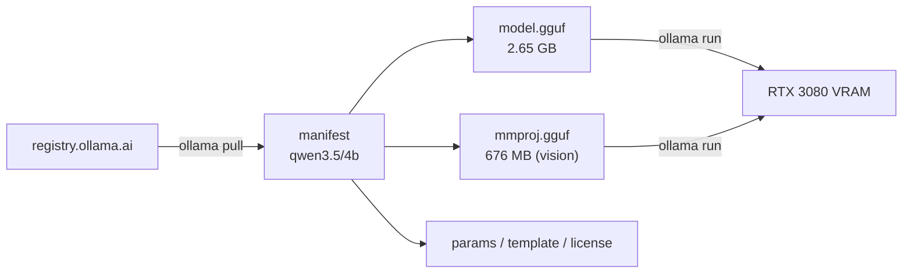

# Lab 01 — Foundations: Models on Disk and in Memory

## 1. Core Concept & DevOps Analogy

A model is **files on disk**, stored the way a container registry cache stores images:

| Ollama | Container world |
|---|---|
| `qwen3.5:4b` | `image:tag` |
| Manifest in `models\manifests\...` | OCI image manifest |
| `models\blobs\sha256-<digest>` | Content-addressed layers |
| GGUF weights layer | The large base layer |
| Template / params / license layers | Small config layers |
| `ollama pull` | `docker pull` |
| Loading into VRAM (`ollama run`) | Starting a container from the image |

## 2. Prerequisites & Hardware Budget

* Lab 00 complete; `scripts/check-vram.ps1` running in a second terminal.
* Disk: ≈3.3 GB for `qwen3.5:4b`.
* VRAM: 0 during download; measured in Step 3 when the model loads.

## 3. Architecture



## 4. Step-by-Step Guide

### Step 1 — Pull the model ✅

```powershell
ollama pull qwen3.5:4b
ollama list
```

### Step 2 — Inspect the model store (read-only)

```powershell
$root = "$env:USERPROFILE\.ollama\models"

# The manifest: one JSON file per name:tag
$mf = Get-Content "$root\manifests\registry.ollama.ai\library\qwen3.5\4b" | ConvertFrom-Json
$mf.layers | Format-Table mediaType, size, from, digest -AutoSize

# The blobs: content-addressed files
Get-ChildItem "$root\blobs" | Sort-Object Length -Descending | Format-Table Length, Name -AutoSize

# Prove content addressing: a blob's name IS the SHA-256 of its content
$p = "$root\blobs\sha256-9371364b27a52acac9d87f88bd93c9db1174d8d6ec57f6888925cdc1788871ff"
(Get-FileHash $p -Algorithm SHA256).Hash.ToLower()
Get-Content $p

# Ollama's own summary of the model
ollama show qwen3.5:4b
ollama show qwen3.5:4b --modelfile
```

### Step 3 — First inference with observation

(Guided in session.)

## 5. Hypotheses → Observed Metrics

| Check | Hypothesis | Observed (2026-10-10) |
|---|---|---|
| Download size | 3.3–4.0 GB | 3.3 GB ✅ |
| VRAM during pull | unchanged, nothing loaded | `/api/ps` empty after pull ✅ |
| Manifest layers | one GGUF + small config layers | **two GGUF layers**: `model.gguf` 2,648,593,216 B + `mmproj.gguf` 675,569,120 B (vision projector), plus template (13 B), params (65 B), license (11,343 B) |
| `ollama show` | 4B, Q4_K_M | `qwen35` arch, 4.2B params, Q4_K_M, context 262,144; projector `clip` 333.51M params |
| Capabilities | tools / thinking to verify | completion, vision, tools, thinking (**on by default**) ✅ |
| Default sampling (params layer) | — | `temperature 1`, `top_k 20`, `top_p 0.95`, `presence_penalty 1.5` |

## 6. Troubleshooting & Failure Modes

| Symptom | Likely cause | Check |
|---|---|---|
| Pull stalls or restarts | Network / proxy | Rerun `ollama pull`; completed blobs are reused |
| Disk fills unexpectedly | Many tags, few shared blobs | Sum sizes in `models\blobs` |

## 7. Cleanup

Keep `qwen3.5:4b` — later labs use it. (`ollama rm qwen3.5:4b` removes the manifest and any blobs no other model references; ask before deleting.)

## 8. Check Your Understanding

1. Which layer makes this model able to see images, and what does it cost on disk?
2. Why is the blob's filename equal to the SHA-256 of its content, and what does that give you (two tags sharing a layer, corrupted downloads)?
3. The params layer sets `temperature 1`. Where would you change it permanently for your own model variant?
4. `ollama list` says 3.3 GB. Add up the layers — does it match?
