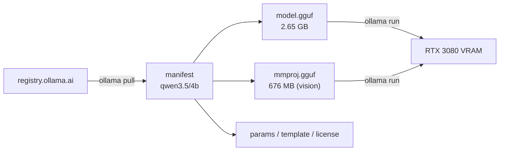

# Lab 01 — Foundations: Models on Disk and in Memory

## 1. Core Concept & DevOps Analogy

A model is **files on disk**, stored the way a container registry cache stores images:

| Ollama | Container world |
|---|---|
| `qwen3.5:4b` | `image:tag` |
| Manifest in `models\manifests\...` | OCI image manifest |
| `models\blobs\sha256-<digest>` | Content-addressed layers |
| GGUF weights layer | The large base layer |
| Template / params / license layers | Small config layers |
| `ollama pull` | `docker pull` |
| Loading into VRAM (`ollama run`) | Starting a container from the image |

## 2. Prerequisites & Hardware Budget

* Lab 00 complete; `scripts/check-vram.ps1` running in a second terminal.
* Disk: ≈3.3 GB for `qwen3.5:4b`.
* VRAM: 0 during download; measured in Step 3 when the model loads.

## 3. Architecture



## 4. Step-by-Step Guide

### Step 1 — Pull the model ✅

```powershell
ollama pull qwen3.5:4b
ollama list
```

### Step 2 — Inspect the model store (read-only)

```powershell
$root = "$env:USERPROFILE\.ollama\models"

# The manifest: one JSON file per name:tag
$mf = Get-Content "$root\manifests\registry.ollama.ai\library\qwen3.5\4b" | ConvertFrom-Json
$mf.layers | Format-Table mediaType, size, from, digest -AutoSize

# The blobs: content-addressed files
Get-ChildItem "$root\blobs" | Sort-Object Length -Descending | Format-Table Length, Name -AutoSize

# Prove content addressing: a blob's name IS the SHA-256 of its content
$p = "$root\blobs\sha256-9371364b27a52acac9d87f88bd93c9db1174d8d6ec57f6888925cdc1788871ff"
(Get-FileHash $p -Algorithm SHA256).Hash.ToLower()
Get-Content $p

# Ollama's own summary of the model
ollama show qwen3.5:4b
ollama show qwen3.5:4b --modelfile
```

### Step 3 — First inference with observation

Terminal A: `.\scripts\check-vram.ps1`. Terminal B:

```powershell
# Run 1: cold start (model loads from disk into VRAM)
ollama run qwen3.5:4b --verbose "Explain a Kubernetes readiness probe in two sentences."
# Run 2: same prompt, warm
ollama run qwen3.5:4b --verbose "Explain a Kubernetes readiness probe in two sentences."
# Run 3: warm, thinking off
ollama run qwen3.5:4b --verbose --think=false "Explain a Kubernetes readiness probe in two sentences."
ollama ps
ollama stop qwen3.5:4b

# Afterwards: the load's memory breakdown
Select-String "$env:LOCALAPPDATA\Ollama\server.log" -Pattern 'offloaded|buffer size|starting llama-server|template selection' | Select-Object -Last 12
```

| `--verbose` field | Meaning | Bottleneck |
|---|---|---|
| `load duration` | Weights disk → VRAM | Disk, PCIe |
| `prompt eval rate` | Prompt tokens/s (parallel) | GPU compute |
| `eval count` / `eval rate` | Generated tokens, tokens/s (sequential) | GPU memory bandwidth |

### Step 4 — First custom model (`Modelfile`)

[`Modelfile`](Modelfile) in this directory: `FROM qwen3.5:4b`, `PARAMETER temperature 0.3`, and a Kubernetes-engineer `SYSTEM` prompt.

```powershell
ollama create devops-assistant -f labs/01-foundations/Modelfile
ollama list
ollama show devops-assistant

# Pulled models use the legacy layout; locally created models use manifests-v2
$root = "$env:USERPROFILE\.ollama\models"
(Get-Content "$root\manifests\registry.ollama.ai\library\qwen3.5\4b" | ConvertFrom-Json).layers | Format-Table mediaType, size, digest
(Get-Content "$root\manifests-v2\ollama.com\library\devops-assistant\latest" | ConvertFrom-Json).layers | Format-Table mediaType, size, digest

# Same question, 3 runs per model
1..3 | ForEach-Object { ollama run qwen3.5:4b --think=false "Explain a Kubernetes readiness probe in two sentences." }
1..3 | ForEach-Object { ollama run devops-assistant --think=false "Explain a Kubernetes readiness probe in two sentences." }
```

### Step 5 — Two models at once, and auto-unload

Announced over-ceiling experiment (two copies would need ≈10.0 GB of 10.24 GB).

```powershell
ollama run qwen3.5:4b --think=false --keepalive 2m "Say OK."
ollama run devops-assistant --verbose --think=false --keepalive 2m "Explain a Kubernetes readiness probe in two sentences."
ollama ps
# wait ~2 minutes, watch check-vram.ps1
# afterwards: which runners started, and which requests were served?
Select-String "$env:LOCALAPPDATA\Ollama\server.log" -Pattern 'starting llama-server|POST'
```

## 5. Hypotheses → Observed Metrics

| Check | Hypothesis | Observed (2026-10-10) |
|---|---|---|
| Download size | 3.3–4.0 GB | 3.3 GB ✅ |
| VRAM during pull | unchanged, nothing loaded | `/api/ps` empty after pull ✅ |
| Manifest layers | one GGUF + small config layers | **two GGUF layers**: `model.gguf` 2,648,593,216 B + `mmproj.gguf` 675,569,120 B (vision projector), plus template (13 B), params (65 B), license (11,343 B) |
| `ollama show` | 4B, Q4_K_M | `qwen35` arch, 4.2B params, Q4_K_M, context 262,144; projector `clip` 333.51M params |
| Capabilities | tools / thinking to verify | completion, vision, tools, thinking (**on by default**) ✅ |
| Default sampling (params layer) | — | `temperature 1`, `top_k 20`, `top_p 0.95`, `presence_penalty 1.5` |
| Reload (file in OS cache) | several seconds | **4.02 s** `load duration` (server log: 3.0 s) ✅ |
| First-ever load | several seconds | **40.7 s** (server log 19:10:43 → 19:11:23) ❗ unexplained — see below |
| Warm load duration | ≈0 | 28–30 ms ✅ |
| VRAM when loaded | > 3.3 GB file size | 2,329 → 6,192 MiB = **+3,863 MiB** ✅ |
| `ollama ps` | `100% GPU`, ctx 4096 | `3.1 GB`, `100% GPU`, `4096`, runner `llamacpp` ✅ |
| Thinking on (Run 2) | many tokens | 1,520 tokens, 118.3 tok/s, 13.18 s total |
| Thinking off (Run 3) | few tokens, same rate | 54 tokens, 116.0 tok/s, 0.90 s total ✅ |
| Unload (`ollama stop`) | VRAM back to baseline | 6,192 → 2,329 MiB within 2 s ✅ |

### Findings from `server.log` (load at 19:10)

```text
CUDA0 model buffer       2,515 MiB   LLM weights, 33/33 layers on GPU
CUDA0 KV cache             128 MiB   n_ctx 4096
CUDA0 recurrent state       50 MiB   hybrid architecture (llama_memory_recurrent)
CUDA0 compute buffers      291 MiB   68 text + 223 vision
vision projector weights  ~640 MiB   inferred from mmproj file size (not logged)
CUDA runtime overhead     ~240 MiB   remainder
                         ≈ 3,860 MiB ≈ nvidia-smi delta
CUDA_Host (system RAM)     497 MiB   kept off-GPU (likely token embeddings)
```

* **Ollama's `SIZE` is an estimate**; plan with `nvidia-smi`.
* **qwen3.5 is hybrid**: most layers keep a fixed-size recurrent state; only some have a KV cache. Long contexts should cost far less VRAM than the classic formula predicts (measure in Phase 2).
* **Chat formatting** comes from a built-in Go renderer (`renderer=qwen3.5 parser=qwen3.5`), not the 13-byte template layer.
* **Ollama starts `llama-server.exe`** (llama.cpp) as a child process pointed at the GGUF blob — the `llamacpp` runner.
* **Prompt eval 18 tok/s is misleading**: 16 of ~20 tokens were reused from the cache (`prompt eval cached`); tiny prompts are dominated by fixed overhead.
* **Load time is mostly fixed overhead, not disk:** the store is on a Samsung 990 PRO NVMe (~7 GB/s), so reading 3.3 GB takes well under 1 s. The 4 s reload is process spawn + CUDA init + projector load + warmup. The 40.7 s first load is **unexplained** — hypotheses: Defender scanning the new blob, one-time GPU kernel cache, cold OS cache. Test in Phase 2 with the first load of `qwen3.5:9b`.
* **Quality (one sample):** Run 3 (no thinking) was factually wrong — readiness failures remove the pod from the Service's EndpointSlice; the kubelet runs the probe but doesn't route traffic. Test properly in Phase 3.

### Findings from Step 4 (custom model)

| Check | Hypothesis | Observed |
|---|---|---|
| Weights reused | GGUF layers shared | ✅ `using existing layer` for both GGUFs; 3 new blobs: system (198 B), params (67 B), manifest (1,274 B) — **≈1.5 KB of extra disk** |
| `ollama list` | 3.3 GB for both | ✅ logical size, not unique disk usage (like `docker images`) |
| Parameter inheritance | open question | **Inherited and merged**: `{"presence_penalty":1.5,"temperature":0.3,"top_k":20,"top_p":0.95}` — like a Kustomize patch |
| Manifest location | same layout as pulled models | ❌ created models live in `manifests-v2\ollama.com\library\<name>\<tag>`; layers record `"from":"qwen3.5:4b"` |

Answer quality (`--think=false`, 3 runs each, graded against Kubernetes behavior: kubelet runs the probe → sets Pod `Ready=false` → EndpointSlice controller marks the endpoint not ready → kube-proxy stops routing; no restart):

| Run | Base `qwen3.5:4b` (temp 1.0) | `devops-assistant` (temp 0.3 + system prompt) |
|---|---|---|
| 1 | 🟡 says probes poll only "until responsive" | 🟡 says the **kubelet** updates EndpointSlices |
| 2 | 🟡 nonsense clause about "existing requests" | 🟡 calls readiness "a liveness check"; kubelet removes endpoints |
| 3 | 🔴 "on startup", self-contradiction, invented "pod set" | 🟢 fully correct |

**Lesson:** the system prompt improved consistency and removed the worst errors, but the model **reused the prompt's vocabulary without understanding it** — "kubelet" and "EndpointSlice" were listed together, so it credited the kubelet with the controller's job. A system prompt controls style and vocabulary, not knowledge (→ RAG in Phase 5). Three samples is anecdotal; Phase 3 measures this properly.

### Findings from Step 5 (two models, auto-unload)

| Check | Hypothesis | Observed |
|---|---|---|
| Second model sharing weights | separate runner, VRAM ≈ doubles (or eviction / spill) | ❌ **runner reused**: one `starting llama-server` (19:31:41); the `devops-assistant` request (19:31:56) took 0.85 s with no load; VRAM stayed ≈6,240 MiB; `/api/ps` kept showing `qwen3.5:4b` |
| Default `keep_alive` | unload 5 min after last request | ✅ last request 19:26:18 → unloaded 19:31:18 |
| `--keepalive 2m` | unload after 2 min | ✅ expiry 19:33:56; `/api/ps` empty at 19:34:04 |
| Timer reset | each request extends expiry | ✅ expiry moved 19:33:44 → 19:33:56 after the second request |
| Idle baseline | ≈2.3 GB | 2,407 MiB (drift continues) |

## 6. Troubleshooting & Failure Modes

| Symptom | Likely cause | Check |
|---|---|---|
| Pull stalls or restarts | Network / proxy | Rerun `ollama pull`; completed blobs are reused |
| Disk fills unexpectedly | Many tags, few shared blobs | Sum sizes in `models\blobs` |

## 7. Cleanup

Keep `qwen3.5:4b` — later labs use it. (`ollama rm qwen3.5:4b` removes the manifest and any blobs no other model references; ask before deleting.)

## 8. Check Your Understanding

**1. Which layer makes this model able to see images, and what does it cost on disk?**

<details>
<summary>Answer</summary>

The `application/vnd.ollama.image.projector` layer (`mmproj.gguf`): a CLIP vision encoder with 333.51M parameters, **675,569,120 bytes (≈676 MB)** — about 20% of the download. It converts an image into embeddings (dimension 2560) that the language model reads like tokens. Its VRAM cost is measured in Step 3.

</details>

**2. Why is the blob's filename equal to the SHA-256 of its content, and what does that give you?**

<details>
<summary>Answer</summary>

It's **content addressing**, the same model as OCI registries:

* **Integrity:** recompute the hash; if it doesn't match the name, the blob is corrupt. A broken download can't silently be used.
* **Deduplication:** two tags that share a layer (e.g. your custom model built `FROM qwen3.5:4b`) point to the same blob — stored once.
* **Immutability:** a blob can never change. Tags are mutable pointers (manifests); blobs are not. Re-pulling a tag only downloads blobs you don't have.

</details>

**3. The params layer sets `temperature 1`. Where would you change it permanently for your own model variant?**

<details>
<summary>Answer</summary>

In a **Modelfile**, then build a new model:

```text
FROM qwen3.5:4b
PARAMETER temperature 0.7
```

`ollama create devops-assistant -f Modelfile` writes a new manifest with a new params layer but **reuses the 2.65 GB weights blob** — near-zero extra disk, like a Dockerfile that only adds a config layer. Per-request overrides (API `options`, `/set parameter` in `ollama run`) are temporary.

</details>

**4. `ollama list` says 3.3 GB. Add up the layers — does it match?**

<details>
<summary>Answer</summary>

All 8 blobs total **3,324,175,492 bytes** — almost all of it the two GGUF files (2,648,593,216 + 675,569,120).

* In decimal GB (1000³): **3.32 GB** → matches `ollama list`.
* In binary GiB (1024³): **3.10 GiB**.

So `ollama list` reports **decimal GB**, while `nvidia-smi` reports **MiB**. Convert before comparing a model's size with free VRAM.

</details>

**5. Run 2 and Run 3 generated at almost the same tokens/s, but Run 2 took 15× longer. Why?**

<details>
<summary>Answer</summary>

Generation **rate** is a property of the model + hardware: each token reads the weights from VRAM once, so it's bounded by memory bandwidth (~117 tok/s here). Total **time** is rate × token count. Thinking produced ~1,466 hidden reasoning tokens before a 54-token answer. To make responses faster, you either generate fewer tokens (thinking off, shorter answers) or raise the rate (smaller model, more bandwidth) — two different levers.

</details>

**6. The file is 3.3 GB, but VRAM grew by 3,863 MiB. Name the extra consumers.**

<details>
<summary>Answer</summary>

KV cache (128 MiB at 4,096 context), recurrent state (50 MiB — hybrid architecture), compute buffers (291 MiB, text + vision), and the CUDA runtime/context overhead. Meanwhile ≈497 MiB of weights stayed in system RAM (`CUDA_Host`), so "file size = VRAM" is wrong in both directions. Always measure with `nvidia-smi`.

</details>

**7. `devops-assistant` costs ≈1.5 KB of disk, yet `ollama list` says 3.3 GB. If you created 10 such variants, how much disk would they use, and how much VRAM if all were loaded at once?**

<details>
<summary>Answer</summary>

Disk: still ≈3.3 GB plus ≈15 KB — the weights blob is shared (content addressing).
VRAM: **also shared** — this refuted the original prediction (Step 5). When `devops-assistant` was requested while `qwen3.5:4b` was loaded, Ollama started **no new `llama-server`**: it routed the request to the runner that already held the same weights blob and applied the system prompt and parameters per request. So 10 variants of one base model cost one model's VRAM (≈3.8 GB), not ten. System prompt and sampling parameters are request-level config — like a ConfigMap applied per request, not a new pod. *Untested:* variants that change load-time settings (e.g. `num_ctx`) probably cannot share a runner — check in Phase 2.

</details>

**8. Why did the custom model attribute EndpointSlice updates to the kubelet?**

<details>
<summary>Answer</summary>

The system prompt listed "kubelet, Service, EndpointSlice" together. The model is steered to use those words, but a system prompt adds no knowledge about how the components relate, so it placed them plausibly but incorrectly. System prompts shape vocabulary, tone, and format; correct facts must come from the model's training or from retrieved context (RAG, Phase 5). Also: wording in your prompt can introduce errors that weren't there before.

</details>
