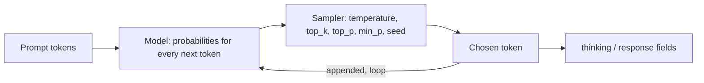

# Lab 03 — Prompting, Sampling & Reproducibility

## 1. Core Concept & DevOps Analogy

A model generates text **one token at a time**. At each step it computes a probability for every token in its vocabulary, picks one, appends it, and repeats. Everything in this lab follows from that loop:

| Concept | What it means | Analogy |
|---|---|---|
| **Autoregressive generation** | Each token is chosen using only the tokens before it. A token can't be revised once it's out | A stream processor that can't go back: once "Yes" is written, the rest has to follow from it |
| **Thinking mode** | The model first writes reasoning tokens (returned in a separate `thinking` field), then the answer. The answer can build on the reasoning | Running `terraform plan` before `apply` instead of applying directly |
| **Temperature** | Reshapes the probabilities before picking. 0 = always the most likely token (greedy). Higher = more random | Deterministic vs randomized load balancing |
| **Seed** | Initializes the random number generator used for picking | Pinning a random seed in a test so failures reproduce |
| **Reproducibility** | Same input + same settings → same output? Not guaranteed: GPU math in a different order can change the last digits of a probability and flip a close choice | Reproducible builds: pin everything, then find what still leaks in (timestamps, parallelism) |

## 2. Prerequisites & Hardware Budget

* Lab 02 complete; `qwen3.5:4b` (and `qwen3.5:9b` for optional comparisons).
* VRAM: 4b at 8,192 context ≈ 4.0 GB of model allocation (`docs/vram-calculator.md`). One model at a time.
* Scripts: `scripts/quality.ps1` (now with `-Think`, `-NumCtx` and a **Wrong** column), `scripts/repro.ps1`.

## 3. Architecture



Verified on 0.40.2 (2026-10-12): with `think: true`, `/api/generate` returns the reasoning in `thinking` and the answer in `response`. **`eval_count` includes the thinking tokens**: "17 + 25" produced a 2-character answer and 182 generated tokens. The response also has `prompt_eval_cached_count`: prompt tokens reused from the prompt cache.

## 4. Step-by-Step Guide

### Step 1 — Does thinking fix "Yes… cannot"?

In Lab 02, every 4b answer to `sched-math` started with "Yes", then did the arithmetic correctly and concluded "cannot". With thinking off, the first answer token *is* the verdict, chosen before any arithmetic exists in the context. With thinking on, the arithmetic is written first, and the verdict is generated after it.

`quality.ps1` now also checks for **known wrong claims** (Lab 02, check-your-understanding question 3): the Wrong column counts matches such as an answer starting with "Yes" on `sched-math`, `kube-system`/`ConfigMap` for Helm 3, or `--auto-heal` described as real. Replayed offline against the saved Lab 02 answers, it flags exactly the errors found by reading them. Caveat: these lists were built from errors we already saw, like regression tests. They catch known mistakes again, not new ones.

**Run:**

```powershell
ollama stop qwen3.5:9b
.\scripts\quality.ps1 -Models qwen3.5:4b                                         # thinking off (baseline)
.\scripts\quality.ps1 -Models qwen3.5:4b -Think -NumPredict 4096 -NumCtx 8192   # thinking on
ollama stop qwen3.5:4b
```

`-NumPredict 4096`: thinking tokens count against `num_predict`. With the default 400, long reasoning would be cut off before the answer starts (`Done` = `length`, empty answer). `-NumCtx 8192`: prompt + thinking + answer must fit in the context.

**Predictions:**

| Question | Thinking on | Why |
|---|---|---|
| sched-math | ✅ "No" first, Wrong = 0 | The verdict comes after the arithmetic |
| fake-flag | uncertain; might say "not aware of such a flag" | Reasoning may notice it has no evidence, but it can't add knowledge |
| helm-state, readiness | still wrong | Knowledge errors (Lab 02 Q2): thinking reorders work, it doesn't add facts |
| Cost | hundreds to ~2,000 tokens per question; at ≈120 tok/s, ≈2–15 s instead of ≈1 s | `eval_count` and `Seconds` columns |

**Optional:** run the same two commands with `qwen3.5:9b`. Does thinking help a model that already got most answers right?

### Step 2 — Reproducibility: when is the output identical?

`repro.ps1` sends the same request N times (sequentially), hashes each answer, and counts distinct outputs. Thinking off, 200 tokens per answer, an open-ended prompt (more room for variation than a yes/no question).

**Run** (≈40 s per line):

```powershell
.\scripts\repro.ps1                                   # A: temperature 0, seed 42
.\scripts\repro.ps1 -NoSeed                           # B: temperature 0, no seed
.\scripts\repro.ps1 -Temperature 0.8                  # C: temperature 0.8, seed 42
.\scripts\repro.ps1 -Temperature 0.8 -NoSeed          # D: temperature 0.8, no seed
.\scripts\repro.ps1 -NumCtx 8192                      # E: like A, different context size (forces a reload)
ollama stop qwen3.5:4b
```

**Predictions:**

| Run | Distinct outputs (of 20) | Reasoning |
|---|---|---|
| A | 1 | Greedy picking, same input, same hardware |
| B | 1 | At temperature 0 nothing is random, so the seed shouldn't matter |
| C | 1 | Random picking, but the same seed gives the same random sequence |
| D | ≈20 | New random sequence each time |
| E | same hash as A? **unknown** | A different `num_ctx` reloads the runner with different buffer sizes; the GPU math might run in a different order and flip a close token choice |

Also watch the `Cached` column: run 1 processes the prompt from scratch, later runs reuse it from the prompt cache. If the cached path computes slightly differently, run 1 would be the odd one out.

**Not tested here:** concurrent requests. This server runs one request at a time (`n_slots = 1` in `server.log`), so parallel requests are queued, not batched together. Batching is a known source of non-determinism; testing it needs `OLLAMA_NUM_PARALLEL` > 1, which is a server setting change (approval first).

### Later steps (set up after Steps 1–2)

* Step 3 — System prompts vs user prompts; chat templates (`/api/chat`).
* Step 4 — Sampling parameters: `top_k`, `top_p`, `min_p`, `repeat_penalty`.
* Step 5 — Context overflow: what the model actually sees when input exceeds `num_ctx` (Lab 02 showed the front is cut; `server.log` showed `--context-shift --keep 4`).
* Step 6 — Hallucination patterns and how to reduce them (grounding with provided context).

## 5. Hypotheses → Observed Metrics

*(Filled in after running.)*

## 6. Troubleshooting & Failure Modes

| Symptom | Likely cause | Check |
|---|---|---|
| Thinking run returns an empty answer | `num_predict` used up by thinking tokens | `Done` = `length`; raise `-NumPredict` |
| Thinking run is very slow or truncated at the start | Prompt + thinking exceeded `num_ctx` | `-NumCtx`; `prompt_eval_count` + `eval_count` vs `num_ctx` |
| First request after a driver update takes over a minute | CUDA kernel recompilation (Lab 02 troubleshooting) | `nvidia-smi` driver version |

## 7. Cleanup

`ollama stop qwen3.5:4b` (and `qwen3.5:9b` if used). Raw answers stay in `results/raw/` (gitignored).

## 8. Check Your Understanding

*(Added after the results.)*
