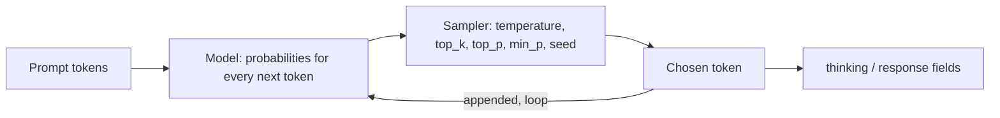

# Lab 03 — Prompting, Sampling & Reproducibility

## 1. Core Concept & DevOps Analogy

A model generates text **one token at a time**. At each step it computes a probability for every token in its vocabulary, picks one, appends it, and repeats. Everything in this lab follows from that loop:

| Concept | What it means | Analogy |
|---|---|---|
| **Autoregressive generation** | Each token is chosen using only the tokens before it. A token can't be revised once it's out | A stream processor that can't go back: once "Yes" is written, the rest has to follow from it |
| **Thinking mode** | The model first writes reasoning tokens (returned in a separate `thinking` field), then the answer. The answer can build on the reasoning | Running `terraform plan` before `apply` instead of applying directly |
| **Temperature** | Reshapes the probabilities before picking. 0 = always the most likely token (greedy). Higher = more random | Deterministic vs randomized load balancing |
| **Seed** | Initializes the random number generator used for picking | Pinning a random seed in a test so failures reproduce |
| **Reproducibility** | Same input + same settings → same output? Not guaranteed: GPU math in a different order can change the last digits of a probability and flip a close choice | Reproducible builds: pin everything, then find what still leaks in (timestamps, parallelism) |

## 2. Prerequisites & Hardware Budget

* Lab 02 complete; `qwen3.5:4b` (and `qwen3.5:9b` for optional comparisons).
* VRAM: 4b at 8,192 context ≈ 4.0 GB of model allocation (`docs/vram-calculator.md`). One model at a time.
* Scripts: `scripts/quality.ps1` (now with `-Think`, `-NumCtx` and a **Wrong** column), `scripts/repro.ps1`.

## 3. Architecture



Verified on 0.40.2 (2026-10-12): with `think: true`, `/api/generate` returns the reasoning in `thinking` and the answer in `response`. **`eval_count` includes the thinking tokens**: "17 + 25" produced a 2-character answer and 182 generated tokens. The response also has `prompt_eval_cached_count`: prompt tokens reused from the prompt cache.

## 4. Step-by-Step Guide

### Step 1 — Does thinking fix "Yes… cannot"?

In Lab 02, every 4b answer to `sched-math` started with "Yes", then did the arithmetic correctly and concluded "cannot". With thinking off, the first answer token *is* the verdict, chosen before any arithmetic exists in the context. With thinking on, the arithmetic is written first, and the verdict is generated after it.

`quality.ps1` now also checks for **known wrong claims** (Lab 02, check-your-understanding question 3): the Wrong column counts matches such as an answer starting with "Yes" on `sched-math`, `kube-system`/`ConfigMap` for Helm 3, or `--auto-heal` described as real. Replayed offline against the saved Lab 02 answers, it flags exactly the errors found by reading them. Caveat: these lists were built from errors we already saw, like regression tests. They catch known mistakes again, not new ones.

**Run:**

```powershell
ollama stop qwen3.5:9b
.\scripts\quality.ps1 -Models qwen3.5:4b                                         # thinking off (baseline)
.\scripts\quality.ps1 -Models qwen3.5:4b -Think -NumPredict 4096 -NumCtx 8192   # thinking on
ollama stop qwen3.5:4b
```

`-NumPredict 4096`: thinking tokens count against `num_predict`. With the default 400, long reasoning would be cut off before the answer starts (`Done` = `length`, empty answer). `-NumCtx 8192`: prompt + thinking + answer must fit in the context.

**Predictions:**

| Question | Thinking on | Why |
|---|---|---|
| sched-math | ✅ "No" first, Wrong = 0 | The verdict comes after the arithmetic |
| fake-flag | uncertain; might say "not aware of such a flag" | Reasoning may notice it has no evidence, but it can't add knowledge |
| helm-state, readiness | still wrong | Knowledge errors (Lab 02 Q2): thinking reorders work, it doesn't add facts |
| Cost | hundreds to ~2,000 tokens per question; at ≈120 tok/s, ≈2–15 s instead of ≈1 s | `eval_count` and `Seconds` columns |

**Optional:** run the same two commands with `qwen3.5:9b`. Does thinking help a model that already got most answers right?

### Step 2 — Reproducibility: when is the output identical?

`repro.ps1` sends the same request N times (sequentially), hashes each answer, and counts distinct outputs. Thinking off, 200 tokens per answer, an open-ended prompt (more room for variation than a yes/no question).

**Run** (≈40 s per line):

```powershell
.\scripts\repro.ps1                                   # A: temperature 0, seed 42
.\scripts\repro.ps1 -NoSeed                           # B: temperature 0, no seed
.\scripts\repro.ps1 -Temperature 0.8                  # C: temperature 0.8, seed 42
.\scripts\repro.ps1 -Temperature 0.8 -NoSeed          # D: temperature 0.8, no seed
.\scripts\repro.ps1 -NumCtx 8192                      # E: like A, different context size (forces a reload)
ollama stop qwen3.5:4b
```

**Predictions:**

| Run | Distinct outputs (of 20) | Reasoning |
|---|---|---|
| A | 1 | Greedy picking, same input, same hardware |
| B | 1 | At temperature 0 nothing is random, so the seed shouldn't matter |
| C | 1 | Random picking, but the same seed gives the same random sequence |
| D | ≈20 | New random sequence each time |
| E | same hash as A? **unknown** | A different `num_ctx` reloads the runner with different buffer sizes; the GPU math might run in a different order and flip a close token choice |

Also watch the `Cached` column: run 1 processes the prompt from scratch, later runs reuse it from the prompt cache. If the cached path computes slightly differently, run 1 would be the odd one out.

**Not tested here:** concurrent requests. This server runs one request at a time (`n_slots = 1` in `server.log`), so parallel requests are queued, not batched together. Batching is a known source of non-determinism; testing it needs `OLLAMA_NUM_PARALLEL` > 1, which is a server setting change (approval first).

### Later steps (set up after Steps 1–2)

* Step 3 — System prompts vs user prompts; chat templates (`/api/chat`).
* Step 4 — Sampling parameters: `top_k`, `top_p`, `min_p`, `repeat_penalty`. Start with the Step 1 helm-state loop: does thinking with sampling (e.g. temperature 0.6, top_p 0.95; check the qwen3.5 model card) break the repetition loop and give an answer?
* Step 5 — Context overflow: what the model actually sees when input exceeds `num_ctx` (Lab 02 showed the front is cut; `server.log` showed `--context-shift --keep 4`).
* Step 6 — Hallucination patterns and how to reduce them (grounding with provided context).

## 5. Hypotheses → Observed Metrics

Run 2026-10-27 on Ollama 0.40.10, driver 591.86 (both changed since Lab 02). Raw answers: `results/raw/quality-20261027-{113902,113947,115315,115345}.md`, `results/raw/repro-20261027-*.md`. Settings: `temperature 0`, `seed 42`; thinking runs `num_predict 4096`, `num_ctx 8192`.

### Step 1 — Thinking off vs on

Score / Wrong from `quality.ps1`, then **verdict from reading the answer** (the regex score was wrong in 5 of 24 cases, see below):

| Question | 4b off | 4b on | 9b off | 9b on |
|---|---|---|---|---|
| probe-defaults | 2/2 ✅ | 2/2 ✅ | 0/2 ❌ "no defaults" | 2/2 ✅ |
| readiness-vs-liveness | 3/3 ✅ | 2/3 → ✅ ¹ | 3/3 ✅ | 2/3 → ✅ ¹ |
| helm-state | 0/2 ❌ `/var/lib/helm` | 0/2, no answer ² | 2/2 → ❌ ³ | 0/2, no answer ² |
| argocd-selfheal | 2/2 ✅ | 2/2 ✅ | 2/2 → ❌ ⁴ | 2/2 ✅ |
| sched-math | 2/3 ❌ "Yes… cannot" | 3/3 ✅ "No" first | 3/3 ✅ | 3/3 ✅ |
| fake-flag | 0/1 ❌ invents behavior | 0/1 → ✅ ¹ | 1/1 ✅ | 1/1 ✅ |
| **Correct by reading** | **3/6** | **5/6** | **3/6** | **5/6** |
| Generated tokens (sum) | 534 | 9,320 | 734 | 10,801 |
| Seconds (sum) | 9.5 | 82.9 | 14.8 | 131.8 |

¹ Correct answer the regex missed: "keeps the container running" / "continues running" (no "not restart"), "There is no `--auto-heal` flag" (no listed phrase).
² Hit `num_predict` (4,096 tokens, `Done` = `length`) inside the thinking. The 4b's thinking is a **repetition loop**: the same five lines ("*Wait, actually:* Helm 3 stores release information in `~/.helm`…") repeated until the budget ran out. It had also settled on a wrong answer.
³ Mentions "Secrets" and "namespace" (so 2/2), but also `kube-state-metrics`, `leases.helm.sh` and "resides in etcd": wrong claims not on the Wrong list.
⁴ Says self-heal applies live-cluster changes "back to the Git repository": the opposite direction. The keyword check can't see direction.

| Prediction | Observed |
|---|---|
| sched-math: thinking puts "No" first | ✅ **Confirmed.** 4b went from "Yes, … Therefore … reject" to "No, the new pod cannot be scheduled", with the same arithmetic |
| fake-flag: uncertain | Thinking fixed it for the 4b ("There is no `--auto-heal` flag"). 9b was already right |
| helm-state, readiness: knowledge errors stay | helm-state: ✅ confirmed, and worse: no answer at all. readiness: it was right all along; only the scorer called it wrong |
| Cost: hundreds to ~2,000 tokens per question | **Underestimated.** 376–4,096 tokens per question; ≈9–17× the tokens and ≈9× the time per run |

Also observed:
* **Thinking helps reasoning *and* recall for the 9b**: probe-defaults went from wrong to right. But that cost 3,191 tokens (43.8 s) for a two-number answer.
* **Thinking answers are shorter** (53–463 characters vs 115–818). The reasoning goes into `thinking`; the answer is the conclusion.
* **Speed is unchanged after the driver and Ollama updates.** The runs that hit the 4,096-token limit give ≈122 tok/s (4b) and ≈87 tok/s (9b), matching Lab 02 (≈120 and ≈85).

### Step 2 — Reproducibility (qwen3.5:4b, 20 sequential runs each)

| Run | Settings | Predicted | Observed |
|---|---|---|---|
| A | temp 0, seed 42 | 1 | **1** (`e205972d`) |
| B | temp 0, no seed | 1 | **1**, same hash as A |
| C | temp 0.8, seed 42 | 1 | **1** (`44a87833`, different from A but stable) |
| D | temp 0.8, no seed | ≈20 | **20**, 134–200 tokens; run 2 hit the 200-token limit |
| E | like A, `num_ctx 8192` (reload) | unknown | **1**, same hash as A |

* All five predictions held. **E answers the open question for this setup**: reloading with a different `num_ctx` didn't change the greedy output.
* **Prompt cache does not change the output.** In A and E, run 1 loaded the model (`Cached` = 0) and runs 2–20 reused 28 of 32 prompt tokens. All 20 had the same hash.
* **The prompt cache outlives a request.** In B–D, run 1 already shows `Cached` = 28, from the previous script's requests while the model stayed loaded.
* **Limits:** one prompt, one GPU, sequential requests (`n_slots = 1`). This shows determinism holds *here*; it doesn't prove it in general. Batching with `OLLAMA_NUM_PARALLEL` > 1, a different GPU or a different Ollama version could still change it.

### Lessons

1. **Generation order matters.** When the verdict is the first token, it is chosen before the reasoning exists. Thinking, or asking for "arithmetic first, verdict last", fixes that class of error.
2. **Thinking isn't free, and it isn't knowledge.** When the model doesn't know a fact, thinking can loop and burn the whole token budget without giving any answer. Always set `num_predict`, and check `done_reason`.
3. **Greedy decoding plus thinking can loop.** These runs use `temperature 0`. The 4b's helm-state loop is the classic greedy repetition failure. Qwen's model cards recommend sampling, not greedy decoding, in thinking mode (from memory of the Qwen3 cards; not yet verified for qwen3.5). This is a Step 4 experiment.
4. **The regex scorer is a smoke test, not a judge.** It gave 3 false negatives and 2 false positives in 24 answers. It can't tell direction ("Git → cluster" vs "cluster → Git") or spot new hallucinations. Read the answers.
   *Fixed afterwards:* `quality.ps1` gained the missed phrasings ("keeps … running", "there is no") and the newly seen wrong claims (`kube-state-metrics`, `leases.helm`, `~/.helm`, "has **no** periodSeconds", "changes … back to Git"). Replayed offline against these 24 saved answers, Score + Wrong now agree with reading in every case. The same caveat applies: these patterns only catch errors already seen.
5. **Determinism is a property of the whole setup.** Same prompt + settings + model + hardware + sequential requests gave identical output 100% of the time. Without a seed, any temperature > 0 gave a new answer every time.

## 6. Troubleshooting & Failure Modes

| Symptom | Likely cause | Check |
|---|---|---|
| Thinking run returns an empty answer | `num_predict` used up by thinking tokens | `Done` = `length`; raise `-NumPredict` |
| Thinking run is very slow or truncated at the start | Prompt + thinking exceeded `num_ctx` | `-NumCtx`; `prompt_eval_count` + `eval_count` vs `num_ctx` |
| First request after a driver update takes over a minute | CUDA kernel recompilation (Lab 02 troubleshooting) | `nvidia-smi` driver version |

## 7. Cleanup

`ollama stop qwen3.5:4b` (and `qwen3.5:9b` if used). Raw answers stay in `results/raw/` (gitignored).

## 8. Check Your Understanding

Try to answer each one before opening the answer.

**1. Why did the 4b contradict itself, and why did thinking fix it?**

With thinking off, the 4b's sched-math answer started "Yes, a new pod requesting 600m can be scheduled", then did the arithmetic correctly (500m free, 600m needed) and concluded "the scheduler will reject this request". With thinking on, the same model, with the same weights and the same question, answered "No" first.

*Why couldn't the model fix the "Yes" once it saw the arithmetic? And what changed with thinking, given that the model itself didn't change?*

<details><summary>Answer</summary>

Generation is **autoregressive**: each token is chosen from the tokens before it, and once emitted it is never revised. Without thinking, "Yes" is the **first** answer token. It was chosen when the context held only the question, before any arithmetic existed. The model was guessing the verdict from the shape of the question. Then it computed 500 < 600 correctly, but "Yes" was already written. The best continuation was to finish the arithmetic and state the conflicting conclusion.

Thinking doesn't make the model smarter. It changes **the order of work**. The arithmetic is written into the `thinking` tokens first, so when the model picks the first answer token, "500m < 600m" is already in its context, and "No" becomes the likely next token. It's like `terraform plan` before `apply`: the same engine, but the decision is made after seeing the computed result.

You can get part of this effect without thinking mode by asking for the work first: "Show the arithmetic, then give the verdict on the last line."
</details>

**2. What protects an automation from a thinking runaway?**

On helm-state, both models spent all 4,096 tokens thinking (the 4b in a loop that repeated the same five lines) and returned an **empty answer** with `done_reason: length`. That took 34–47 s for nothing.

*Imagine a script or CI job that calls this model. Which settings or checks would you add, and what does each protect against?*

<details><summary>Answer</summary>

* **`num_predict` (token cap):** bounds cost and latency. Without it, a loop could run until the context fills. Like a request timeout or a CPU limit, it turns "hangs" into "fails fast".
* **Check `done_reason`:** `stop` means the model finished, `length` means it was cut off. An empty or truncated answer with `length` should be treated as an error (retry, fall back, alert), not passed on as a result. Like checking the exit code, not only stdout.
* **A client timeout:** a wall-clock limit on the HTTP call, because token speed varies (a CPU spill or a busy GPU).
* **Turn thinking off when it isn't needed:** recall questions ("where does Helm store releases?") gain little from thinking, and the model can't reason its way to a fact it doesn't know. Use thinking for multi-step reasoning such as arithmetic or planning.
* **Sampling instead of greedy decoding:** these runs used `temperature 0`. Always picking the most likely token can lock into a loop: once a phrase repeats, repeating it again becomes the most likely continuation. Step 4 tests whether the sampling settings Qwen recommends for thinking break the loop.
</details>

**3. What does the seed actually control?**

Results of the 20-run tests: **A** (temperature 0, seed 42) and **B** (temperature 0, no seed) gave the *same single output*. **C** (temperature 0.8, seed 42) gave one stable output, different from A. **D** (temperature 0.8, no seed) gave 20 different outputs.

*What is the seed used for? Why did removing it change nothing in B but everything in D?*

<details><summary>Answer</summary>

At each step the model produces a probability for every token. The **sampler** then picks one:

* **Temperature 0** = greedy: always take the most likely token. No randomness is involved, so there's nothing for the seed to influence. That's why A and B are identical.
* **Temperature > 0** = draw a token at random, weighted by the probabilities. The draw uses a random number generator, and **the seed is its starting value**. The same seed gives the same sequence of "random" numbers, so the same draws and the same text (C). No seed gives a new starting value per request, so each run diverges at the first close choice (D).

Analogy: pinning the seed of a randomized test or a chaos experiment so a failure can be replayed. And the temperature 0.8 + seed 42 output (C) differs from A because it's still a random draw, just a repeatable one.

The deeper point: the seed makes the *sampler* repeatable. It doesn't protect against the probabilities themselves changing (a different GPU, Ollama version, quantization, or batched requests). Run E showed a reload with a different `num_ctx` didn't change them *here*.
</details>

**4. What does a wrong answer with a perfect score teach about testing LLM output?**

The 9b's selfheal answer scored **2/2**: it mentions "live cluster" and "Git repository". But it says self-heal applies changes from the live cluster "back to the Git repository". The opposite is true: self-heal reverts the **cluster** to match **Git**.

*If you added an LLM step to a CI pipeline (e.g. summarizing a diff or triaging an incident), what does this tell you about how to validate its output?*

<details><summary>Answer</summary>

**Keyword and format checks show an answer *looks* right, not that it *is* right.** A fluent wrong answer uses all the right vocabulary. This one also scored 2/2 on the original scorer, and the 9b's helm-state answer passed by mentioning "Secrets" while inventing `kube-state-metrics`. Meaning (direction, cause and effect, which value is which) is exactly what string matching can't see.

In a pipeline:

* **Validate structure mechanically, content separately.** A JSON schema (Phase 4) guarantees the shape; it says nothing about the values.
* **Check against ground truth where you have it:** compare the extracted pod name with the real one, recompute the arithmetic, run `kubectl explain` on a claimed field.
* **Regression lists catch known errors only.** Like our Wrong patterns, they are tests for bugs you've already seen, not proof of correctness.
* **Keep a human (or a stronger check) in the loop for anything that acts.** Read-only suggestions are cheap to get wrong; an LLM that decides an apply is not (Phase 6 safety gates).
</details>
