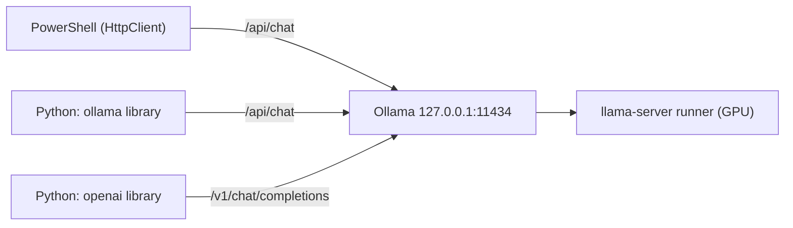

# Lab 04 — APIs, Streaming & Structured Output

## 1. Core Concept & DevOps Analogy

Until now we used Ollama as an experiment target. This lab treats it as what it is in a real system: **an HTTP service other programs call**. Calling it well means streaming for responsiveness, getting machine-readable output, and handling the failure modes (Lab 03 showed plenty) in code.

| Concept | What it means | Analogy |
|---|---|---|
| **Native API** | `/api/chat`, `/api/generate`, `/api/embed`, `/api/ps`, … JSON over HTTP on `127.0.0.1:11434` | The service's own REST API |
| **Streaming (NDJSON)** | With `stream: true` (the default), the response is **one JSON object per line**, one per token chunk, flushed as generated. The last line has `done: true` and the statistics | `kubectl logs -f`, or a chunked HTTP response: you see output while the job runs |
| **TTFT** | Time to first token: how long until the *first* text arrives. What a user feels as "responsiveness" | Time to first byte (TTFB) |
| **OpenAI-compatible API** | `/v1/chat/completions` etc.: the same models behind OpenAI's request format, so tools written for OpenAI work locally | An S3-compatible API on MinIO |
| **Structured output** | `format: <JSON schema>`: generation is **constrained** to tokens that keep the output valid against the schema | A CRD's OpenAPI schema: the API server rejects anything that doesn't fit, so consumers can rely on the shape |
| **Shape vs content** | The schema guarantees valid JSON with the right fields, *not* correct values | `kubectl apply --dry-run=server` validates the manifest, not whether the replica count is sensible |

## 2. Prerequisites & Hardware Budget

* Labs 01–03. `qwen3.5:4b` (≈4 GB VRAM at 4K context). One model at a time.
* **Python (from Step 2):** Python 3.12 via the launcher, `py -3.12`. Plain `python` on this machine is a **3.9** from the Microsoft Store, which Pydantic 2.14 doesn't support (needs ≥ 3.10). See Step 2 for the virtual environment.
* Scripts: `scripts/stream.ps1` (Step 1), `scripts/client_basics.py` (Step 3).

## 3. Architecture



All three are clients of the same server and the same model. They differ only in request format and convenience.

Verified 2026-10-27 (docs.ollama.com, PyPI):
* `ollama` (Python) 0.6.3, needs Python ≥ 3.8. `pydantic` 2.14.1, needs ≥ 3.10.
* Structured output: "Provide a JSON schema to the `format` field". With Pydantic: `format=Model.model_json_schema()`, then `Model.model_validate_json(...)`. The docs recommend temperature 0 and **also putting the schema in the prompt** "to ground the model's response".
* OpenAI compatibility: `base_url='http://localhost:11434/v1/'`, `api_key` required by the client but ignored by Ollama. **No way to set `num_ctx`** through it ("create a Modelfile with `PARAMETER num_ctx`"). Unsupported on chat: `tool_choice`, `logit_bias`, `user`, `n`, logprobs.

## 4. Step-by-Step Guide

### Step 1 — Streaming vs non-streaming, measured from the client

Every Lab 03 script used `Invoke-RestMethod` with `stream: false`. That waits for the **whole** answer. Real assistants stream. `stream.ps1` uses .NET `HttpClient` with `ResponseHeadersRead`, so it can read the NDJSON body line by line while it's generated, print tokens live, and time everything from the client's side:

| Column | Meaning |
|---|---|
| TTFT | Seconds until the first text chunk (thinking or answer) |
| FirstAnswer | Seconds until the first *answer* text (differs from TTFT with thinking on) |
| Total | Seconds until the final chunk |
| LoadS, PromptS | Server-side model load and prompt processing time, from the final chunk |
| Chunks | Lines received |
| EvalCount, TokS | Generated tokens and generation speed |

Four runs, the same prompt (≈150-word explanation), temperature 0:

1. **stream, cold**: the script first unloads the model (`keep_alive: 0`), so this includes loading
2. **stream, warm**
3. **no stream, warm**
4. **stream, think, warm**: thinking on

```powershell
.\scripts\stream.ps1                 # tokens print live; ≈30 s
ollama stop qwen3.5:4b
```

**Predictions:**

| Run | TTFT | Total | Why |
|---|---|---|---|
| stream, cold | ≈ 4–6 s | ≈ TTFT + 2 s | Load time (Lab 01–02: ≈4–6 s) comes before the first token |
| stream, warm | **≈ 0.1–0.3 s** | ≈ 2 s (≈200 tokens at ≈120 tok/s) | Only prompt processing + one token |
| no stream, warm | **= Total** | ≈ the same as streaming | Generation isn't faster or slower; the client just sees nothing until the end |
| stream, think, warm | short | much longer; **FirstAnswer ≫ TTFT** | Thinking tokens stream first (`message.thinking`), then the answer |
| Chunks | ≈ EvalCount + 1 | | One line per token plus the final stats line? **To check** |
| Same text streamed vs not | True | | Streaming only changes delivery (smoke test: True) |

What this teaches: **streaming changes perceived latency, not throughput.** Like `kubectl logs -f` vs waiting for the job to finish: same work, but you see progress, and you can cancel early (or detect a thinking loop, Lab 03 Step 1) without waiting for the end.

### Step 2 — Python setup (needs approval)

Python runs on **Windows** (decision D-03: WSL2 only from Phase 5). Proposal:

```powershell
py -3.12 -m venv .venv                          # project-local, gitignored; no system changes
.\.venv\Scripts\python -m pip install -r requirements.txt
```

`requirements.txt` pins `ollama==0.6.3` and `pydantic==2.14.1` (≈5 MB of downloads with dependencies, e.g. `httpx`). Everything stays inside `.venv\`; deleting that folder removes it all.

**Done 2026-10-27 (approved):** Python 3.12.1 venv, 27.7 MB on disk. Installed `ollama 0.6.3`, `pydantic 2.14.1`, `httpx 0.28.1` (the HTTP client underneath `ollama`) plus 9 small dependencies. Check: `Client(host='http://127.0.0.1:11434').list()` returns both models; `git status` stays clean (`.venv/` is gitignored). Always call the venv's interpreter: `.\.venv\Scripts\python`.

### Step 3 — The Python client and its failure modes

The `ollama` library is a **thin wrapper over httpx**: it builds the same JSON body as Step 1, posts it, and turns the response into typed objects. Knowing exactly what it adds, and what it *doesn't* handle, is what lets you write a robust integration. Analogy: `client-go` vs `curl` against the Kubernetes API. Same endpoints and same objects, but typed, with conveniences, and with defaults you need to know.

**Read from the installed source (`.venv\Lib\site-packages\ollama\_client.py`, 0.6.3)**, not assumed:

| Behavior | What the code does | Why it matters |
|---|---|---|
| Default timeout | `timeout: None`: **wait forever** (httpx's own default would be 5 s) | A hung or slow server blocks your script indefinitely. Set one: `Client(host=..., timeout=120)` |
| Host | `host` argument, else the `OLLAMA_HOST` environment variable | An env var can silently redirect your script to another server |
| `OLLAMA_API_KEY` | If set, sent as `Authorization: Bearer …` | Relevant for Ollama's cloud; not used here |
| HTTP 4xx/5xx | `httpx.HTTPStatusError` → `ollama.ResponseError(message, status_code)`. The message is the `error` field of the JSON body | One exception type for server-side errors |
| Server unreachable | `httpx.ConnectError` → Python's built-in **`ConnectionError`** | A different type from `ResponseError` |
| Timeouts | **Not wrapped**: raw `httpx` exceptions | A third type to catch |
| Streaming | `chat(stream=True)` returns a **generator**; the HTTP request and its errors happen on the **first iteration**. An `error` line mid-stream raises `ResponseError` with `status_code -1` | A `try` around the call alone catches nothing |
| `chat()` parameters | `tools, stream, think, logprobs, top_logprobs, format, options, keep_alive`: **no `truncate`** | Lab 03's safety switch is only reachable with raw HTTP |

`client_basics.py` makes each of these visible:

* **Part 1:** the same non-streaming request through the library and through raw `httpx`. Same answer? What type comes back?
* **Part 2:** streaming with the library, timed on the client (compare with Step 1).
* **Part 3:** seven failure modes, each showing the exception type, status code, message and how long it took. Unknown model (normal and streaming), oversized prompt (library vs raw `truncate: false`), an option of the wrong type (`temperature: "hot"`), a server that isn't there, and a **1 s client timeout during a cold load**. Afterwards it checks whether the server finished loading anyway.

```powershell
.\.venv\Scripts\python scripts\client_basics.py      # ≈40 s; unloads the model at the end
```

**Predictions:**

| Case | Prediction | Why |
|---|---|---|
| Part 1: same answer | True; library returns `ollama._types.ChatResponse`, raw returns `dict` | Same JSON on the wire; temperature 0 + seed (Lab 03 Step 2) |
| Part 1: access | Both `lib.message.content` and `lib["message"]["content"]` work | The response models are subscriptable Pydantic models |
| Part 2 | TTFT ≈ Step 1's warm stream; same text as Part 1 | Same server, same request |
| unknown model | `ResponseError`, **404**, "model … not found" | `raise_for_status` on a 404 |
| unknown model, stream=True | **No exception at the call**; `ResponseError` 404 on the first `next()` | Lazy generator |
| oversized, library | **No exception**, `prompt_eval_count=2050`, answer `prod` or similar | Silent truncation (Lab 03 Step 5a), and the library can't turn it off |
| oversized, raw truncate=false | **No exception** either, but `HTTP 400: {"error": "request (… tokens) exceeds the available context size …"}` | httpx returns 4xx as a normal response unless you call `raise_for_status()` |
| temperature="hot" | **unknown**: 400, or ignored like a misspelled option (Lab 03 Step 4) | A wrong *type* may be stricter than a wrong *name* |
| server not running | `builtins.ConnectionError` fast (< 1 s) | Connection refused on localhost is immediate |
| timeout 1 s, cold | `httpx.ReadTimeout` after ≈1 s | Not wrapped by the library |
| `/api/ps` 8 s later | **unknown**: the model loaded anyway, or the load was cancelled | Does the server notice the client left? |

The last case is the one to watch. If the server keeps working for a client that's gone, a client with short timeouts and retries can pile up work (and VRAM) on the server. That's the classic retry-storm problem from microservices.

### Later steps

* Step 4 — Structured output: extract Kubernetes incident data from raw logs into a Pydantic `IncidentReport` schema. Measure the **parse rate** over 50 runs (including `num_predict` truncation) and **field accuracy** separately (Lab 03: valid shape ≠ correct values). Corrupt and adversarial logs.
* Step 5 — The OpenAI-compatible API with the `openai` library: what's the same, what's missing (`num_ctx`), and why it matters for tools like Codex (Phase 6).
* Step 6 — Errors, timeouts and concurrency: unknown model, oversized input (`truncate: false`), client timeouts vs cold starts, and what happens to 4 simultaneous requests with one slot (`n_slots = 1`, queued). Testing `OLLAMA_NUM_PARALLEL` > 1 is a server setting change: approval first.

## 5. Hypotheses → Observed Metrics

### Step 1 — Streaming vs non-streaming

Raw: `results/raw/stream-20261027-144742.md`. qwen3.5:4b, Ollama 0.40.10, temperature 0.

| Run | TTFT | FirstAnswer | Total | Load | Chunks | EvalCount | tok/s |
|---|---|---|---|---|---|---|---|
| stream, cold | 4.21 s | 4.21 s | 5.39 s | 4.08 s | 136 | 136 | 114 |
| stream, warm | **0.10 s** | 0.10 s | 1.28 s | 0.01 s | 136 | 136 | 115 |
| no stream, warm | **1.18 s** (= Total) | 1.18 s | 1.18 s | 0.01 s | 1 | 136 | 122 |
| stream, think, warm | 0.06 s | **none** | 3.51 s | 0.01 s | 359 | **400** (= `num_predict`) | 116 |

| Prediction | Observed |
|---|---|
| Cold TTFT ≈ 4–6 s | ✅ 4.21 s, of which 4.08 s was loading |
| Warm TTFT ≈ 0.1–0.3 s | ✅ 0.10 s |
| No stream: TTFT = Total, same total time | ✅ 1.18 s vs 1.28 s. The same work, delivered at once |
| Think: FirstAnswer ≫ TTFT | **More than that: no answer at all.** The thinking used all 400 tokens of `num_predict` and stopped mid-sentence (Lab 03 Step 1 again: thinking needs a bigger budget) |
| Chunks ≈ EvalCount + 1 | **Chunks = EvalCount** (136): one line per token. The final `done` line carries no text, probably the end-of-turn token |
| Same text, streamed vs not | ✅ True |

* **Streaming changes perceived latency by ≈12×** (0.10 s vs 1.18 s until the user sees anything) at **no cost in throughput**: the totals are within 0.1 s and tok/s is the same.
* **Cold starts dominate.** 4.08 s of loading vs 0.05 s of prompt processing. For an interactive tool, `keep_alive` (keep the model loaded) matters more than any streaming optimization, like keeping a minimum of one replica warm instead of scaling to zero.
* **Thinking streamed 359 lines for 400 tokens.** Some chunks seem to carry more than one token in thinking mode, possibly where the parser buffers text while it looks for the `</think>` tag. Not verified.
* **A display artifact, not a data problem:** the live console output showed "Unlike th LivenessProbe" and "rotatio until", but the received text (saved file, `SameText`) is intact. Characters were lost at line wraps, likely through the progress bar's redraws (since removed from `stream.ps1`; Python's `print` lost none). Lesson: verify with the data, not with the screen.

### Step 3 — Python client and failure modes

Raw: `results/raw/client-basics-20261027-144842.md`; `server.log` 14:48.

* **Part 1:** ✅ `ollama._types.ChatResponse` vs `dict`, the same answer, and both attribute and dict access work. Durations are integers in nanoseconds. Wall time: library 1.27 s, raw 1.47 s (one sample each; the library's `Client` reuses its connection, `httpx.post` opens a new one. Not measured further).
* **Part 2:** ✅ TTFT 0.06 s, 136 chunks, the same text, and no lost characters with `print`.

| Case | Predicted | Observed |
|---|---|---|
| unknown model | `ResponseError` 404 | ✅ 404 `model 'qwen3.5:404b' not found` |
| unknown model, stream=True | raised on first `next()` | ✅ "call returned a generator without raising; raised on first next()" |
| oversized, library | silent, 2,050 tokens | ✅ `prompt_eval_count=2050`, no exception, answer "Based on the log entries provided, the c…". Same `WARN truncating input prompt … prompt=5790` in the log |
| oversized, raw `truncate: false` | HTTP 400, no exception | ✅ `HTTP 400: {"error":"request (5790 tokens) exceeds the available context size (4096 tokens)…"}`. httpx returned it as a normal response |
| `temperature: "hot"` | unknown | **`ResponseError` 500**: `option "temperature" must be of type float32` |
| server not running | `ConnectionError` < 1 s | `ConnectionError` ✅, but after **2.30 s** ❌ |
| 1 s timeout, cold model | `httpx.ReadTimeout` ≈ 1 s | ✅ after 1.34 s |
| `/api/ps` 8 s later | unknown | **`[]`: the load was cancelled** |

What it shows:
* **The server cancels work for a client that left.** `server.log`: `WARN msg="client connection closed before llama-server finished loading, aborting load"`, then `Load failed`. Good news for retry storms: abandoned requests don't pile up. But it also means **a client timeout shorter than the cold start can never succeed**. Every retry starts the load again and cancels it again. It's the same trap as a liveness probe that fires before the app has started: set the first-request timeout above the load time (≈4–6 s here), or warm the model first.
* **A wrong option *type* is a 500, a wrong option *name* is ignored** (Lab 03 Step 4: `bogus_option` → only a WARN). Two inconsistencies to know: a client error reported as a **server** error (500, not 400), and typos that pass silently. Don't retry 5xx from Ollama blindly: this one fails identically every time.
* **"Connection refused" took 2.3 s, not milliseconds.** On Windows, a connect to a closed port is retried before it gives up (likely the same Windows TCP behavior behind the ≈2 s `localhost`/`::1` delay in Lab 01; not verified). Health checks with sub-second timeouts would read "slow" as "down" here.
* **Three exception types to handle:** `ollama.ResponseError` (has `.status_code`; `-1` for mid-stream errors), built-in `ConnectionError`, and `httpx.TimeoutException` subclasses. Plus, with raw httpx, **no exception at all for 4xx/5xx** unless you call `raise_for_status()`.

## 6. Troubleshooting & Failure Modes

| Symptom | Likely cause | Check |
|---|---|---|
| `python` reports 3.9, or `pip install pydantic` fails on version | The Microsoft Store Python 3.9 is first on PATH | Use `py -3.12`, or the venv's `.venv\Scripts\python` |
| Streaming script prints nothing until the end | Body buffered: `Invoke-RestMethod`, or `HttpClient` without `ResponseHeadersRead` | Use `stream.ps1`'s pattern |
| `localhost` requests ≈2 s slower | Windows resolves `localhost` to `::1` first; Ollama binds IPv4 only (Lab 01) | Use `127.0.0.1` |

## 7. Cleanup

`ollama stop qwen3.5:4b`. Raw outputs stay in `results/raw/` (gitignored). The venv (Step 2) can be removed with `Remove-Item -Recurse .venv`.

## 8. Check Your Understanding

Try to answer each one before opening the answer.

**1. Streaming made the first text appear 12× sooner. Did it make the model faster?**

Warm, the streamed run showed text after 0.10 s and finished at 1.28 s. The non-streamed run showed nothing until 1.18 s, then everything. tok/s was ≈115–122 in both.

*What did streaming change, and what didn't it? When would you not bother streaming?*

<details><summary>Answer</summary>

Streaming changes **delivery**, not **generation**. The model produces tokens one at a time either way, at the same speed. Without streaming, Ollama collects them and sends one JSON body at the end; with streaming, it flushes each token as an NDJSON line. Total time and throughput are the same (within noise); only the *time until the client sees something* changes.

Use it when a human is waiting (chat, CLI tools), or when you want to watch and cancel early: a thinking loop or a runaway answer is visible after a second, not after 40 (Lab 03 Step 1). Skip it when a program consumes the whole result anyway (batch jobs, structured JSON you'll parse at the end). There, streaming only adds parsing work. Analogy: `kubectl logs -f` vs `kubectl logs` after the job finished. Same logs, different moment you see them.
</details>

**2. The client gave up after 1 s, and the server aborted the load. Good or bad?**

With a 1 s timeout on a cold model, the client got `httpx.ReadTimeout`. The server logged "client connection closed before llama-server finished loading, aborting load", and 8 s later no model was loaded.

*What happens if a script has a 1 s timeout and retries 5 times? How would you set timeouts for an Ollama client?*

<details><summary>Answer</summary>

The good part: Ollama doesn't keep working for clients that are gone, so retries don't stack up hidden loads on the GPU (no retry storm on the server side).

The bad part: with a 1 s timeout and a ≈4 s cold start, **every attempt fails**. Each retry starts a new load, times out, and makes the server abort that load. Five retries, five cancelled loads, no answer ever. It's the same trap as a liveness probe that kills a container before it finishes starting: the check is shorter than the startup.

Setting timeouts:

* **Separate connect and read timeouts** (httpx supports `httpx.Timeout(connect=…, read=…)`): connect short-ish (the server is local, though Windows takes ≈2.3 s to refuse), read long enough for **cold load + prompt + generation**.
* **Or warm the model first** (a tiny request, or `keep_alive` so it stays loaded), then use tighter timeouts.
* **Retry with backoff only on retryable errors:** connection errors and timeouts, not 4xx and not this 500 (Q3).
* **Never leave the library default (`None`)** in automation: a hung server would block forever.
</details>

**3. Which of these errors would you retry?**

From Part 3: `ResponseError` 404 (unknown model), HTTP 400 (context exceeded, raw httpx), `ResponseError` 500 (`option "temperature" must be of type float32`), `ConnectionError`, `httpx.ReadTimeout`.

*Sort them into "retry", "don't retry", and "fix the request". Why is the 500 surprising?*

<details><summary>Answer</summary>

* **Retry (with backoff):** `ConnectionError` (the server may be restarting; Ollama's tray app restarts it) and `ReadTimeout` (if the timeout was reasonable; see Q2, otherwise fix the timeout).
* **Don't retry, fix the request or the setup:** 404 (pull the model or fix the name: retrying won't make it exist), 400 context exceeded (shrink the input or raise `num_ctx`; this is the error you *want* from `truncate: false`).
* **The 500:** by HTTP convention, 5xx means "the server failed, the request may be fine", which generic retry logic treats as retryable. Here it's really a client error (a string where a number belongs) reported as 500, so a naive retry policy retries a request that fails identically every time. Lesson: classify errors by *what they mean*, not only by the status code class. And validate requests on the client side: Pydantic models or typed options would have caught `"hot"` before it was sent.

Also remember the asymmetry with Lab 03: a misspelled option *name* doesn't error at all. The 500 only protects you from wrong *types*.
</details>

**4. The library doesn't have `truncate`. What would you do?**

`client.chat()` has no `truncate` parameter, so an oversized prompt is silently cut to 2,050 tokens (the answer then comes from half the input). Raw httpx with `truncate: false` got a clear HTTP 400.

*How would you get fail-loudly behavior in a Python integration that uses the `ollama` library?*

<details><summary>Answer</summary>

Options, from simplest:

1. **Check after the fact:** compare `response.prompt_eval_count` with the expected size. Truncation shows as a constant `4 + (num_ctx − 4) / 2` (2,050 at 4,096). Raise an error yourself when it matches, or when it's far below what you sent (count tokens once, as Lab 03 did, or estimate ≈4 characters per token for English).
2. **Call that endpoint with httpx directly** and send `truncate: false` (as Part 3 did). Handle `400` explicitly, and remember `raise_for_status()`.
3. **Prevent it:** size `num_ctx` for the job, and filter or trim the input before sending (only errors, last N lines). The best truncation is the one you do deliberately.

Whatever you choose, test it: `truncate` is undocumented, so a future Ollama version could change it. A small regression test that sends an oversized prompt and expects the 400 (or the check to fire) makes the upgrade safe. Lab 01's version history shows how often Ollama updates here.
</details>
