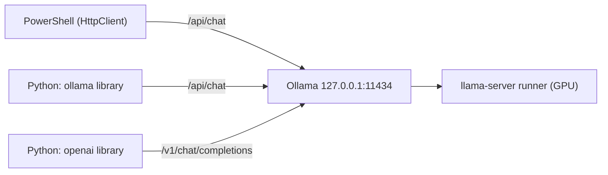

# Lab 04 — APIs, Streaming & Structured Output

## 1. Core Concept & DevOps Analogy

Until now we used Ollama as an experiment target. This lab treats it as what it is in a real system: **an HTTP service other programs call**. Calling it well means streaming for responsiveness, getting machine-readable output, and handling the failure modes (Lab 03 showed plenty) in code.

| Concept | What it means | Analogy |
|---|---|---|
| **Native API** | `/api/chat`, `/api/generate`, `/api/embed`, `/api/ps`, … JSON over HTTP on `127.0.0.1:11434` | The service's own REST API |
| **Streaming (NDJSON)** | With `stream: true` (the default), the response is **one JSON object per line**, one per token chunk, flushed as generated. The last line has `done: true` and the statistics | `kubectl logs -f`, or a chunked HTTP response: you see output while the job runs |
| **TTFT** | Time to first token: how long until the *first* text arrives. What a user feels as "responsiveness" | Time to first byte (TTFB) |
| **OpenAI-compatible API** | `/v1/chat/completions` etc.: the same models behind OpenAI's request format, so tools written for OpenAI work locally | An S3-compatible API on MinIO |
| **Structured output** | `format: <JSON schema>`: generation is **constrained** to tokens that keep the output valid against the schema | A CRD's OpenAPI schema: the API server rejects anything that doesn't fit, so consumers can rely on the shape |
| **Shape vs content** | The schema guarantees valid JSON with the right fields, *not* correct values | `kubectl apply --dry-run=server` validates the manifest, not whether the replica count is sensible |

## 2. Prerequisites & Hardware Budget

* Labs 01–03. `qwen3.5:4b` (≈4 GB VRAM at 4K context). One model at a time.
* **Python (from Step 2):** Python 3.12 via the launcher, `py -3.12`. Plain `python` on this machine is a **3.9** from the Microsoft Store, which Pydantic 2.14 doesn't support (needs ≥ 3.10). See Step 2 for the virtual environment.
* Scripts: `scripts/stream.ps1` (Step 1).

## 3. Architecture



All three are clients of the same server and the same model. They differ only in request format and convenience.

Verified 2026-10-27 (docs.ollama.com, PyPI):
* `ollama` (Python) 0.6.3, needs Python ≥ 3.8. `pydantic` 2.14.1, needs ≥ 3.10.
* Structured output: "Provide a JSON schema to the `format` field". With Pydantic: `format=Model.model_json_schema()`, then `Model.model_validate_json(...)`. The docs recommend temperature 0 and **also putting the schema in the prompt** "to ground the model's response".
* OpenAI compatibility: `base_url='http://localhost:11434/v1/'`, `api_key` required by the client but ignored by Ollama. **No way to set `num_ctx`** through it ("create a Modelfile with `PARAMETER num_ctx`"). Unsupported on chat: `tool_choice`, `logit_bias`, `user`, `n`, logprobs.

## 4. Step-by-Step Guide

### Step 1 — Streaming vs non-streaming, measured from the client

Every Lab 03 script used `Invoke-RestMethod` with `stream: false`. That waits for the **whole** answer. Real assistants stream. `stream.ps1` uses .NET `HttpClient` with `ResponseHeadersRead`, so it can read the NDJSON body line by line while it's generated, print tokens live, and time everything from the client's side:

| Column | Meaning |
|---|---|
| TTFT | Seconds until the first text chunk (thinking or answer) |
| FirstAnswer | Seconds until the first *answer* text (differs from TTFT with thinking on) |
| Total | Seconds until the final chunk |
| LoadS, PromptS | Server-side model load and prompt processing time, from the final chunk |
| Chunks | Lines received |
| EvalCount, TokS | Generated tokens and generation speed |

Four runs, the same prompt (≈150-word explanation), temperature 0:

1. **stream, cold**: the script first unloads the model (`keep_alive: 0`), so this includes loading
2. **stream, warm**
3. **no stream, warm**
4. **stream, think, warm**: thinking on

```powershell
.\scripts\stream.ps1                 # tokens print live; ≈30 s
ollama stop qwen3.5:4b
```

**Predictions:**

| Run | TTFT | Total | Why |
|---|---|---|---|
| stream, cold | ≈ 4–6 s | ≈ TTFT + 2 s | Load time (Lab 01–02: ≈4–6 s) comes before the first token |
| stream, warm | **≈ 0.1–0.3 s** | ≈ 2 s (≈200 tokens at ≈120 tok/s) | Only prompt processing + one token |
| no stream, warm | **= Total** | ≈ the same as streaming | Generation isn't faster or slower; the client just sees nothing until the end |
| stream, think, warm | short | much longer; **FirstAnswer ≫ TTFT** | Thinking tokens stream first (`message.thinking`), then the answer |
| Chunks | ≈ EvalCount + 1 | | One line per token plus the final stats line? **To check** |
| Same text streamed vs not | True | | Streaming only changes delivery (smoke test: True) |

What this teaches: **streaming changes perceived latency, not throughput.** Like `kubectl logs -f` vs waiting for the job to finish: same work, but you see progress, and you can cancel early (or detect a thinking loop, Lab 03 Step 1) without waiting for the end.

### Step 2 — Python setup (needs approval)

Python runs on **Windows** (decision D-03: WSL2 only from Phase 5). Proposal:

```powershell
py -3.12 -m venv .venv                          # project-local, gitignored; no system changes
.\.venv\Scripts\python -m pip install -r requirements.txt
```

`requirements.txt` pins `ollama==0.6.3` and `pydantic==2.14.1` (≈5 MB of downloads with dependencies, e.g. `httpx`). Everything stays inside `.venv\`; deleting that folder removes it all. **Not run yet: waiting for your approval.**

### Later steps

* Step 3 — The Python client: chat, streaming, a custom `Client` (host, timeout), `ResponseError` handling. Compare with the raw HTTP from Step 1.
* Step 4 — Structured output: extract Kubernetes incident data from raw logs into a Pydantic `IncidentReport` schema. Measure the **parse rate** over 50 runs (including `num_predict` truncation) and **field accuracy** separately (Lab 03: valid shape ≠ correct values). Corrupt and adversarial logs.
* Step 5 — The OpenAI-compatible API with the `openai` library: what's the same, what's missing (`num_ctx`), and why it matters for tools like Codex (Phase 6).
* Step 6 — Errors, timeouts and concurrency: unknown model, oversized input (`truncate: false`), client timeouts vs cold starts, and what happens to 4 simultaneous requests with one slot (`n_slots = 1`, queued). Testing `OLLAMA_NUM_PARALLEL` > 1 is a server setting change: approval first.

## 5. Hypotheses → Observed Metrics

*(Filled in after running.)*

## 6. Troubleshooting & Failure Modes

| Symptom | Likely cause | Check |
|---|---|---|
| `python` reports 3.9, or `pip install pydantic` fails on version | The Microsoft Store Python 3.9 is first on PATH | Use `py -3.12`, or the venv's `.venv\Scripts\python` |
| Streaming script prints nothing until the end | Body buffered: `Invoke-RestMethod`, or `HttpClient` without `ResponseHeadersRead` | Use `stream.ps1`'s pattern |
| `localhost` requests ≈2 s slower | Windows resolves `localhost` to `::1` first; Ollama binds IPv4 only (Lab 01) | Use `127.0.0.1` |

## 7. Cleanup

`ollama stop qwen3.5:4b`. Raw outputs stay in `results/raw/` (gitignored). The venv (Step 2) can be removed with `Remove-Item -Recurse .venv`.

## 8. Check Your Understanding

*(Added after the results.)*
