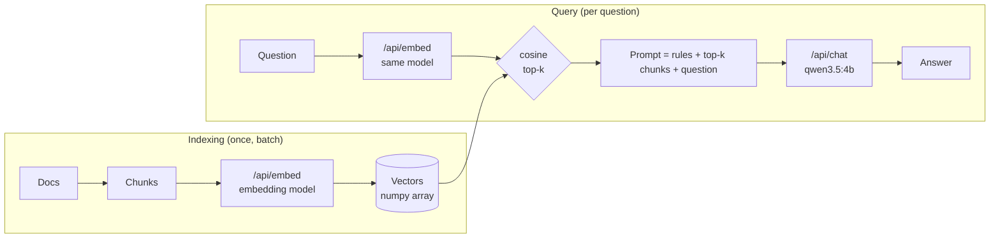

# Lab 05 — Embeddings, Vector Search & Local RAG

## 1. Core Concept & DevOps Analogy

An **embedding model** turns a text into a fixed-length list of numbers (a vector), so that texts with similar *meaning* get vectors that point in similar directions. Search then becomes geometry: embed the question, and find the stored vectors closest to it. That's **semantic search**, and it finds "my app keeps dying and coming back" in a runbook that only says "CrashLoopBackOff".

**RAG (Retrieval-Augmented Generation)** connects it to Lab 03 Step 6. There, the right reference in the prompt beat the model's own knowledge, and a wrong one won. RAG is the machinery that **picks** that reference automatically: chunk your docs, embed them once, and for each question retrieve the top-*k* chunks and put them in the prompt. Retrieval quality decides the answer quality: a chat model can't use a passage it was never shown.

DevOps analogy: an embedding index is a **search index built at deploy time**, like a pre-computed lookup table. Indexing (embed all chunks) is the batch job; querying (embed one question, compare) is the hot path. As with any index, the index and the queries must be built by the **same version of the same tool**: vectors from two different embedding models are no more comparable than two different hash functions.

## 2. Prerequisites & Hardware Budget

* Lab 03 Step 6 (grounding), Lab 04 Steps 2–4 (Python venv, the API).
* Embedding models (pulled 2026-10-27, approved):

| Model | Params | Quant | Dims | Context (card / loaded default) | Disk | VRAM (`/api/ps`) |
|---|---|---|---|---|---|---|
| `embeddinggemma:300m` | 307.6M | BF16 | 768 | 2,048 / 2,048 | 621 MB | ≈654 MiB |
| `qwen3-embedding:0.6b` | 595.8M | Q8_0 | 1,024 | 32,768 / **4,096** | 639 MB | ≈1,172 MiB |

* Both can be loaded next to `qwen3.5:4b` (≈3.9 GB) within the 8,500 MiB ceiling: different weights blobs, so different runners (Lab 04 Step 6).
* Python: the Windows venv (D-07), plus `numpy` (in `requirements.txt`). No vector database yet (D-10).

## 3. Architecture



**Verified before the experiment (2026-10-27):**
* The chat model can't embed here: `/api/embed` with `qwen3.5:4b` → **HTTP 501** "This server does not support embeddings. Start it with `--embeddings`" (the llama-server runner). Dedicated embedding models are the only option on this setup.
* `ollama show`: capabilities `embedding` (both). `qwen3-embedding` also lists `tools` and `thinking`, which come from its GGUF chat template, not from anything usable via `/api/embed`.
* Docs: `/api/embed` takes `input` (string or array), `truncate` (default `true`; `false` → error), `dimensions`, `keep_alive`, `options`. It "returns L2‑normalized (unit‑length) vectors"; "Use cosine similarity"; "Use the same embedding model for both indexing and querying". Response: `embeddings`, `total_duration`, `load_duration`, `prompt_eval_count`.
* First check: both return unit-length vectors (norm 1.0000), 768 and 1,024 dims. Oversized input with `truncate: false` → **HTTP 400** "the input length exceeds the context length". The first-ever load took 15–17 s each (Lab 02: the one-time CUDA kernel compile).
* Model cards: **embeddinggemma** wants prefixes on both sides: queries `task: search result | query: …`, documents `title: none | text: …`. **qwen3-embedding** wants an instruction on the query only (`Instruct: <task>\nQuery:…`), "No need to add instruction for retrieval documents"; without it, retrieval drops "by approximately 1% to 5%". Both support smaller (Matryoshka) dimensions.

## 4. Step-by-Step Guide

### Step 1 — What an embedding is, measured

`embed_basics.py` runs both models through four parts. Vectors stay in numpy; since they're unit length, **cosine similarity is just a dot product**.

* **Part 1, the vector:** dimensions, norm, cold load time, whether the same text twice gives the identical vector, whether a batch gives the same vectors as one-by-one, and the time per text in a batch of 48.
* **Part 2, similarity of 7 sentence pairs:** identical, paraphrase ("pod keeps restarting" / "stuck in a crash loop"), jargon vs plain words (`ImagePullBackOff` / "cannot download the image"), **negation** ("ready" / "not ready"), same topic but another task (Helm rollback / install), another language (Portuguese), unrelated (baking bread).
* **Part 3, a tiny retrieval:** 6 runbook passages (crash loop, OOM, image pull, Pending, Helm rollback, readiness) and 6 questions written **without the passages' keywords** ("my app keeps dying and coming back every few minutes"). For each model, with and without the card's prefixes: is the right passage ranked first, and by what **margin** over the best wrong one?
* **Part 4, input longer than the context:** ≈20,000 characters (≈5,000+ tokens). Is it truncated or rejected, how many tokens are embedded, and **which end is kept** (the long text's vector is compared with the vectors of its first and its last 3,000 characters)?

```powershell
.\.venv\Scripts\python scripts\embed_basics.py      # ≈1 minute; stops both models at the end
```

**Predictions:**

| Case | Prediction | Why |
|---|---|---|
| Norm | 1.0000 | Docs: L2-normalized |
| Same text twice | identical | No sampling in an embedding: one forward pass, deterministic on the same hardware (Lab 03 Step 2) |
| Batch vs one-by-one | **tiny differences** (≈1e-6), not exactly 0 | Batched math adds in a different order (Lab 03 Step 2: batch size changed the output). Harmless for search |
| ms per text | ≈5–20 ms (gemma faster) | 300–600M params vs 4B; ≈40-token inputs |
| identical pair | 1.000 | Same vector |
| paraphrase | high (≈0.7–0.9) | The whole point of embeddings |
| **negation** | **very high (≈0.9)**, higher than the paraphrase | Embeddings capture topic more than logic: "ready" and "not ready" are about the same thing. A known weakness |
| unrelated | **not 0**: ≈0.1–0.4 | Real embeddings don't spread over the full sphere; scores have a model-specific floor |
| other language | fairly high | Both models are trained on multilingual data (not verified per language) |
| **Scale per model** | the two models give **different numbers** for the same pairs | A threshold like "> 0.8 = match" doesn't transfer between models |
| Part 3 hits@1 | 5–6 of 6 for both; prefixes raise the **margin** more than the hits | 6 distinct topics are easy; the card says 1–5% |
| Part 4 default | no error; tokens embedded = **2,048** (gemma), **4,096** (qwen3: the loaded default, not the card's 32K) | `truncate: true` by default; Lab 04 Step 6: `num_ctx` defaults to 4,096 |
| Part 4 which end | **the start is kept** (vector closer to the first 3,000 chars) | Docs: "truncate inputs"; chat truncation kept the end (Lab 03), so this would be the opposite. Unknown |

What this means for RAG: if Part 4 shows silent truncation, **every chunk longer than the context loses its end without an error**, so chunk size must stay below the embedding model's context, and `truncate: false` (or counting `prompt_eval_count`) is the safety check.

### Step 2 — Retrieval quality on a labelled corpus

Step 1 had 6 queries: one miss moved the score by 17 points, so it couldn't compare anything. Step 2 builds a small **labelled evaluation set**, the retrieval equivalent of a test suite: questions whose right answer is known, so any change (model, prefix, chunking later) gets a number instead of an impression.

**The data (written for this lab, no private documents):**
* `corpus/*.md`: **18 synthetic runbooks**, ≈120–200 words each, all in the same shape (`# Title`, `## Symptoms`, `## Cause`, `## Fix`). Topics: CrashLoopBackOff, OOMKilled, eviction, ImagePullBackOff, Pending (resources), PVC Pending, readiness, liveness, DNS, expired certificates, Helm rollback, Helm "another operation in progress", Argo CD OutOfSync, Terraform state lock, node NotReady, HPA not scaling, stuck Terminating, ingress 502/503. The facts are standard Kubernetes/Helm/Terraform behavior; error strings are written as the tools print them.
* **Deliberate near-duplicates**, as in real runbook collections: readiness vs liveness, OOMKilled vs eviction, Helm rollback vs Helm "operation in progress", PVC Pending vs Pending for CPU, and "137" in both the OOM and the liveness runbooks.
* `questions.json`: **33 questions** in four types, each labelled with its runbook(s) and section (the section is for Step 3):

| Type | N | What it tests | Example |
|---|---|---|---|
| paraphrase | 10 | the same problem in other words, no shared keywords | "a worker machine dropped out of the cluster" → node NotReady |
| identifier | 10 | an exact error string or code, copied from the runbook | `TARGETS <unknown>/80%` → HPA |
| distractor | 6 | a near-identical runbook exists | "health check keeps failing while it is still starting up" → liveness, not readiness |
| knowledge | 7 | needs an inference the text doesn't spell out | "two people ran apply at the same time" → Terraform state lock |

One question has **two acceptable answers** (k01 "pod is up but gets no traffic": readiness *or* ingress 502/503), so the label doesn't punish a defensible answer (Lab 04 Step 4's ground-truth caveat).

**Methods** (`retrieval_eval.py`), one retrieval unit = one whole runbook (chunking is Step 3):
* **BM25**, the classic keyword ranking behind Elasticsearch/OpenSearch, implemented in ≈20 lines in the script so nothing is hidden: rare words that match count a lot, common words little, long documents are normalized.
* **Each embedding model, with and without the model card's prefixes** (gemma's document prefix uses the runbook's real title).
* **Hybrid:** BM25 and one embedding ranking merged with **reciprocal rank fusion** (RRF): each method adds `1/(60 + rank)` per runbook. It uses ranks, not scores, so it doesn't care that BM25 scores and cosine similarities have different scales (Step 1 Q2).
* Runbooks are embedded with `truncate: false`, so one that exceeded the context would fail instead of being cut silently (the Step 1 lesson).

**Metrics:** Hit@1 (right runbook first), **Hit@3** (it's in the top 3, i.e. in the prompt of a RAG system with *k* = 3), MRR (mean of 1/rank). Each Hit@1 is also split by question type, and every miss is listed with what came first.

```powershell
.\.venv\Scripts\python scripts\retrieval_eval.py      # ≈1 minute; stops both models at the end
```

**Predictions:**

| Method | paraphrase | identifier | distractor | knowledge | Overall Hit@1 / Hit@3 |
|---|---|---|---|---|---|
| BM25 | **weak**, ≈3–5/10 | **≈10/10** | ≈3–4/6 | weak, ≈2–3/7 | ≈55–65% / ≈75% |
| embeddings (either) | **≈8–9/10** | ≈7–9/10 (blurs exact codes, Step 1) | ≈3–5/6 | ≈4–5/7 | ≈70–80% / ≈90% |
| + prefixes | small gain or none | | | | ±1–2 questions (noise at 33) |
| hybrid | ≈ the better of the two per type | **≈10/10** | | | **the best overall**, Hit@3 ≈95% |

And:
* **Hit@3 well above Hit@1** for every method: retrieval is often "close", which is why RAG passes several chunks, not one.
* **qwen3 vs gemma: unknown.** Step 1 couldn't separate them; 33 questions still can't separate small differences (one question = 3 points), so only a gap of ≈4+ questions means something.
* The distractors: k = 3 retrieval will often contain **both** near-duplicates, and the chat model will have to pick (Step 4).

### Step 3 — Chunking: what is the retrieval unit?

So far a whole runbook was one unit. Real documents are longer than an embedding model's context (Step 1: the end gets dropped) and longer than you want in a prompt, so they're cut into **chunks**, and only the best chunks go to the chat model. How you cut decides what can be found: a chunk is all the search engine and the chat model ever see. Analogy: log aggregation. Index a whole day's log as one document and every search "finds" it but tells you nothing; index line by line and a stack trace is split into meaningless pieces.

**New questions first (Step 2 found author bias):**
* **18 `on-call` questions**, one per topic, written the way you'd type during an incident, from the topic list only, and deliberately **not** in the runbooks' words: "java app gets OOM'd even though grafana says the box has 20 gigs free", "tf in CI refuses to run, says someone else is holding it", "load balancer gives bad gateway for the checkout service". Caveat: written by the same author (me), so the bias is reduced, not removed. Questions from someone who hasn't read the runbooks would still be the better test.
* **3 `no-answer` questions** whose topic isn't in the corpus at all (etcd space exceeded, port-forward drops, rotating AWS keys). Search always returns *something*; the question is whether its score gives that away.
* Total: 51 answerable questions + 3 no-answer. Each answerable question has a labelled section (where the answer is: Symptoms, Cause or Fix).

**Five chunking strategies** (`chunking_eval.py`) on the same 18 runbooks:

| Strategy | Chunks | Idea |
|---|---|---|
| `doc` | 18 | one chunk per runbook: the Step 2 baseline |
| `section` | 54 | one chunk per `##` section, with only the section heading ("## Fix …") |
| `section+title` | 54 | the same, plus the runbook's `#` title in front: a **contextual header** |
| `fixed-60` | 49 | 60-word windows over the file, ignoring headings |
| `fixed-60/20` | 58 | 60-word windows overlapping by 20 words |

Searched with BM25, both embedding models (no prefixes; Step 2 found no effect), and the two hybrids. Scored at two levels:
* **Doc level:** the top chunk comes from the right runbook (enough to find the document).
* **Section level:** the top chunk *is* the labelled section of the right runbook, e.g. its Fix. That's what a RAG prompt actually needs: a chunk from the right runbook that doesn't contain the answer is useless to the chat model.

```powershell
.\.venv\Scripts\python scripts\chunking_eval.py      # ≈1–2 minutes; stops both models at the end
```

**Predictions:**

| Question | Prediction | Why |
|---|---|---|
| on-call questions vs Step 2's (doc strategy) | **lower for every method, BM25 most** | No borrowed vocabulary: the author-bias test |
| `section` vs `doc`, doc level | **lower**: a Fix section alone ("Raise `timeoutSeconds` …") lacks the topic's words | The chunk lost its context |
| `section+title` vs `section` | **higher**, close to `doc` at doc level | The title puts the topic back into every chunk |
| Section level vs doc level | **much lower**, ≈55–75% Hit@1 | Symptoms, Cause and Fix of one runbook share vocabulary; picking the right one of three is harder than picking the runbook |
| Section Hit@3 | high (≈85–95%) | With *k* = 3, the right runbook's three sections often all fit in |
| `fixed-60` vs `section+title` | **lower** | Windows cut through sections and have no title (except the first) |
| `fixed-60/20` vs `fixed-60` | slightly higher | Overlap keeps sentences that sit on a boundary in one chunk |
| hybrid | still the best in every strategy | Uncorrelated errors (Step 2) |
| no-answer top score | **lower** than most answerable questions, but **not below all of them** | No clean threshold (Q2): you can't reliably say "nothing found" from the score |

### Later steps (planned)

* Step 4 — RAG end to end: retrieve top-*k*, build the prompt (Lab 03 Step 6 rules), answer with `qwen3.5:4b`, and check whether the answer is right *and* cites the right section. What happens when retrieval misses.
* Step 5 — A vector store (ChromaDB or sqlite-vec, decided then): what it adds over the numpy array (persistence, metadata filters, approximate search) and what it doesn't change (the vectors).

## 5. Hypotheses → Observed Metrics

### Step 1 — What an embedding is

Raw: `results/raw/embed-basics-20261027-225633.md`. Ollama 0.40.10. The losing passages were looked up afterwards with the same code and texts (not saved).

| Model | Dims | Norm | Load | Tokens for "The pod keeps restarting." | Same twice | Batch vs single | ms/text (batch of 48) |
|---|---|---|---|---|---|---|---|
| embeddinggemma:300m | 768 | 1.0000 | 2.51 s | 7 | identical | **max diff 0.0** | 17.3 |
| qwen3-embedding:0.6b | 1,024 | 1.0000 | 1.59 s | 6 | identical | **max diff 0.0** | 14.8 |

| Pair | gemma | qwen3 |
|---|---|---|
| identical | 1.000 | 1.000 |
| paraphrase ("keeps restarting" / "stuck in a crash loop") | 0.617 | 0.666 |
| jargon vs plain words (`ImagePullBackOff` / "cannot download the image") | **0.361** | 0.558 |
| **negation** ("ready" / "not ready") | **0.833** | **0.890** |
| same topic, other task (Helm rollback / install) | 0.628 | 0.680 |
| other language (Portuguese) | 0.758 | 0.648 |
| unrelated (baking bread) | 0.193 | 0.296 |

| Retrieval (6 passages, 6 queries) | Hits@1 | Mean margin | Missed |
|---|---|---|---|
| gemma, no prefixes | 5/6 | 0.135 | "pod is up but gets no traffic" → **pending** (0.537) over readiness (0.433) |
| gemma, prefixes | 5/6 | 0.145 | the same |
| qwen3, no prefixes | 4/6 | 0.098 | "no traffic" → pending; "my app keeps dying and coming back" → **oom** (0.568) over crashloop (0.448) |
| qwen3, prefix | 4/6 | 0.117 | "no traffic" → pending; "container killed, exit status 137" → **crashloop 0.601 vs oom 0.598** |

| Long input (19,158 chars) | Tokens embedded | `truncate: false` | Similarity to start / end |
|---|---|---|---|
| gemma (num_ctx 2,048) | 2,048, no error | HTTP 400 "the input length exceeds the context length" | **0.985** / 0.844 |
| qwen3 (num_ctx 4,096) | 4,095, no error | HTTP 400 | **0.980** / 0.830 |

| Prediction | Observed |
|---|---|
| Norm 1.0000 | ✅ |
| Same text twice: identical | ✅ |
| Batch vs single: tiny differences | ❌ **exactly identical** (0.0). Unlike generation in Lab 03, batching didn't change a single bit here |
| ≈5–20 ms/text, gemma faster | ✅ range; ❌ qwen3 was a little faster (14.8 vs 17.3). gemma is BF16, qwen3 Q8_0: both ≈600 MB of weights to read, so "fewer parameters" didn't mean less work |
| paraphrase ≈0.7–0.9 | ❌ lower: **0.62 / 0.67** |
| **negation higher than the paraphrase** | ✅ **0.83 / 0.89**, the highest non-identical pair in both models |
| unrelated not 0 (≈0.1–0.4) | ✅ 0.19 / 0.30 |
| other language fairly high | ✅ 0.76 / 0.65: gemma rates the Portuguese translation **above** the English paraphrase |
| different scales per model | ✅ qwen3 is higher across the board (floor 0.30 vs 0.19) |
| hits@1 5–6/6; prefixes raise the margin more than hits | ≈ 5/6 and 4/6; prefixes raised the margin a little (+0.01, +0.02) and didn't change hits |
| Part 4: no error, 2,048 / 4,096 tokens | ✅ 2,048 / **4,095** (one less; probably a token the model appends itself, not verified). qwen3 uses the 4,096 default, not its 32K |
| Part 4: the start is kept | ✅ start 0.98 vs end 0.83–0.84: **the end of the text is dropped**, the opposite of chat truncation (Lab 03 kept the end) |

What it shows:
* **An embedding measures "about the same thing", not "means the same thing".** "The pod is ready" and "The pod is not ready" were closer than a real paraphrase in both models. For retrieval that's mostly fine: both sentences belong in the same runbook. For anything that depends on *polarity* (is this a success or a failure log line?), similarity is the wrong tool; that's the chat model's job, or a filter.
* **Scores are relative, not absolute.** The same pair got 0.36 from one model and 0.56 from the other; the unrelated floor is 0.19 vs 0.30. A threshold like "similarity > 0.6 means relevant" is model-specific, like a latency SLO that only makes sense for one service. And "same topic, other task" (rollback vs install, 0.63–0.68) scored like the paraphrase: a question about rolling back will also pull up install docs.
* **Dense embeddings blur exact tokens.** "container killed, exit status 137" vs a passage that literally contains "exit code 137": qwen3 with the prefix ranked it second by **0.003**. A keyword search (BM25) would have found it instantly. Error codes, pod names and flags are exactly what engineers search for, so Step 2 measures BM25 next to the embeddings (hybrid search is the usual fix).
* **The hard query was one that needs knowledge, not words:** "pod is up but gets no traffic" means "removed from the Service endpoints", which is in the readiness passage. Both models sent it to the *Pending* passage (pod + something wrong). The embedding can only match what the text says, not what an engineer infers.
* **6 queries can't rank the models.** gemma 5/6 vs qwen3 4/6 is one query, and the prefix moved qwen3's miss from one query to another. That's noise at this size; Step 2's labelled set (20–30 questions) is there to measure it properly.
* **Long chunks lose their end silently.** Default `truncate: true` dropped everything after 2,048 (gemma) or 4,095 (qwen3) tokens, without an error and with HTTP 200. A runbook chunk whose fix is in its last paragraph would be indexed **without the fix**. Keep chunks well below the embedding model's context, and check `prompt_eval_count`, or use `truncate: false` while indexing so oversized chunks fail loudly.
* **Deterministic and batch-invariant:** the same text always gives the same vector, so an index can be rebuilt reproducibly, and batching while indexing is safe.

### Step 2 — Retrieval quality on a labelled corpus

Raw: `results/raw/retrieval-eval-20261027-231619.md`. 18 runbooks (3,418–3,512 tokens in total, ≈190 per runbook; the largest is far below both context limits, and `truncate: false` raised nothing), 33 questions.

| Method | Hit@1 | Hit@3 | MRR | paraphrase | identifier | distractor | knowledge |
|---|---|---|---|---|---|---|---|
| BM25 | 27/33 | 32/33 | 0.885 | **5/10** | **10/10** | 5/6 | 7/7 |
| embeddinggemma | **31/33** | 32/33 | 0.960 | 9/10 | 9/10 | 6/6 | 7/7 |
| embeddinggemma +prefix | 30/33 | 33/33 | 0.949 | 9/10 | 8/10 | 6/6 | 7/7 |
| qwen3-embedding | 29/33 | 32/33 | 0.932 | 9/10 | 9/10 | 6/6 | 5/7 |
| qwen3-embedding +prefix | 29/33 | 32/33 | 0.923 | 10/10 | 8/10 | 6/6 | 5/7 |
| hybrid BM25 + gemma +prefix | 32/33 | 33/33 | 0.985 | 9/10 | 10/10 | 6/6 | 7/7 |
| **hybrid BM25 + qwen3 +prefix** | **33/33** | 33/33 | **1.000** | 10/10 | 10/10 | 6/6 | 7/7 |

Misses (what came first instead):
* **BM25**, all paraphrases except d01: "pods got kicked off a machine that ran out of RAM" → node-notready (rank 5 for evicted); "a worker machine dropped out of the cluster" → coredns; "the storage request never gets a disk" → hpa-not-scaling; d01 "health check keeps failing while it is still starting up" → stuck-terminating.
* **gemma +prefix:** p01 "restarts over and over and the wait keeps growing" → liveness-probe; `toomanyrequests` → oomkilled (rank 3); `TARGETS <unknown>/80%` → ingress-5xx.
* **qwen3 +prefix:** `exit code 137` → crashloopbackoff (rank 3); `toomanyrequests` → pending-insufficient (**rank 8**); k01 "pod is up but gets no traffic" → pending-insufficient; k07 "two people ran apply at the same time" → argocd-outofsync.

| Prediction | Observed |
|---|---|
| BM25: paraphrase weak (≈3–5/10), identifier ≈10/10 | ✅ 5/10 and 10/10 |
| BM25: knowledge weak (≈2–3/7) | ❌ **7/7** (see "author bias" below) |
| BM25 overall ≈55–65% | ❌ 82% |
| embeddings: paraphrase ≈8–9/10, identifiers blurred (≈7–9/10) | ✅ 9–10/10 and 8–9/10 |
| embeddings overall ≈70–80% / Hit@3 ≈90% | ❌ higher: 88–94% / 97–100% |
| prefixes: small gain or none | ✅ none: −1 to 0 on Hit@1, both models lost one identifier |
| hybrid ≈ the better of the two per type, best overall | ✅ **better than both** in every column; 33/33 with qwen3 |
| Hit@3 well above Hit@1 | ✅ for BM25 (27 → 32); dense methods were already close to the ceiling |
| qwen3 vs gemma: unknown, needs a gap of ≈4 questions | gemma 31 vs qwen3 29: 2 questions, **not a meaningful difference** |

What it shows:
* **Keyword and semantic search fail on different questions, and that's why hybrid works.** BM25's 6 misses are paraphrases ("ran out of RAM" never says "eviction"); the embeddings' misses are mostly exact strings (`toomanyrequests`, `TARGETS <unknown>/80%`, `137`). No question was missed by both, so fusing the two rankings fixed everything. That's the case for hybrid search in one table, and RRF did it without any tuning or score calibration.
* **A meaningless token is the embedding's worst case.** `toomanyrequests` is one rare word with no semantic content for the model to place; qwen3 ranked its runbook **8th**. BM25 found it first because the word occurs in exactly one runbook (highest IDF). Error codes, request IDs, hostnames and image tags all look like this to an embedding.
* **The prefixes didn't help here**, and both cost one identifier question: `task: search result | query: toomanyrequests` turns a one-word query into mostly prefix. The model cards measure on general benchmarks; on this corpus the effect is within noise (1 question). Test before adopting a "recommended" setting, as with the sampling defaults in Lab 03.
* **The set is too easy to rank the embedding models.** Hit@3 is 32–33/33 everywhere, so every method would put the right runbook into a *k* = 3 prompt: a **ceiling effect**. 18 runbooks on 18 distinct topics are easy to tell apart. The difference between gemma and qwen3 (2 questions) is noise.
* **Author bias in the questions: BM25 got all 7 "knowledge" questions.** I wrote the questions while looking at the runbooks, and the knowledge ones leaked words from them: "apply" (Terraform), "Let's Encrypt", "metrics are not available", "CI job cancelled", "Unknown", "heap". A real user wouldn't know the runbook's vocabulary. That's the same lesson as Lab 04 Step 4's ground-truth caveat: **an eval set measures the questions as much as the system**. Questions written by someone who hasn't read the documents are the better test (see the next step's plan).

## 6. Troubleshooting & Failure Modes

| Symptom | Likely cause | Check |
|---|---|---|
| `/api/embed` → 501 "does not support embeddings" | A chat model was given to `/api/embed` | Use an embedding model (`ollama show` → capabilities `embedding`) |
| Search results suddenly all wrong after a change | Index and queries embedded with different models (or prefixes) | Store the model name with the index; re-embed everything after a model change |
| First request takes 15+ s | First-ever load of a new model compiles CUDA kernels (Lab 02) | Only once per model; later loads are fast |

## 7. Cleanup

`ollama stop embeddinggemma:300m`, `ollama stop qwen3-embedding:0.6b`. To remove the models (≈1.26 GB): `ollama rm` each (ask first; later steps use them).

## 8. Check Your Understanding

Try to answer each one before opening the answer.

**1. "The pod is ready" vs "The pod is not ready" scored 0.83–0.89, higher than a real paraphrase (0.62–0.67). Is the embedding broken?**

The paraphrase pair was "The pod keeps restarting." / "The container is stuck in a crash loop."

*What does cosine similarity actually measure, and where would this behavior hurt you in a RAG system or a log pipeline?*

<details><summary>Answer</summary>

It isn't broken; it's doing what it was trained for. An embedding places texts by **what they're about**: the same words, the same subject, the same context of use. "Ready" and "not ready" share almost every token and appear in exactly the same documents (readiness probes, pod status), so they land close together. The paraphrase uses different words ("restarting" vs "crash loop") and has to be matched by learned meaning, which is a harder and weaker signal.

For retrieval this is mostly what you want: a question about a pod that isn't ready *should* find the readiness runbook. It hurts where the **polarity** matters:

* Classifying log lines as success/failure by similarity to examples: "deployment succeeded" and "deployment failed" will look alike.
* Deduplicating alerts by similarity: "disk usage is below 80%" and "disk usage is above 80%" would merge.
* A RAG answer that needs "when does it NOT restart": retrieval brings the right passage, but the **chat model** has to read the "not" (Lab 03 Step 6 showed it can).

Rule: use embeddings to find *candidates* by topic, and use exact filters or the chat model for logic. It's like a search index: it finds the right file, but `grep -v` is still a separate step.
</details>

**2. A teammate proposes "anything above 0.6 similarity is relevant". What's wrong with that?**

The same pairs, scored by the two models: jargon vs plain words 0.36 vs 0.56, unrelated 0.19 vs 0.30, same topic but other task 0.63 vs 0.68.

*Why doesn't a fixed threshold work, and what would you do instead?*

<details><summary>Answer</summary>

Similarity values have no absolute meaning; each model has its own scale. qwen3's score for an unrelated pair (0.30) is almost as high as gemma's score for a correct jargon match (0.36). 0.6 would reject the right jargon match for gemma and accept "Helm install" for a rollback question with both. And the threshold would silently change meaning the day you switch models.

Instead:

* **Rank, don't threshold:** take the top-*k* (Step 2 measures which *k*) and let the chat model ignore what's irrelevant.
* If you need a cut-off (to answer "I don't know" when nothing matches), **calibrate it per model on labelled data**: the scores of right vs wrong passages for real questions. Store the model name next to the threshold.
* Look at the **margin** (best minus second best) as well as the score: a top result that barely beats the rest is a weak match.

It's the same as alert thresholds: a CPU threshold tuned on one instance type doesn't carry over to another; you set it from that system's own baseline.
</details>

**3. "container killed, exit status 137" didn't reliably find the passage that contains "exit code 137". Why, and what's the fix?**

qwen3 with the prefix ranked the OOM passage second, 0.598 vs 0.601. The other model found it, and it's the one query that shares an exact token with its passage.

*Why are dense embeddings weak at exact identifiers, and why does that matter for engineering docs in particular?*

<details><summary>Answer</summary>

An embedding compresses a whole text into 768–1,024 numbers that represent its overall meaning. One token like "137" is a small part of that, and numbers carry little meaning on their own, so it barely moves the vector. "container killed" pulled the query toward "a container exits repeatedly" just as strongly.

Engineering search is full of exact identifiers: exit codes, error strings (`ImagePullBackOff`), flags (`--previous`), resource names, versions. Keyword search (BM25, the algorithm behind Elasticsearch/OpenSearch scoring) is excellent at exactly those and weak at paraphrases. Embeddings are the opposite. So the standard fix is **hybrid search**: run both, and merge the rankings (for example with reciprocal rank fusion). Step 2 adds BM25 as a baseline to measure how often each one wins on this lab's questions.

Analogy: label selectors vs free-text search. When you know the exact label, you don't want "something similar".
</details>

**4. A 19,000-character text was embedded with HTTP 200 and no warning. What did the index actually store?**

gemma embedded 2,048 tokens and qwen3 4,095. The long text's vector was 0.98 similar to its first 3,000 characters and 0.83–0.84 to its last 3,000. With `truncate: false`, both returned HTTP 400.

*What does this mean for chunking, and how would you make the indexing job fail loudly?*

<details><summary>Answer</summary>

The index stored a vector for **the beginning of the text only**. Everything after the context limit was dropped, and nothing in the response says so except `prompt_eval_count`. Note that this is the opposite of chat truncation (Lab 03 kept the end and dropped the start), so "which part gets lost" depends on the endpoint.

For RAG, that means a question about something in the dropped part can never retrieve this chunk, however good the model is. A runbook section with the symptoms first and the fix last would be found for the symptoms but would be indexed **without its fix**, so the retrieved text could still contain it (if you store the full text) but its vector doesn't represent it.

Making it fail loudly:

* **Chunk below the limit:** sizes measured in tokens, with a margin (Step 3), not in characters.
* **`truncate: false` while indexing:** an oversized chunk becomes an HTTP 400, and the job fails or splits it, like a schema validation step in CI.
* **Check `prompt_eval_count`** against the limit (2,048 / 4,095 here) and log it.
* Remember that qwen3's "32K" is only on the card: it loaded with **4,096**, the server default (Lab 04 Step 6).
</details>

**5. BM25 got 27/33, the best embedding 31/33, and the hybrid 33/33. Why was the hybrid better than both, not just as good as the better one?**

BM25 missed 6 paraphrases ("pods got kicked off a machine that ran out of RAM" → node-notready). qwen3 missed `toomanyrequests` (rank 8), `exit code 137` and two knowledge questions. RRF only adds `1/(60 + rank)` from each ranking.

*What property of the two methods' errors makes fusion work? When would it not help?*

<details><summary>Answer</summary>

Their errors were **uncorrelated**: no question was missed by both. When one method ranks the right runbook 5th or 8th and the other ranks it 1st, the fused score of that runbook (≈1/61 + 1/68) beats a runbook that only one method liked (≈1/61 + something far down). Fusion picks the candidate both methods agree is plausible.

That's the same reason two different monitoring signals (black-box probe + metrics) catch more than either alone: they fail for different reasons. It would **not** help when both methods fail together: a question that shares no words with its runbook *and* needs an inference the embedding can't make (k01 "no traffic" leaned that way), or a corpus where the right answer isn't in any document at all. And fusing two similar methods (two embedding models) helps less, because their errors are correlated.

RRF's other advantage: it ignores raw scores, so there's nothing to calibrate between BM25 values (unbounded) and cosine similarities (model-specific, Step 1 Q2).
</details>

**6. Every method scored Hit@3 of 32–33/33. What does that tell you about the evaluation set?**

18 runbooks, one per topic, ≈190 tokens each. BM25 also scored 7/7 on the "knowledge" questions, which were meant to be hard for keyword search.

*Why might this set overrate all methods, and how would you make it a better test?*

<details><summary>Answer</summary>

It's near the **ceiling**: when everything scores ≈100%, the test can't tell methods apart, like a load test that never reaches saturation. Reasons:

* **Few, very distinct documents.** 18 topics with different vocabulary are easy to separate. A real knowledge base has hundreds of documents, many about the same component.
* **Whole runbooks as units.** Each unit contains all the vocabulary of its topic (symptoms, cause and fix), so almost any question about it matches something. Section-level chunks (Step 3) are smaller and more alike.
* **Author bias.** The questions were written by the runbooks' author, looking at the runbooks, so they reuse their words: "apply", "Let's Encrypt", "metrics are not available". That's why BM25 aced "knowledge".

Better tests: questions from people who **haven't read** the documents (real tickets, chat messages, on-call questions), more documents including near-duplicates, smaller units, and questions whose answer is **not** in the corpus (does retrieval return confident garbage?). Track the score over time like a regression test, not as an absolute grade.
</details>

**7. The model cards recommend query prefixes, and here they changed nothing or made it slightly worse. Should you use them?**

gemma: 31/33 without, 30/33 with. qwen3: 29/33 both ways (paraphrase +1, identifier −1). Both lost an identifier question, for example `toomanyrequests`.

*How do you decide on a "recommended" setting like this?*

<details><summary>Answer</summary>

Treat it as a **hypothesis to test on your own data**, not a fact. The card's "1% to 5%" comes from broad public benchmarks; this corpus is small and technical, and the measured effect (±1 question of 33) is within noise. Neither "use it" nor "never use it" is supported yet.

What the misses suggest is a plausible mechanism: a long instruction in front of a one-word query (`toomanyrequests`) makes the query's vector mostly "about" the instruction. That may matter for short, identifier-like queries, which is exactly what engineers type.

How to decide: keep the setting that's **consistent between indexing and querying**, measure on a larger and harder set (Step 3), and choose by the numbers. And since the hybrid already covers identifiers with BM25, the prefix's effect on identifiers matters less in a hybrid system. It's the same discipline as Lab 03 with the sampling defaults: the vendor's recommendation is a starting point, the measurement decides.
</details>
