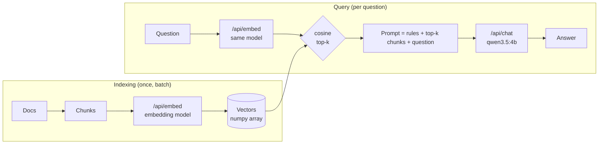

# Lab 05 — Embeddings, Vector Search & Local RAG

## 1. Core Concept & DevOps Analogy

An **embedding model** turns a text into a fixed-length list of numbers (a vector), so that texts with similar *meaning* get vectors that point in similar directions. Search then becomes geometry: embed the question, and find the stored vectors closest to it. That's **semantic search**, and it finds "my app keeps dying and coming back" in a runbook that only says "CrashLoopBackOff".

**RAG (Retrieval-Augmented Generation)** connects it to Lab 03 Step 6. There, the right reference in the prompt beat the model's own knowledge, and a wrong one won. RAG is the machinery that **picks** that reference automatically: chunk your docs, embed them once, and for each question retrieve the top-*k* chunks and put them in the prompt. Retrieval quality decides the answer quality: a chat model can't use a passage it was never shown.

DevOps analogy: an embedding index is a **search index built at deploy time**, like a pre-computed lookup table. Indexing (embed all chunks) is the batch job; querying (embed one question, compare) is the hot path. As with any index, the index and the queries must be built by the **same version of the same tool**: vectors from two different embedding models are no more comparable than two different hash functions.

## 2. Prerequisites & Hardware Budget

* Lab 03 Step 6 (grounding), Lab 04 Steps 2–4 (Python venv, the API).
* Embedding models (pulled 2026-10-27, approved):

| Model | Params | Quant | Dims | Context (card / loaded default) | Disk | VRAM (`/api/ps`) |
|---|---|---|---|---|---|---|
| `embeddinggemma:300m` | 307.6M | BF16 | 768 | 2,048 / 2,048 | 621 MB | ≈654 MiB |
| `qwen3-embedding:0.6b` | 595.8M | Q8_0 | 1,024 | 32,768 / **4,096** | 639 MB | ≈1,172 MiB |

* Both can be loaded next to `qwen3.5:4b` (≈3.9 GB) within the 8,500 MiB ceiling: different weights blobs, so different runners (Lab 04 Step 6).
* Python: the Windows venv (D-07), plus `numpy` (in `requirements.txt`). No vector database yet (D-10).

## 3. Architecture



**Verified before the experiment (2026-10-27):**
* The chat model can't embed here: `/api/embed` with `qwen3.5:4b` → **HTTP 501** "This server does not support embeddings. Start it with `--embeddings`" (the llama-server runner). Dedicated embedding models are the only option on this setup.
* `ollama show`: capabilities `embedding` (both). `qwen3-embedding` also lists `tools` and `thinking`, which come from its GGUF chat template, not from anything usable via `/api/embed`.
* Docs: `/api/embed` takes `input` (string or array), `truncate` (default `true`; `false` → error), `dimensions`, `keep_alive`, `options`. It "returns L2‑normalized (unit‑length) vectors"; "Use cosine similarity"; "Use the same embedding model for both indexing and querying". Response: `embeddings`, `total_duration`, `load_duration`, `prompt_eval_count`.
* First check: both return unit-length vectors (norm 1.0000), 768 and 1,024 dims. Oversized input with `truncate: false` → **HTTP 400** "the input length exceeds the context length". The first-ever load took 15–17 s each (Lab 02: the one-time CUDA kernel compile).
* Model cards: **embeddinggemma** wants prefixes on both sides: queries `task: search result | query: …`, documents `title: none | text: …`. **qwen3-embedding** wants an instruction on the query only (`Instruct: <task>\nQuery:…`), "No need to add instruction for retrieval documents"; without it, retrieval drops "by approximately 1% to 5%". Both support smaller (Matryoshka) dimensions.

## 4. Step-by-Step Guide

### Step 1 — What an embedding is, measured

`embed_basics.py` runs both models through four parts. Vectors stay in numpy; since they're unit length, **cosine similarity is just a dot product**.

* **Part 1, the vector:** dimensions, norm, cold load time, whether the same text twice gives the identical vector, whether a batch gives the same vectors as one-by-one, and the time per text in a batch of 48.
* **Part 2, similarity of 7 sentence pairs:** identical, paraphrase ("pod keeps restarting" / "stuck in a crash loop"), jargon vs plain words (`ImagePullBackOff` / "cannot download the image"), **negation** ("ready" / "not ready"), same topic but another task (Helm rollback / install), another language (Portuguese), unrelated (baking bread).
* **Part 3, a tiny retrieval:** 6 runbook passages (crash loop, OOM, image pull, Pending, Helm rollback, readiness) and 6 questions written **without the passages' keywords** ("my app keeps dying and coming back every few minutes"). For each model, with and without the card's prefixes: is the right passage ranked first, and by what **margin** over the best wrong one?
* **Part 4, input longer than the context:** ≈20,000 characters (≈5,000+ tokens). Is it truncated or rejected, how many tokens are embedded, and **which end is kept** (the long text's vector is compared with the vectors of its first and its last 3,000 characters)?

```powershell
.\.venv\Scripts\python scripts\embed_basics.py      # ≈1 minute; stops both models at the end
```

**Predictions:**

| Case | Prediction | Why |
|---|---|---|
| Norm | 1.0000 | Docs: L2-normalized |
| Same text twice | identical | No sampling in an embedding: one forward pass, deterministic on the same hardware (Lab 03 Step 2) |
| Batch vs one-by-one | **tiny differences** (≈1e-6), not exactly 0 | Batched math adds in a different order (Lab 03 Step 2: batch size changed the output). Harmless for search |
| ms per text | ≈5–20 ms (gemma faster) | 300–600M params vs 4B; ≈40-token inputs |
| identical pair | 1.000 | Same vector |
| paraphrase | high (≈0.7–0.9) | The whole point of embeddings |
| **negation** | **very high (≈0.9)**, higher than the paraphrase | Embeddings capture topic more than logic: "ready" and "not ready" are about the same thing. A known weakness |
| unrelated | **not 0**: ≈0.1–0.4 | Real embeddings don't spread over the full sphere; scores have a model-specific floor |
| other language | fairly high | Both models are trained on multilingual data (not verified per language) |
| **Scale per model** | the two models give **different numbers** for the same pairs | A threshold like "> 0.8 = match" doesn't transfer between models |
| Part 3 hits@1 | 5–6 of 6 for both; prefixes raise the **margin** more than the hits | 6 distinct topics are easy; the card says 1–5% |
| Part 4 default | no error; tokens embedded = **2,048** (gemma), **4,096** (qwen3: the loaded default, not the card's 32K) | `truncate: true` by default; Lab 04 Step 6: `num_ctx` defaults to 4,096 |
| Part 4 which end | **the start is kept** (vector closer to the first 3,000 chars) | Docs: "truncate inputs"; chat truncation kept the end (Lab 03), so this would be the opposite. Unknown |

What this means for RAG: if Part 4 shows silent truncation, **every chunk longer than the context loses its end without an error**, so chunk size must stay below the embedding model's context, and `truncate: false` (or counting `prompt_eval_count`) is the safety check.

### Later steps (planned)

* Step 2 — A labelled corpus: ≈15–25 synthetic runbook documents written for this lab (no private documents), with ≈20–30 questions whose right passage is known. Hit rate and MRR per model, the effect of prefixes, and BM25 keyword search as the baseline (the search equivalent of "does the fancy thing beat `grep`?").
* Step 3 — Chunking: fixed size vs Markdown headers, chunk size and overlap, measured on the same questions.
* Step 4 — RAG end to end: retrieve top-*k*, build the prompt (Lab 03 Step 6 rules), answer with `qwen3.5:4b`, and check whether the answer is right *and* cites the right section. What happens when retrieval misses.
* Step 5 — A vector store (ChromaDB or sqlite-vec, decided then): what it adds over the numpy array (persistence, metadata filters, approximate search) and what it doesn't change (the vectors).

## 5. Hypotheses → Observed Metrics

*(Filled in after each run.)*

## 6. Troubleshooting & Failure Modes

| Symptom | Likely cause | Check |
|---|---|---|
| `/api/embed` → 501 "does not support embeddings" | A chat model was given to `/api/embed` | Use an embedding model (`ollama show` → capabilities `embedding`) |
| Search results suddenly all wrong after a change | Index and queries embedded with different models (or prefixes) | Store the model name with the index; re-embed everything after a model change |
| First request takes 15+ s | First-ever load of a new model compiles CUDA kernels (Lab 02) | Only once per model; later loads are fast |

## 7. Cleanup

`ollama stop embeddinggemma:300m`, `ollama stop qwen3-embedding:0.6b`. To remove the models (≈1.26 GB): `ollama rm` each (ask first; later steps use them).

## 8. Check Your Understanding

*(Added after the results.)*
