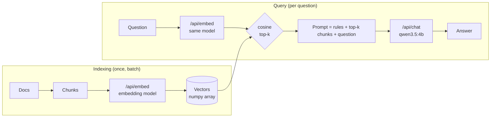

# Lab 05 — Embeddings, Vector Search & Local RAG

## 1. Core Concept & DevOps Analogy

An **embedding model** turns a text into a fixed-length list of numbers (a vector), so that texts with similar *meaning* get vectors that point in similar directions. Search then becomes geometry: embed the question, and find the stored vectors closest to it. That's **semantic search**, and it finds "my app keeps dying and coming back" in a runbook that only says "CrashLoopBackOff".

**RAG (Retrieval-Augmented Generation)** connects it to Lab 03 Step 6. There, the right reference in the prompt beat the model's own knowledge, and a wrong one won. RAG is the machinery that **picks** that reference automatically: chunk your docs, embed them once, and for each question retrieve the top-*k* chunks and put them in the prompt. Retrieval quality decides the answer quality: a chat model can't use a passage it was never shown.

DevOps analogy: an embedding index is a **search index built at deploy time**, like a pre-computed lookup table. Indexing (embed all chunks) is the batch job; querying (embed one question, compare) is the hot path. As with any index, the index and the queries must be built by the **same version of the same tool**: vectors from two different embedding models are no more comparable than two different hash functions.

## 2. Prerequisites & Hardware Budget

* Lab 03 Step 6 (grounding), Lab 04 Steps 2–4 (Python venv, the API).
* Embedding models (pulled 2026-10-27, approved):

| Model | Params | Quant | Dims | Context (card / loaded default) | Disk | VRAM (`/api/ps`) |
|---|---|---|---|---|---|---|
| `embeddinggemma:300m` | 307.6M | BF16 | 768 | 2,048 / 2,048 | 621 MB | ≈654 MiB |
| `qwen3-embedding:0.6b` | 595.8M | Q8_0 | 1,024 | 32,768 / **4,096** | 639 MB | ≈1,172 MiB |

* Both can be loaded next to `qwen3.5:4b` (≈3.9 GB) within the 8,500 MiB ceiling: different weights blobs, so different runners (Lab 04 Step 6).
* Python: the Windows venv (D-07), plus `numpy` (in `requirements.txt`). No vector database yet (D-10).

## 3. Architecture



**Verified before the experiment (2026-10-27):**
* The chat model can't embed here: `/api/embed` with `qwen3.5:4b` → **HTTP 501** "This server does not support embeddings. Start it with `--embeddings`" (the llama-server runner). Dedicated embedding models are the only option on this setup.
* `ollama show`: capabilities `embedding` (both). `qwen3-embedding` also lists `tools` and `thinking`, which come from its GGUF chat template, not from anything usable via `/api/embed`.
* Docs: `/api/embed` takes `input` (string or array), `truncate` (default `true`; `false` → error), `dimensions`, `keep_alive`, `options`. It "returns L2‑normalized (unit‑length) vectors"; "Use cosine similarity"; "Use the same embedding model for both indexing and querying". Response: `embeddings`, `total_duration`, `load_duration`, `prompt_eval_count`.
* First check: both return unit-length vectors (norm 1.0000), 768 and 1,024 dims. Oversized input with `truncate: false` → **HTTP 400** "the input length exceeds the context length". The first-ever load took 15–17 s each (Lab 02: the one-time CUDA kernel compile).
* Model cards: **embeddinggemma** wants prefixes on both sides: queries `task: search result | query: …`, documents `title: none | text: …`. **qwen3-embedding** wants an instruction on the query only (`Instruct: <task>\nQuery:…`), "No need to add instruction for retrieval documents"; without it, retrieval drops "by approximately 1% to 5%". Both support smaller (Matryoshka) dimensions.

## 4. Step-by-Step Guide

### Step 1 — What an embedding is, measured

`embed_basics.py` runs both models through four parts. Vectors stay in numpy; since they're unit length, **cosine similarity is just a dot product**.

* **Part 1, the vector:** dimensions, norm, cold load time, whether the same text twice gives the identical vector, whether a batch gives the same vectors as one-by-one, and the time per text in a batch of 48.
* **Part 2, similarity of 7 sentence pairs:** identical, paraphrase ("pod keeps restarting" / "stuck in a crash loop"), jargon vs plain words (`ImagePullBackOff` / "cannot download the image"), **negation** ("ready" / "not ready"), same topic but another task (Helm rollback / install), another language (Portuguese), unrelated (baking bread).
* **Part 3, a tiny retrieval:** 6 runbook passages (crash loop, OOM, image pull, Pending, Helm rollback, readiness) and 6 questions written **without the passages' keywords** ("my app keeps dying and coming back every few minutes"). For each model, with and without the card's prefixes: is the right passage ranked first, and by what **margin** over the best wrong one?
* **Part 4, input longer than the context:** ≈20,000 characters (≈5,000+ tokens). Is it truncated or rejected, how many tokens are embedded, and **which end is kept** (the long text's vector is compared with the vectors of its first and its last 3,000 characters)?

```powershell
.\.venv\Scripts\python scripts\embed_basics.py      # ≈1 minute; stops both models at the end
```

**Predictions:**

| Case | Prediction | Why |
|---|---|---|
| Norm | 1.0000 | Docs: L2-normalized |
| Same text twice | identical | No sampling in an embedding: one forward pass, deterministic on the same hardware (Lab 03 Step 2) |
| Batch vs one-by-one | **tiny differences** (≈1e-6), not exactly 0 | Batched math adds in a different order (Lab 03 Step 2: batch size changed the output). Harmless for search |
| ms per text | ≈5–20 ms (gemma faster) | 300–600M params vs 4B; ≈40-token inputs |
| identical pair | 1.000 | Same vector |
| paraphrase | high (≈0.7–0.9) | The whole point of embeddings |
| **negation** | **very high (≈0.9)**, higher than the paraphrase | Embeddings capture topic more than logic: "ready" and "not ready" are about the same thing. A known weakness |
| unrelated | **not 0**: ≈0.1–0.4 | Real embeddings don't spread over the full sphere; scores have a model-specific floor |
| other language | fairly high | Both models are trained on multilingual data (not verified per language) |
| **Scale per model** | the two models give **different numbers** for the same pairs | A threshold like "> 0.8 = match" doesn't transfer between models |
| Part 3 hits@1 | 5–6 of 6 for both; prefixes raise the **margin** more than the hits | 6 distinct topics are easy; the card says 1–5% |
| Part 4 default | no error; tokens embedded = **2,048** (gemma), **4,096** (qwen3: the loaded default, not the card's 32K) | `truncate: true` by default; Lab 04 Step 6: `num_ctx` defaults to 4,096 |
| Part 4 which end | **the start is kept** (vector closer to the first 3,000 chars) | Docs: "truncate inputs"; chat truncation kept the end (Lab 03), so this would be the opposite. Unknown |

What this means for RAG: if Part 4 shows silent truncation, **every chunk longer than the context loses its end without an error**, so chunk size must stay below the embedding model's context, and `truncate: false` (or counting `prompt_eval_count`) is the safety check.

### Step 2 — Retrieval quality on a labelled corpus

Step 1 had 6 queries: one miss moved the score by 17 points, so it couldn't compare anything. Step 2 builds a small **labelled evaluation set**, the retrieval equivalent of a test suite: questions whose right answer is known, so any change (model, prefix, chunking later) gets a number instead of an impression.

**The data (written for this lab, no private documents):**
* `corpus/*.md`: **18 synthetic runbooks**, ≈120–200 words each, all in the same shape (`# Title`, `## Symptoms`, `## Cause`, `## Fix`). Topics: CrashLoopBackOff, OOMKilled, eviction, ImagePullBackOff, Pending (resources), PVC Pending, readiness, liveness, DNS, expired certificates, Helm rollback, Helm "another operation in progress", Argo CD OutOfSync, Terraform state lock, node NotReady, HPA not scaling, stuck Terminating, ingress 502/503. The facts are standard Kubernetes/Helm/Terraform behavior; error strings are written as the tools print them.
* **Deliberate near-duplicates**, as in real runbook collections: readiness vs liveness, OOMKilled vs eviction, Helm rollback vs Helm "operation in progress", PVC Pending vs Pending for CPU, and "137" in both the OOM and the liveness runbooks.
* `questions.json`: **33 questions** in four types, each labelled with its runbook(s) and section (the section is for Step 3):

| Type | N | What it tests | Example |
|---|---|---|---|
| paraphrase | 10 | the same problem in other words, no shared keywords | "a worker machine dropped out of the cluster" → node NotReady |
| identifier | 10 | an exact error string or code, copied from the runbook | `TARGETS <unknown>/80%` → HPA |
| distractor | 6 | a near-identical runbook exists | "health check keeps failing while it is still starting up" → liveness, not readiness |
| knowledge | 7 | needs an inference the text doesn't spell out | "two people ran apply at the same time" → Terraform state lock |

One question has **two acceptable answers** (k01 "pod is up but gets no traffic": readiness *or* ingress 502/503), so the label doesn't punish a defensible answer (Lab 04 Step 4's ground-truth caveat).

**Methods** (`retrieval_eval.py`), one retrieval unit = one whole runbook (chunking is Step 3):
* **BM25**, the classic keyword ranking behind Elasticsearch/OpenSearch, implemented in ≈20 lines in the script so nothing is hidden: rare words that match count a lot, common words little, long documents are normalized.
* **Each embedding model, with and without the model card's prefixes** (gemma's document prefix uses the runbook's real title).
* **Hybrid:** BM25 and one embedding ranking merged with **reciprocal rank fusion** (RRF): each method adds `1/(60 + rank)` per runbook. It uses ranks, not scores, so it doesn't care that BM25 scores and cosine similarities have different scales (Step 1 Q2).
* Runbooks are embedded with `truncate: false`, so one that exceeded the context would fail instead of being cut silently (the Step 1 lesson).

**Metrics:** Hit@1 (right runbook first), **Hit@3** (it's in the top 3, i.e. in the prompt of a RAG system with *k* = 3), MRR (mean of 1/rank). Each Hit@1 is also split by question type, and every miss is listed with what came first.

```powershell
.\.venv\Scripts\python scripts\retrieval_eval.py      # ≈1 minute; stops both models at the end
```

**Predictions:**

| Method | paraphrase | identifier | distractor | knowledge | Overall Hit@1 / Hit@3 |
|---|---|---|---|---|---|
| BM25 | **weak**, ≈3–5/10 | **≈10/10** | ≈3–4/6 | weak, ≈2–3/7 | ≈55–65% / ≈75% |
| embeddings (either) | **≈8–9/10** | ≈7–9/10 (blurs exact codes, Step 1) | ≈3–5/6 | ≈4–5/7 | ≈70–80% / ≈90% |
| + prefixes | small gain or none | | | | ±1–2 questions (noise at 33) |
| hybrid | ≈ the better of the two per type | **≈10/10** | | | **the best overall**, Hit@3 ≈95% |

And:
* **Hit@3 well above Hit@1** for every method: retrieval is often "close", which is why RAG passes several chunks, not one.
* **qwen3 vs gemma: unknown.** Step 1 couldn't separate them; 33 questions still can't separate small differences (one question = 3 points), so only a gap of ≈4+ questions means something.
* The distractors: k = 3 retrieval will often contain **both** near-duplicates, and the chat model will have to pick (Step 4).

### Step 3 — Chunking: what is the retrieval unit?

So far a whole runbook was one unit. Real documents are longer than an embedding model's context (Step 1: the end gets dropped) and longer than you want in a prompt, so they're cut into **chunks**, and only the best chunks go to the chat model. How you cut decides what can be found: a chunk is all the search engine and the chat model ever see. Analogy: log aggregation. Index a whole day's log as one document and every search "finds" it but tells you nothing; index line by line and a stack trace is split into meaningless pieces.

**New questions first (Step 2 found author bias):**
* **18 `on-call` questions**, one per topic, written the way you'd type during an incident, from the topic list only, and deliberately **not** in the runbooks' words: "java app gets OOM'd even though grafana says the box has 20 gigs free", "tf in CI refuses to run, says someone else is holding it", "load balancer gives bad gateway for the checkout service". Caveat: written by the same author (me), so the bias is reduced, not removed. Questions from someone who hasn't read the runbooks would still be the better test.
* **3 `no-answer` questions** whose topic isn't in the corpus at all (etcd space exceeded, port-forward drops, rotating AWS keys). Search always returns *something*; the question is whether its score gives that away.
* Total: 51 answerable questions + 3 no-answer. Each answerable question has a labelled section (where the answer is: Symptoms, Cause or Fix).

**Five chunking strategies** (`chunking_eval.py`) on the same 18 runbooks:

| Strategy | Chunks | Idea |
|---|---|---|
| `doc` | 18 | one chunk per runbook: the Step 2 baseline |
| `section` | 54 | one chunk per `##` section, with only the section heading ("## Fix …") |
| `section+title` | 54 | the same, plus the runbook's `#` title in front: a **contextual header** |
| `fixed-60` | 49 | 60-word windows over the file, ignoring headings |
| `fixed-60/20` | 58 | 60-word windows overlapping by 20 words |

Searched with BM25, both embedding models (no prefixes; Step 2 found no effect), and the two hybrids. Scored at two levels:
* **Doc level:** the top chunk comes from the right runbook (enough to find the document).
* **Section level:** the top chunk *is* the labelled section of the right runbook, e.g. its Fix. That's what a RAG prompt actually needs: a chunk from the right runbook that doesn't contain the answer is useless to the chat model.

```powershell
.\.venv\Scripts\python scripts\chunking_eval.py      # ≈1–2 minutes; stops both models at the end
```

**Predictions:**

| Question | Prediction | Why |
|---|---|---|
| on-call questions vs Step 2's (doc strategy) | **lower for every method, BM25 most** | No borrowed vocabulary: the author-bias test |
| `section` vs `doc`, doc level | **lower**: a Fix section alone ("Raise `timeoutSeconds` …") lacks the topic's words | The chunk lost its context |
| `section+title` vs `section` | **higher**, close to `doc` at doc level | The title puts the topic back into every chunk |
| Section level vs doc level | **much lower**, ≈55–75% Hit@1 | Symptoms, Cause and Fix of one runbook share vocabulary; picking the right one of three is harder than picking the runbook |
| Section Hit@3 | high (≈85–95%) | With *k* = 3, the right runbook's three sections often all fit in |
| `fixed-60` vs `section+title` | **lower** | Windows cut through sections and have no title (except the first) |
| `fixed-60/20` vs `fixed-60` | slightly higher | Overlap keeps sentences that sit on a boundary in one chunk |
| hybrid | still the best in every strategy | Uncorrelated errors (Step 2) |
| no-answer top score | **lower** than most answerable questions, but **not below all of them** | No clean threshold (Q2): you can't reliably say "nothing found" from the score |

### Step 4 — RAG end to end

Steps 1–3 measured retrieval alone. Now the chat model reads what retrieval found and answers. A RAG answer can go wrong in two places, and they need different fixes: **retrieval** didn't bring the right runbook (fix the index, chunking, search), or the **reader** (the chat model) had it and didn't use it (fix the prompt or the model). Analogy: a 404 from the backend vs a backend that returned the right data and a frontend that rendered the wrong field. The script measures them separately.

**Setup** (`rag_answer.py`): retrieval is Step 3's best: section+title chunks, hybrid BM25 + qwen3-embedding. The embedding model is stopped before generation, so only `qwen3.5:4b` holds VRAM. Four ways to build the prompt, for all 51 answerable and 3 no-answer questions:

| Condition | What goes into the prompt | ≈ Prompt size |
|---|---|---|
| `closed-book` | nothing: the question only | ≈60 tokens |
| `chunks` | the top 3 section chunks | ≈350 tokens |
| `parents` | the **parent runbooks** of the top chunks, the first 3 distinct ones ("search small, return big", Q8) | ≈750 tokens |
| `oracle` | only the right runbook: what perfect retrieval would give | ≈350 tokens |

The rules (system prompt, from Lab 03 Step 6): use only the runbooks; **start the reply with the runbook id in brackets** (`[oomkilled]`), so the citation can be checked by code; at most 4 sentences with the applicable commands; and if no runbook answers it, reply exactly `NOT IN RUNBOOKS`. `closed-book` gets a plain "answer in at most 4 sentences, with commands". Think off, temperature 0, seed 42, `num_predict` 300, `truncate: false` (a prompt over 4,096 tokens would fail instead of being cut).

**Scored per answer, deterministically:**
* **In context:** the right runbook is in the prompt (retrieval's part).
* **Cited ok:** the reply starts with the right runbook's id (the reader's part).
* **Abstained:** `NOT IN RUNBOOKS`. Right for the 3 no-answer questions, a miss for the 51 others.
* **Unsupported items:** backticked commands or identifiers in the reply that **don't appear in the prompt's runbooks**, with placeholders allowed (`kubectl logs my-pod --previous` matches `kubectl logs <pod> --previous`; an invented flag doesn't). A rough hallucination measure. For `closed-book`, they're checked against the right runbook instead ("does the model's own answer match our runbook?").
* For a `parents` miss: **was the right runbook not retrieved, or retrieved but not cited, or retrieved and abstained?**

Not scored automatically: whether the answer is actually *right*. Every reply is saved to `results/raw/rag-answer-*.jsonl`, and the analysis reads them (Lab 03 habit: the scores, then the raw answers).

```powershell
.\.venv\Scripts\python scripts\rag_answer.py      # ≈7–10 minutes (213 answers); stops the models at the end
```

**Predictions:**

| Condition | In context | Cited ok | Wrongly abstained | No-answer abstained | Unsupported items |
|---|---|---|---|---|---|
| closed-book | – | – | – | – | **many**: real kubectl commands, but not our runbook's |
| chunks | ≈49/51 | ≈38–44 | **highest**, ≈5–10: the chunk often lacks the answer (Step 3: wrong section) | 2–3/3 | few |
| parents | ≈49–50/51 (= doc Hit@3) | **≈43–47** | ≈2–5 | 2–3/3 | few |
| oracle | 51/51 | ≈48–51 | ≈0–3 | – | fewest |

And:
* **oracle − parents** is what retrieval costs; **51 − oracle** is what the reader costs. Prediction: retrieval is the bigger loss on the on-call questions, the reader is near-perfect when the right runbook is there.
* **Lab 03 Step 6 found the strict "not in reference" rule over-abstains.** Expect a few wrong abstentions even with the right runbook in the prompt, more with `chunks`.
* **No-answer questions:** the model should abstain with `parents`, but may answer from a loosely related runbook ("port-forward drops" → crash loop) for at least one.
* `parents` costs ≈2× the prompt tokens of `chunks`, ≈0.1–0.2 s more per answer (prompt processing is fast, Lab 02).

### Step 5 — A vector store: sqlite-vec

Until now the "index" was a numpy array rebuilt on every run: embed 54 chunks, multiply, sort. That's fine for a lab, but a real system needs the vectors to **persist** (embed once, query for months), to sit **next to their metadata** (which runbook, which section, the text), and to be **queried by other programs**. A vector store does that. Analogy: the numpy array is an in-memory cache built at startup; the vector store is the database behind it.

**Verified before the experiment (2026-10-28):**
* Installed `sqlite-vec==0.1.9` in the venv (D-11, pinned in `requirements.txt`). SQLite 3.43.1 (Python 3.12's bundled one); `vec_version()` = `v0.1.9`. The README says "`sqlite-vec` is a pre-v1, so expect breaking changes!"
* `vec0` virtual tables: vectors as `float[N]`, `int8[N]` or `bit[N]`; **metadata columns** that can be filtered in a KNN query's `WHERE` (only `=`, `!=`, `>`, `>=`, `<`, `<=`); **auxiliary columns** (`+text`) that are stored but not filterable; queries use `emb match ? and k = N`. Tested here: `distance_metric=cosine` works, a `kind = 'b'` metadata filter works, and `vec_quantize_int8(v, 'unit')` / `vec_quantize_binary(v)` produce 8-byte / 1-byte vectors for 8 dims.
* **Not stated in the docs:** whether KNN is exhaustive or approximate. Part F measures it indirectly (time vs size, and top-1 = exact top-1).
* `*.db` is gitignored, so the index file (`labs/05-embeddings-rag/index.db`) stays out of Git, like weights and raw results.

`vector_store.py` (embedding model: `qwen3-embedding:0.6b`, dense search only, no BM25):

* **Part A, build:** embed the 54 section+title chunks once, insert them with `doc` and `section` as metadata and the text as an auxiliary column, plus three tables (float32, int8, bit), and a `meta` table that records **which model and chunking built the index**. File size, embedding time vs insert time.
* **Part B, same answers?** For all 54 questions: is sqlite-vec's ranking identical to numpy's dot product, and how far apart are the distances (`distance` = 1 − cosine)?
* **Part C, persistence:** close the file, reopen, answer without re-embedding. Then query with a 768-dim vector (embeddinggemma's size) against the 1,024-dim index.
* **Part D, metadata filter:** for the questions labelled "Fix", search only `section = 'Fix'`. When the question type is known ("how do I fix…"), does a filter beat the vector's own choice of section (Step 3's weak spot)?
* **Part E, quantized vectors:** float32 (4,096 bytes per vector) vs int8 (1,024) vs bit (128), and the common pattern **bit search for 30 candidates, then exact float32 re-ranking**. Doc and section Hit@1 / Hit@3.
* **Part F, scale:** 50,000 random 1,024-dim vectors in memory: insert rate, query time (float32 vs bit vs a numpy matrix product), and whether sqlite-vec's top-1 is the exact top-1.

```powershell
.\.venv\Scripts\python scripts\vector_store.py      # ≈1–2 minutes; stops the embedding model after Part A
```

**Predictions:**

| Part | Prediction | Why |
|---|---|---|
| A | file ≈0.5–1 MB; insert ≪ embedding time (milliseconds vs seconds) | Storing vectors is cheap; computing them is the expensive part |
| B | **identical rankings** (maybe a near-tie swapped), distance diff ≈1e-7 | The same cosine math, float32 vs numpy's float32/float64 mix |
| C | reopens in milliseconds; **the 768-dim query fails with an error** | vec0 knows its dimension; but a same-sized vector from another model would pass |
| D | section Hit@1 **rises clearly** for Fix questions | The filter removes the Symptoms/Cause sections that compete with the Fix |
| E | int8 ≈ float32 (±1); **bit clearly worse**; bit + re-rank ≈ float32 | Lab 02's quantization trade-off, applied to vectors; re-ranking recovers the precision on a short candidate list |
| F | sqlite-vec float32 a few tens of ms/query at 50k, slower than numpy; bit several times faster; top-1 exact 20/20 | A full scan (exhaustive search) in C over rows vs one BLAS matrix product; that would also be the signal that it's not an approximate index |

What the vector store is **not** expected to change: retrieval quality. The vectors are the same, so Steps 2–4's numbers hold; the store adds persistence, metadata, and speed/size options.

### Later steps (planned)
* Step 5 — A vector store (ChromaDB or sqlite-vec, decided then): what it adds over the numpy array (persistence, metadata filters, approximate search) and what it doesn't change (the vectors).

## 5. Hypotheses → Observed Metrics

### Step 1 — What an embedding is

Raw: `results/raw/embed-basics-20261027-225633.md`. Ollama 0.40.10. The losing passages were looked up afterwards with the same code and texts (not saved).

| Model | Dims | Norm | Load | Tokens for "The pod keeps restarting." | Same twice | Batch vs single | ms/text (batch of 48) |
|---|---|---|---|---|---|---|---|
| embeddinggemma:300m | 768 | 1.0000 | 2.51 s | 7 | identical | **max diff 0.0** | 17.3 |
| qwen3-embedding:0.6b | 1,024 | 1.0000 | 1.59 s | 6 | identical | **max diff 0.0** | 14.8 |

| Pair | gemma | qwen3 |
|---|---|---|
| identical | 1.000 | 1.000 |
| paraphrase ("keeps restarting" / "stuck in a crash loop") | 0.617 | 0.666 |
| jargon vs plain words (`ImagePullBackOff` / "cannot download the image") | **0.361** | 0.558 |
| **negation** ("ready" / "not ready") | **0.833** | **0.890** |
| same topic, other task (Helm rollback / install) | 0.628 | 0.680 |
| other language (Portuguese) | 0.758 | 0.648 |
| unrelated (baking bread) | 0.193 | 0.296 |

| Retrieval (6 passages, 6 queries) | Hits@1 | Mean margin | Missed |
|---|---|---|---|
| gemma, no prefixes | 5/6 | 0.135 | "pod is up but gets no traffic" → **pending** (0.537) over readiness (0.433) |
| gemma, prefixes | 5/6 | 0.145 | the same |
| qwen3, no prefixes | 4/6 | 0.098 | "no traffic" → pending; "my app keeps dying and coming back" → **oom** (0.568) over crashloop (0.448) |
| qwen3, prefix | 4/6 | 0.117 | "no traffic" → pending; "container killed, exit status 137" → **crashloop 0.601 vs oom 0.598** |

| Long input (19,158 chars) | Tokens embedded | `truncate: false` | Similarity to start / end |
|---|---|---|---|
| gemma (num_ctx 2,048) | 2,048, no error | HTTP 400 "the input length exceeds the context length" | **0.985** / 0.844 |
| qwen3 (num_ctx 4,096) | 4,095, no error | HTTP 400 | **0.980** / 0.830 |

| Prediction | Observed |
|---|---|
| Norm 1.0000 | ✅ |
| Same text twice: identical | ✅ |
| Batch vs single: tiny differences | ❌ **exactly identical** (0.0). Unlike generation in Lab 03, batching didn't change a single bit here |
| ≈5–20 ms/text, gemma faster | ✅ range; ❌ qwen3 was a little faster (14.8 vs 17.3). gemma is BF16, qwen3 Q8_0: both ≈600 MB of weights to read, so "fewer parameters" didn't mean less work |
| paraphrase ≈0.7–0.9 | ❌ lower: **0.62 / 0.67** |
| **negation higher than the paraphrase** | ✅ **0.83 / 0.89**, the highest non-identical pair in both models |
| unrelated not 0 (≈0.1–0.4) | ✅ 0.19 / 0.30 |
| other language fairly high | ✅ 0.76 / 0.65: gemma rates the Portuguese translation **above** the English paraphrase |
| different scales per model | ✅ qwen3 is higher across the board (floor 0.30 vs 0.19) |
| hits@1 5–6/6; prefixes raise the margin more than hits | ≈ 5/6 and 4/6; prefixes raised the margin a little (+0.01, +0.02) and didn't change hits |
| Part 4: no error, 2,048 / 4,096 tokens | ✅ 2,048 / **4,095** (one less; probably a token the model appends itself, not verified). qwen3 uses the 4,096 default, not its 32K |
| Part 4: the start is kept | ✅ start 0.98 vs end 0.83–0.84: **the end of the text is dropped**, the opposite of chat truncation (Lab 03 kept the end) |

What it shows:
* **An embedding measures "about the same thing", not "means the same thing".** "The pod is ready" and "The pod is not ready" were closer than a real paraphrase in both models. For retrieval that's mostly fine: both sentences belong in the same runbook. For anything that depends on *polarity* (is this a success or a failure log line?), similarity is the wrong tool; that's the chat model's job, or a filter.
* **Scores are relative, not absolute.** The same pair got 0.36 from one model and 0.56 from the other; the unrelated floor is 0.19 vs 0.30. A threshold like "similarity > 0.6 means relevant" is model-specific, like a latency SLO that only makes sense for one service. And "same topic, other task" (rollback vs install, 0.63–0.68) scored like the paraphrase: a question about rolling back will also pull up install docs.
* **Dense embeddings blur exact tokens.** "container killed, exit status 137" vs a passage that literally contains "exit code 137": qwen3 with the prefix ranked it second by **0.003**. A keyword search (BM25) would have found it instantly. Error codes, pod names and flags are exactly what engineers search for, so Step 2 measures BM25 next to the embeddings (hybrid search is the usual fix).
* **The hard query was one that needs knowledge, not words:** "pod is up but gets no traffic" means "removed from the Service endpoints", which is in the readiness passage. Both models sent it to the *Pending* passage (pod + something wrong). The embedding can only match what the text says, not what an engineer infers.
* **6 queries can't rank the models.** gemma 5/6 vs qwen3 4/6 is one query, and the prefix moved qwen3's miss from one query to another. That's noise at this size; Step 2's labelled set (20–30 questions) is there to measure it properly.
* **Long chunks lose their end silently.** Default `truncate: true` dropped everything after 2,048 (gemma) or 4,095 (qwen3) tokens, without an error and with HTTP 200. A runbook chunk whose fix is in its last paragraph would be indexed **without the fix**. Keep chunks well below the embedding model's context, and check `prompt_eval_count`, or use `truncate: false` while indexing so oversized chunks fail loudly.
* **Deterministic and batch-invariant:** the same text always gives the same vector, so an index can be rebuilt reproducibly, and batching while indexing is safe.

### Step 2 — Retrieval quality on a labelled corpus

Raw: `results/raw/retrieval-eval-20261027-231619.md`. 18 runbooks (3,418–3,512 tokens in total, ≈190 per runbook; the largest is far below both context limits, and `truncate: false` raised nothing), 33 questions.

| Method | Hit@1 | Hit@3 | MRR | paraphrase | identifier | distractor | knowledge |
|---|---|---|---|---|---|---|---|
| BM25 | 27/33 | 32/33 | 0.885 | **5/10** | **10/10** | 5/6 | 7/7 |
| embeddinggemma | **31/33** | 32/33 | 0.960 | 9/10 | 9/10 | 6/6 | 7/7 |
| embeddinggemma +prefix | 30/33 | 33/33 | 0.949 | 9/10 | 8/10 | 6/6 | 7/7 |
| qwen3-embedding | 29/33 | 32/33 | 0.932 | 9/10 | 9/10 | 6/6 | 5/7 |
| qwen3-embedding +prefix | 29/33 | 32/33 | 0.923 | 10/10 | 8/10 | 6/6 | 5/7 |
| hybrid BM25 + gemma +prefix | 32/33 | 33/33 | 0.985 | 9/10 | 10/10 | 6/6 | 7/7 |
| **hybrid BM25 + qwen3 +prefix** | **33/33** | 33/33 | **1.000** | 10/10 | 10/10 | 6/6 | 7/7 |

Misses (what came first instead):
* **BM25**, all paraphrases except d01: "pods got kicked off a machine that ran out of RAM" → node-notready (rank 5 for evicted); "a worker machine dropped out of the cluster" → coredns; "the storage request never gets a disk" → hpa-not-scaling; d01 "health check keeps failing while it is still starting up" → stuck-terminating.
* **gemma +prefix:** p01 "restarts over and over and the wait keeps growing" → liveness-probe; `toomanyrequests` → oomkilled (rank 3); `TARGETS <unknown>/80%` → ingress-5xx.
* **qwen3 +prefix:** `exit code 137` → crashloopbackoff (rank 3); `toomanyrequests` → pending-insufficient (**rank 8**); k01 "pod is up but gets no traffic" → pending-insufficient; k07 "two people ran apply at the same time" → argocd-outofsync.

| Prediction | Observed |
|---|---|
| BM25: paraphrase weak (≈3–5/10), identifier ≈10/10 | ✅ 5/10 and 10/10 |
| BM25: knowledge weak (≈2–3/7) | ❌ **7/7** (see "author bias" below) |
| BM25 overall ≈55–65% | ❌ 82% |
| embeddings: paraphrase ≈8–9/10, identifiers blurred (≈7–9/10) | ✅ 9–10/10 and 8–9/10 |
| embeddings overall ≈70–80% / Hit@3 ≈90% | ❌ higher: 88–94% / 97–100% |
| prefixes: small gain or none | ✅ none: −1 to 0 on Hit@1, both models lost one identifier |
| hybrid ≈ the better of the two per type, best overall | ✅ **better than both** in every column; 33/33 with qwen3 |
| Hit@3 well above Hit@1 | ✅ for BM25 (27 → 32); dense methods were already close to the ceiling |
| qwen3 vs gemma: unknown, needs a gap of ≈4 questions | gemma 31 vs qwen3 29: 2 questions, **not a meaningful difference** |

What it shows:
* **Keyword and semantic search fail on different questions, and that's why hybrid works.** BM25's 6 misses are paraphrases ("ran out of RAM" never says "eviction"); the embeddings' misses are mostly exact strings (`toomanyrequests`, `TARGETS <unknown>/80%`, `137`). No question was missed by both, so fusing the two rankings fixed everything. That's the case for hybrid search in one table, and RRF did it without any tuning or score calibration.
* **A meaningless token is the embedding's worst case.** `toomanyrequests` is one rare word with no semantic content for the model to place; qwen3 ranked its runbook **8th**. BM25 found it first because the word occurs in exactly one runbook (highest IDF). Error codes, request IDs, hostnames and image tags all look like this to an embedding.
* **The prefixes didn't help here**, and both cost one identifier question: `task: search result | query: toomanyrequests` turns a one-word query into mostly prefix. The model cards measure on general benchmarks; on this corpus the effect is within noise (1 question). Test before adopting a "recommended" setting, as with the sampling defaults in Lab 03.
* **The set is too easy to rank the embedding models.** Hit@3 is 32–33/33 everywhere, so every method would put the right runbook into a *k* = 3 prompt: a **ceiling effect**. 18 runbooks on 18 distinct topics are easy to tell apart. The difference between gemma and qwen3 (2 questions) is noise.
* **Author bias in the questions: BM25 got all 7 "knowledge" questions.** I wrote the questions while looking at the runbooks, and the knowledge ones leaked words from them: "apply" (Terraform), "Let's Encrypt", "metrics are not available", "CI job cancelled", "Unknown", "heap". A real user wouldn't know the runbook's vocabulary. That's the same lesson as Lab 04 Step 4's ground-truth caveat: **an eval set measures the questions as much as the system**. Questions written by someone who hasn't read the documents are the better test (see the next step's plan).

### Step 3 — Chunking

Raw: `results/raw/chunking-eval-20261027-232525.md` (first run crashed on the fixed windows, fixed in `7a94621`; the numbers of the first three strategies were identical in both runs). 51 answerable questions, 3 no-answer. One question ≈ 2 points, so differences of 1–2 questions are noise.

| Strategy | Chunks (tokens each) | Best doc Hit@1 | Best section Hit@1 | Best section Hit@3 | Section unreachable |
|---|---|---|---|---|---|
| doc | 18 (195) | 46/51 (hybrid gemma) | – | – | – |
| section | 54 (63) | 46/51 (qwen3) | **35/51** (hybrid gemma) | 45/51 | 0 |
| section+title | 54 (71) | 46/51 (hybrid qwen3) | 33/51 (hybrid qwen3) | 45/51 | 0 |
| fixed-60 | 49 (70) | 42/51 (hybrid qwen3) | 22/51 (hybrid qwen3) | 30/51 | **12** |
| fixed-60/20 | 58 (79) | 42/51 (hybrid qwen3) | 26/51 (hybrid qwen3) | 40/51 (qwen3) | **5** |

The new questions (doc strategy, doc-level Hit@1):

| Method | Step 2's types (33) | on-call (18) |
|---|---|---|
| BM25 | 27/33 (82%) | **10/18 (56%)** |
| embeddinggemma | 31/33 (94%) | 13/18 (72%) |
| qwen3-embedding | 29/33 (88%) | 13/18 (72%) |
| hybrid BM25 + gemma | 32/33 (97%) | 14/18 (78%) |

At section level (section+title), the on-call questions scored **2/18 (BM25) to 8/18 (hybrid qwen3)**.

Of hybrid qwen3's 18 section-level misses, **13 had the right runbook but the wrong section** (Symptoms instead of Cause, etc.). The other 5 (the 51 − 46 doc-level misses): `toomanyrequests` → argocd; o05 "4 of them just sit there unscheduled" → argocd/Fix (rank 9); o07 "new pods never join the load balancer" → crashloop/Fix (rank 25); o08 "spring boot needs 3 minutes to boot and k8s kills it" → crashloop/Symptoms (rank 13); o12 → helm-rollback instead of helm-upgrade-failed.

No-answer questions (section+title): top-1 similarity 0.46 / 0.57 / 0.41 (gemma) and 0.52 / 0.48 / 0.40 (qwen3), against answerable questions' top-1 of 0.35–0.77 (gemma) and 0.39–0.78 (qwen3). gemma's "port-forward drops" (0.572) scored **higher than 25 of the 51 answerable questions**, and went to crashloop/Cause.

| Prediction | Observed |
|---|---|
| on-call lower for every method, BM25 most | ✅ BM25 82% → 56%, embeddings 88–94% → 72% |
| `section` lower than `doc` at doc level | ≈ mixed: gemma 44 → 41, **qwen3 42 → 46**, hybrids ±1–2. Within noise, except that qwen3 did better on small chunks |
| `section+title` higher than `section` | ❌ **no effect** (±2 either way) |
| section level ≈55–75% Hit@1 | ✅ 47–69% for the section strategies |
| section Hit@3 ≈85–95% | ✅ 78–88% for the section strategies (a bit lower) |
| fixed-60 lower than section+title | ✅ clearly: 22 vs 33 at section level, and 12 sections had no window of their own |
| overlap slightly higher | ✅ 22 → 26 at section level; unreachable sections 12 → 5 |
| hybrid still the best | ✅ at section level in every strategy; at doc level it ties with qwen3 alone on `section` |
| no-answer below most but not all | ✅ no threshold separates them (below) |

What it shows:
* **Finding the document is the easy part; finding the paragraph is hard.** Doc level reached 46/51 for every structured strategy, but the right *section* came first only 31–35 times, and 13 of 18 misses were the right runbook with the wrong section. Symptoms, Cause and Fix of one runbook share their vocabulary, so for a question that describes symptoms but needs the cause, the three sections score almost alike. Labels are part of it too: "postgres statefulset won't come up, its disk never gets created" was labelled Cause, but the Symptoms section is a defensible match (the Step 2 ground-truth caveat again).
* **So: search small, return big.** Small chunks are where the match is precise, but the chat model needs the context around it. With runbooks of ≈195 tokens, the practical design is to search sections (hybrid) and **put the whole parent runbook in the prompt**: 3 runbooks ≈ 600 tokens, far below the 4,096 context. This is called parent-document or "small-to-big" retrieval. It would have turned 13 of the 18 misses into hits, because the parent runbook of the top chunk was right.
* **Chunk on the document's structure, not on a word count.** Fixed 60-word windows were worse at both levels, and **12 labelled sections owned no window** (a short Symptoms section split between two windows is the majority of neither): that content can only be found as a fragment of something else. Overlap halved the damage (5) but didn't remove it. Markdown headings are free boundaries; use them.
* **The contextual title did nothing here.** Probably because the topic was already identifiable (doc level was 46/51 with or without it), and the title is the same for all three sections of a runbook, so it can't help choose *between* them, which is where the misses were. It helps when chunks from different documents look alike without their title, which this corpus (one runbook per topic) rarely has.
* **Real questions are much harder than author questions.** The on-call set (same author, but without the runbook's words) lowered BM25 from 82% to 56% and the embeddings from ≈90% to 72%. At section level, on-call was 2–8 of 18. Step 2's 100% was the ceiling effect plus author bias, as suspected. **Measure with the questions your users ask.**
* **"Nothing found" can't be read from the score.** The no-answer questions landed among the answerable ones. A cut-off at 0.45 would have rejected two of three no-answer questions for gemma, but also several real ones, and still let "port-forward drops" (0.57) through. Saying "I don't know" must come from the chat model reading the chunks (Lab 03 Step 6's strict rule), not from retrieval alone.

### Step 4 — RAG end to end

#### Run 1: the prompt's example became the answer

Raw: `results/raw/rag-answer-20261027-233533.jsonl` (213 answers).

| Condition | In context | Cited ok (as scored) | Abstained (as scored) | No-answer abstained (as scored) | Unsupported items | Prompt tokens | s/answer |
|---|---|---|---|---|---|---|---|
| closed-book | – | – | – | – | **130/174** | 55 | 0.9 |
| chunks | 49/51 | 37/51 | 2/51 | 1/3 | 6/103 | 368 | 0.7 |
| parents | 50/51 | 36/51 | 1/51 | 1/3 | 2/114 | 714 | 0.8 |
| oracle | 51/51 | **35/51** | 0/51 | – | 3/127 | 323 | 0.8 |

The oracle, with *only* the right runbook in the prompt, scored the **lowest**. Reading the replies showed why: **all 16 oracle misses cited `[oomkilled]`**, the id used as the example in the rules ("for example [oomkilled]"), and the oomkilled runbook wasn't in a single one of those prompts. The same happened in 9 (chunks) and 10 (parents) answers. Most of those replies then answered from the right runbook ("[oomkilled] Run `helm history <release> -n <namespace>` …"). A second scoring gap: the model refused in its own words ("[not in runbooks]", "The provided runbooks do not contain …") instead of the exact phrase, so the check `"NOT IN RUNBOOKS" in reply` missed it.

Recounted from the saved replies, with refusals in any phrasing:

| Condition | Cited ok | Cited the example, answered anyway | Refused although the right runbook was in the prompt | No-answer refused |
|---|---|---|---|---|
| chunks | 37 | 5 | 4 | **3/3** |
| parents | 36 | 8 | 2 | **3/3** |
| oracle | 35 | 9 | **7** | – |

What run 1 shows:
* **A concrete example in the instructions is a default the model falls back on.** When unsure (or when refusing), the 4B model reached for the one id it had been shown. It's few-shot prompting by accident: Lab 03 found that order and wording change answers, and here a single example token became the most common "citation". Use a placeholder description ("copied exactly from the line above that runbook"), not a real value, or show several varied examples.
* **A metric that depends on output format measures format compliance first.** "Cited ok" and "abstained" were both partly measuring whether the model followed the bracket/phrase format. Reading the raw answers (not only the table) is what caught it, the same habit as the scorer fixes in Lab 03.
* **Over-refusal is real and was hidden:** with the oracle runbook in the prompt, the model still said "do not contain" 7 times, including i05, where the exact error string `UPGRADE FAILED: another operation …` is in the runbook ("uses different terminology and does not match"). With 3 runbooks (parents) it refused only twice. The strict rule from Lab 03 Step 6 still over-abstains.
* **No-answer questions: refused 3/3 in substance** with chunks and parents, but in three different formats ("[not in runbooks]", "[readiness-probe] The provided runbooks do not contain …", "[terraform-state-lock] NOT IN RUNBOOKS"): even a refusal came with a citation. Closed-book answered all three confidently (`etcdctl snapshot status`, `aws configure`).
* **Grounding works for the commands:** 75% of closed-book items (130/174) aren't in our runbooks: mostly real commands, but not the documented ones (`kubectl drain`, `kill -9`, `docker network inspect`, `openssl x509 -noout -dates` where the runbook says `-enddate`). With retrieval, 2–5% (2–6 per ≈110). The answers quote the runbooks instead of the model's general knowledge.

**v2 (`rag_answer.py`, for run 2):** no concrete id in the rules ("in square brackets, copied exactly from the line above that runbook"); a refusal is `[none] NOT IN RUNBOOKS`; refusals are detected in any phrasing (`not in runbooks`, "do/does not contain/address/cover/match/mention/include"); a new column **"cited not in prompt"** counts citations of a runbook that wasn't there (the anchoring signature). Everything else is unchanged, so run 2 shows what the prompt fix changes.

#### Run 2: v2 prompt

Raw: `results/raw/rag-answer-20261027-234549.jsonl`. Same questions, retrieval and model; closed-book is identical to run 1 (its prompt didn't change, temperature 0).

| Condition | In context | Cited ok | Wrongly refused | No-answer refused | Cited not in prompt | Unsupported items | Prompt tokens | s/answer |
|---|---|---|---|---|---|---|---|---|
| closed-book | – | – | – | – | – | 130/174 | 55 | 0.9 |
| chunks | 49/51 | **44/51** (run 1: 37) | 4 | **3/3** | **0** | 2/107 | 375 | 0.7 |
| parents | 50/51 | **47/51** (36) | 0 | **3/3** | **0** | 2/134 | 722 | 0.8 |
| oracle | 51/51 | **49/51** (35) | 2 | – | **0** | 5/138 | 330 | 0.8 |

| Cited ok per type | paraphrase | identifier | distractor | knowledge | on-call |
|---|---|---|---|---|---|
| chunks | 10/10 | 9/10 | 6/6 | 7/7 | 12/18 |
| parents | 10/10 | 9/10 | 6/6 | 7/7 | **15/18** |
| oracle | 10/10 | 9/10 | 6/6 | 7/7 | 17/18 |

The misses, from the replies:
* **parents (4):** o07 "new pods never join the load balancer": readiness **not retrieved**, and the model **answered anyway** from the crash-loop runbook ("the new pods failing to start due to configuration errors …"), with no refusal. o05 "4 of 12 replicas sit there unscheduled": the right runbook was there, the model chose Argo CD ("Argo CD is trying to manage replica counts"). o08 "spring boot needs 3 minutes and k8s kills it": chose crash loop over liveness. i04 `toomanyrequests`: cited three ids (`[argocd-outofsync] [coredns] [imagepullbackoff]`) and then answered correctly about the Docker Hub rate limit: a format miss, not a content miss.
* **oracle (2):** i04 and o04 (both image pull) refused with only the image-pull runbook in the prompt, although it contains `toomanyrequests` and `ErrImagePull` verbatim.
* **chunks (7):** 4 refusals (o04, o06, o15, and i04 where the runbook wasn't retrieved): the 3 sections in the prompt didn't contain the answer, which is Step 3's wrong-section problem showing up as "NOT IN RUNBOOKS".
* **Unsupported items with retrieval (9 in 379)** are mostly commands written out from the runbook's prose ("read the logs of the CSI provisioner pods" → `kubectl logs <csi-provisioner-pod>`), which the check can't recognize. Two are real errors: `lifecycle.probes.liveness.initialDelaySeconds` (not a Kubernetes field path) and `nslookup orders-db.svc.cluster.local` (the namespace is missing; the runbook says `<service>.<namespace>.svc.cluster.local`).

| Prediction | Observed |
|---|---|
| chunks: cited ≈38–44, most wrong refusals (≈5–10) | ✅ 44, and 4 refusals: the most of the three |
| parents: cited ≈43–47, ≈2–5 wrong refusals | ✅ 47; ❌ better: **0** refusals |
| oracle: ≈48–51 | ✅ 49 |
| No-answer refused 2–3/3, at least one answered from a loosely related runbook | ✅ 3/3; ❌ none answered from a wrong runbook |
| Retrieval is the bigger loss, the reader near-perfect | ❌ **the reader was the bigger loss for parents**: 1 retrieval miss vs 3 reader misses (the oracle's 49 shows the reader alone loses 2) |
| closed-book: many unsupported, real commands | ✅ 130/174 |
| parents ≈2× tokens, ≈same time | ✅ 722 vs 375 tokens, 0.8 vs 0.7 s |

What it shows:
* **Fixing the prompt was worth more than any retrieval change.** Removing one example id raised the cited-ok rate by 7–14 answers per condition; citations of absent runbooks went from 9–16 to **0**. Steps 2–3's retrieval tuning moved results by 1–4 questions. Prompt and output format are part of the system, and the first place to look.
* **"Search small, return big" confirmed end to end:** parents 47/51 vs chunks 44/51, and the chunks' extra misses are refusals where the right section wasn't among the three. Doubling the prompt (375 → 722 tokens) cost ≈0.1 s per answer.
* **When retrieval misses, the reader doesn't notice.** o07 had no readiness runbook in the prompt and got a confident wrong answer from the crash-loop runbook instead of `NOT IN RUNBOOKS`. The refusal rule worked for questions with *nothing* related (3/3), but not for a question with a *plausible but wrong* runbook. This is the Lab 03 Step 6 "poisoned reference" effect again: the context wins, even when it's the wrong context.
* **The remaining reader errors are judgment calls between plausible runbooks** (o05 Argo CD vs Pending, o08 crash loop vs liveness): on-call questions only (15/18 vs 17/18 with the oracle). And the 4B reader also refuses the right runbook occasionally (i04, o04 with the oracle). A bigger model (`qwen3.5:9b`) would be the experiment for the reader side.
* **Grounding changed what the commands are:** 75% of closed-book commands are not the documented ones; with retrieval, 2% (9/379), and most of those are faithful renderings of prose. The two real errors are subtle (a made-up field path, a missing namespace): exactly the kind a human skimming the answer would not catch.
* **Measurement limits:** "cited ok" checks the citation, not the whole answer; the replies were read for the misses and spot-checked for hits, not graded one by one. And the questions are still author-written.

#### Run 3: a bigger reader, `qwen3.5:9b`

Same v2 prompt, retrieval and questions; only the reader changes (`rag_answer.py --chat qwen3.5:9b`). The embedding model is stopped before generation, so VRAM is the 9b alone (≈6,450 MiB at 4K, Lab 02; within the 8,500 MiB ceiling).

**Predictions (written before the run):**

| Measure | 4b (run 2) | 9b prediction | Why |
|---|---|---|---|
| oracle cited ok | 49/51 | **50–51/51** | The 2 refusals (i04, o04) had the answer verbatim; a bigger model reads more carefully |
| parents cited ok | 47/51 | ≈48–49/51 | The judgment calls (o05 Argo CD, o08 crash loop) may flip; **o07 stays wrong** (not retrieved: no reader can fix it) |
| chunks cited ok | 44/51 | ≈45–46/51 | Fewer wrong refusals, but the wrong-section problem is retrieval's |
| no-answer refused | 3/3 | 3/3 | Already perfect |
| closed-book unsupported | 130/174 | **about the same share** | More knowledge, but still not *our* runbooks |
| s/answer | 0.7–0.9 | ≈1.0–1.4 | ≈85 vs ≈120 tok/s (Lab 02), plus slower prompt processing |

**Observed** (raw: `results/raw/rag-answer-qwen3.5-9b-20261027-235343.jsonl`; run by Claude, at the user's request). During generation: `ollama ps` 100% GPU, 4,096 context; `nvidia-smi` 8,794 MiB used vs 2,508 MiB idle, so the 9b took ≈6,290 MiB.

| Condition | Cited ok 4b → 9b | Wrongly refused 4b → 9b | No-answer refused 4b → 9b | Unsupported 4b → 9b | s/answer 4b → 9b |
|---|---|---|---|---|---|
| closed-book | – | – | – | 130/174 → 160/209 | 0.9 → 1.4 |
| chunks | 44 → **42** | 4 → **7** | 3/3 → **2/3** | 2/107 → 9/127 | 0.7 → 1.0 |
| parents | 47 → **47** | 0 → **3** | 3/3 → 3/3 | 2/134 → 0/130 | 0.8 → 1.1 |
| oracle | 49 → **48** | 2 → **3** | – | 5/138 → 4/130 | 0.8 → 1.0 |

Question by question, the two readers mostly agree; the flips go both ways:
* **parents:** the 9b fixed o08 (liveness, not crash loop) and lost p09 (refused, with the PVC runbook in the prompt). And **o07**, the retrieval miss: the 4b answered confidently from the crash-loop runbook, the **9b replied `[none] NOT IN RUNBOOKS`**: still a miss in the table, but the safe kind.
* **chunks:** the 9b fixed o05 and o15, and lost p07, p08, p09 (refusals) and k06. It also **answered a no-answer question** (n02 "port-forward drops") with an invented explanation from the readiness runbook ("the underlying pod is restarting due to a failing readiness probe, causing the service endpoint to become stale"), where the 4b had refused.
* **oracle:** the 9b refused i04 (like the 4b) and o05.

| Prediction | Observed |
|---|---|
| oracle 50–51 | ❌ 48 |
| parents ≈48–49, o07 stays wrong | ❌ 47; o07 still a miss, but now a refusal instead of a wrong answer |
| chunks ≈45–46 | ❌ 42 |
| no-answer 3/3 | ✅ parents; ❌ chunks 2/3 |
| closed-book: same share unsupported | ✅ 75% → 77% (longer answers: median 110 vs 98 tokens) |
| ≈1.0–1.4 s/answer | ✅ 1.0–1.4 s, ≈1.4× the 4b |

What it shows:
* **A 2× bigger reader didn't score better on this task:** 47 = 47 with parents, ±1–2 elsewhere, which is noise at 51 questions. The 4b already gets everything right that the prompt makes clear; the remaining errors come from ambiguity (two plausible runbooks), retrieval, and the strict refusal rule, not from the reader's capacity. Cost: ≈1.4× the time and ≈6.3 vs ≈3.9 GB of VRAM for no gain. As in Phase 2: **bigger isn't automatically better; measure on your task.**
* **The 9b behaves differently, not better: more cautious.** It refused more where the answer was there (wrong refusals 0 → 3 with parents), and it refused where retrieval had failed (o07). That's the precision/recall trade-off of Lab 03 Step 6 and Lab 04 Step 4 again, now between models: a more cautious model makes fewer dangerous errors and more useless ones. Which one you want depends on what a wrong answer costs. For an on-call bot, refusing o07 is worth more than answering p09.
* **Not monotonic:** the same 9b that refused o07 invented an explanation for a no-answer question in `chunks`. One run per question at temperature 0 can't separate "the 9b is safer" from "the 9b is different on these few questions": the flips are 1–4 per condition.
* **The unsupported-items check has false positives** that show up more with a chattier model: `node-7` comes from the *question*, `READY 0/1` is the runbook's "READY shows `0/1`" re-quoted. A real check would compare against the question and the prompt as a whole, or normalize quoting.

### Step 5 — sqlite-vec

Raw: `results/raw/vector-store-20261028-000335.md`. sqlite-vec v0.1.9, SQLite 3.43.1, qwen3-embedding:0.6b, dense search only (no BM25).

| Part | Observed |
|---|---|
| A, build | 54 chunks, 3,752 tokens. Embedding **3.54 s** (incl. load) vs insert **0.070 s**. File **5,452 KiB**, while the float32 vectors are 216 KiB |
| B, same answers | identical full ranking **54/54**, identical top 3 54/54; largest distance difference 1.07e-6. Dense Hit@1: doc 45/51, section 24/51, **exactly Step 3's numbers** for qwen3 on section+title |
| C, persistence | reopened and answered in **13.9 ms**, `meta` intact. 768-dim query: `OperationalError: Dimension mismatch for query vector for the "emb" column. Expected 1024 dimensions but received 768.` |
| D, filter (6 Fix questions) | section Hit@1 **2/6 → 5/6** with `section = 'Fix'`; doc Hit@3 6/6 → 5/6 |
| E, quantized | float32 45/47/24/44 (doc@1, doc@3, sec@1, sec@3); **int8 45/48/24/44**; **bit 41/46/23/43**; **bit top 30 + float32 re-rank 45/47/24/44** |
| F, 50,000 vectors | insert 1.5 s (32,789/s). Query: sqlite-vec float32 **91.4 ms**, sqlite-vec bit **1.9 ms**, numpy **8.7 ms**. Top-1 = exact 20/20 |

| Prediction | Observed |
|---|---|
| A: file ≈0.5–1 MB, insert ≪ embedding | ❌ **5.3 MB**; ✅ insert 50× faster than embedding |
| B: identical rankings, diff ≈1e-7 | ✅ identical; diff 1e-6 (float32 rounding) |
| C: reopens in ms, 768-dim query fails | ✅ both |
| D: section Hit@1 rises clearly | ✅ 2/6 → 5/6 |
| E: int8 ≈ float32, bit worse, bit + re-rank ≈ float32 | ✅ all three (bit −4 at doc Hit@1, fully recovered by re-ranking) |
| F: tens of ms, slower than numpy, bit several× faster, top-1 exact | ✅ but slower than expected: **91 ms**, 10× numpy; bit 48× faster than float32 |

What it shows:
* **The store changed nothing about quality**, as expected: the same rankings as numpy, to 1e-6, and the same Hit rates as Step 3. Vectors in, the same vectors out. Retrieval quality comes from the embedding model, the chunking and the search method, never from the database.
* **What it adds is operational:** embed once (3.5 s) and query forever (a reopen + query in 14 ms); the metadata lives with the vectors; and the index **knows its dimension** and rejects a 768-dim query. But a different 1,024-dim model would pass that check: only the `meta.model` row protects against mixing models, so a real index should verify it on every open, like a schema version check before a migration.
* **The file is 25× bigger than its vectors.** 5,452 KiB for 216 KiB of float32. The numbers fit a storage layout that reserves space in blocks of 1,024 rows per table: 1,024 × 4,096 B (float32) + 1,024 × 1,024 B (int8) + 1,024 × 128 B (bit) = 5,248 KiB, plus ≈200 KiB of SQLite pages for text and metadata. That's an inference from the arithmetic, not from the docs. It's a fixed cost: at 1,000 chunks the file would hardly grow. Same lesson as Lab 01's `SIZE` column: measure the real footprint.
* **Filters fix what similarity can't.** Step 3's weak spot (the right runbook, the wrong section) mostly disappears when the query says what kind of section it wants: 2/6 → 5/6. Only 6 questions, but a large effect. The catch: something has to *know* that the question is a "how do I fix" question, which in a real system means classifying the query first (a rule, or the chat model). Metadata filters are the vector-search equivalent of a label selector.
* **Vector quantization works like weight quantization in Lab 02:** int8 (4× smaller) lost nothing, bit (32× smaller) lost 4 of 51 at Hit@1, and **bit search + float32 re-ranking of 30 candidates lost nothing** while scanning 128 bytes per vector instead of 4,096. That two-stage pattern is the standard trick for large indexes.
* **sqlite-vec scans everything**, and at 50,000 vectors it shows: 91 ms per query, linear in the number of rows (every probe's exact top-1 was found, 20/20, consistent with exhaustive search; not proof). numpy does the same work in 8.7 ms as one BLAS matrix product. For this lab's 54 chunks none of this matters (sub-millisecond), but at a million chunks float32 would be ≈2 s per query: that's where approximate indexes (HNSW, IVF) or the bit pre-filter come in. Right-size the tool: a full scan is the simplest correct index, like a sequential scan in Postgres for a small table.

## 6. Troubleshooting & Failure Modes

| Symptom | Likely cause | Check |
|---|---|---|
| `/api/embed` → 501 "does not support embeddings" | A chat model was given to `/api/embed` | Use an embedding model (`ollama show` → capabilities `embedding`) |
| Search results suddenly all wrong after a change | Index and queries embedded with different models (or prefixes) | Store the model name with the index; re-embed everything after a model change |
| First request takes 15+ s | First-ever load of a new model compiles CUDA kernels (Lab 02) | Only once per model; later loads are fast |

## 7. Cleanup

`ollama stop embeddinggemma:300m`, `ollama stop qwen3-embedding:0.6b`. To remove the models (≈1.26 GB): `ollama rm` each (ask first; later steps use them).

## 8. Check Your Understanding

Try to answer each one before opening the answer.

**1. "The pod is ready" vs "The pod is not ready" scored 0.83–0.89, higher than a real paraphrase (0.62–0.67). Is the embedding broken?**

The paraphrase pair was "The pod keeps restarting." / "The container is stuck in a crash loop."

*What does cosine similarity actually measure, and where would this behavior hurt you in a RAG system or a log pipeline?*

<details><summary>Answer</summary>

It isn't broken; it's doing what it was trained for. An embedding places texts by **what they're about**: the same words, the same subject, the same context of use. "Ready" and "not ready" share almost every token and appear in exactly the same documents (readiness probes, pod status), so they land close together. The paraphrase uses different words ("restarting" vs "crash loop") and has to be matched by learned meaning, which is a harder and weaker signal.

For retrieval this is mostly what you want: a question about a pod that isn't ready *should* find the readiness runbook. It hurts where the **polarity** matters:

* Classifying log lines as success/failure by similarity to examples: "deployment succeeded" and "deployment failed" will look alike.
* Deduplicating alerts by similarity: "disk usage is below 80%" and "disk usage is above 80%" would merge.
* A RAG answer that needs "when does it NOT restart": retrieval brings the right passage, but the **chat model** has to read the "not" (Lab 03 Step 6 showed it can).

Rule: use embeddings to find *candidates* by topic, and use exact filters or the chat model for logic. It's like a search index: it finds the right file, but `grep -v` is still a separate step.
</details>

**2. A teammate proposes "anything above 0.6 similarity is relevant". What's wrong with that?**

The same pairs, scored by the two models: jargon vs plain words 0.36 vs 0.56, unrelated 0.19 vs 0.30, same topic but other task 0.63 vs 0.68.

*Why doesn't a fixed threshold work, and what would you do instead?*

<details><summary>Answer</summary>

Similarity values have no absolute meaning; each model has its own scale. qwen3's score for an unrelated pair (0.30) is almost as high as gemma's score for a correct jargon match (0.36). 0.6 would reject the right jargon match for gemma and accept "Helm install" for a rollback question with both. And the threshold would silently change meaning the day you switch models.

Instead:

* **Rank, don't threshold:** take the top-*k* (Step 2 measures which *k*) and let the chat model ignore what's irrelevant.
* If you need a cut-off (to answer "I don't know" when nothing matches), **calibrate it per model on labelled data**: the scores of right vs wrong passages for real questions. Store the model name next to the threshold.
* Look at the **margin** (best minus second best) as well as the score: a top result that barely beats the rest is a weak match.

It's the same as alert thresholds: a CPU threshold tuned on one instance type doesn't carry over to another; you set it from that system's own baseline.
</details>

**3. "container killed, exit status 137" didn't reliably find the passage that contains "exit code 137". Why, and what's the fix?**

qwen3 with the prefix ranked the OOM passage second, 0.598 vs 0.601. The other model found it, and it's the one query that shares an exact token with its passage.

*Why are dense embeddings weak at exact identifiers, and why does that matter for engineering docs in particular?*

<details><summary>Answer</summary>

An embedding compresses a whole text into 768–1,024 numbers that represent its overall meaning. One token like "137" is a small part of that, and numbers carry little meaning on their own, so it barely moves the vector. "container killed" pulled the query toward "a container exits repeatedly" just as strongly.

Engineering search is full of exact identifiers: exit codes, error strings (`ImagePullBackOff`), flags (`--previous`), resource names, versions. Keyword search (BM25, the algorithm behind Elasticsearch/OpenSearch scoring) is excellent at exactly those and weak at paraphrases. Embeddings are the opposite. So the standard fix is **hybrid search**: run both, and merge the rankings (for example with reciprocal rank fusion). Step 2 adds BM25 as a baseline to measure how often each one wins on this lab's questions.

Analogy: label selectors vs free-text search. When you know the exact label, you don't want "something similar".
</details>

**4. A 19,000-character text was embedded with HTTP 200 and no warning. What did the index actually store?**

gemma embedded 2,048 tokens and qwen3 4,095. The long text's vector was 0.98 similar to its first 3,000 characters and 0.83–0.84 to its last 3,000. With `truncate: false`, both returned HTTP 400.

*What does this mean for chunking, and how would you make the indexing job fail loudly?*

<details><summary>Answer</summary>

The index stored a vector for **the beginning of the text only**. Everything after the context limit was dropped, and nothing in the response says so except `prompt_eval_count`. Note that this is the opposite of chat truncation (Lab 03 kept the end and dropped the start), so "which part gets lost" depends on the endpoint.

For RAG, that means a question about something in the dropped part can never retrieve this chunk, however good the model is. A runbook section with the symptoms first and the fix last would be found for the symptoms but would be indexed **without its fix**, so the retrieved text could still contain it (if you store the full text) but its vector doesn't represent it.

Making it fail loudly:

* **Chunk below the limit:** sizes measured in tokens, with a margin (Step 3), not in characters.
* **`truncate: false` while indexing:** an oversized chunk becomes an HTTP 400, and the job fails or splits it, like a schema validation step in CI.
* **Check `prompt_eval_count`** against the limit (2,048 / 4,095 here) and log it.
* Remember that qwen3's "32K" is only on the card: it loaded with **4,096**, the server default (Lab 04 Step 6).
</details>

**5. BM25 got 27/33, the best embedding 31/33, and the hybrid 33/33. Why was the hybrid better than both, not just as good as the better one?**

BM25 missed 6 paraphrases ("pods got kicked off a machine that ran out of RAM" → node-notready). qwen3 missed `toomanyrequests` (rank 8), `exit code 137` and two knowledge questions. RRF only adds `1/(60 + rank)` from each ranking.

*What property of the two methods' errors makes fusion work? When would it not help?*

<details><summary>Answer</summary>

Their errors were **uncorrelated**: no question was missed by both. When one method ranks the right runbook 5th or 8th and the other ranks it 1st, the fused score of that runbook (≈1/61 + 1/68) beats a runbook that only one method liked (≈1/61 + something far down). Fusion picks the candidate both methods agree is plausible.

That's the same reason two different monitoring signals (black-box probe + metrics) catch more than either alone: they fail for different reasons. It would **not** help when both methods fail together: a question that shares no words with its runbook *and* needs an inference the embedding can't make (k01 "no traffic" leaned that way), or a corpus where the right answer isn't in any document at all. And fusing two similar methods (two embedding models) helps less, because their errors are correlated.

RRF's other advantage: it ignores raw scores, so there's nothing to calibrate between BM25 values (unbounded) and cosine similarities (model-specific, Step 1 Q2).
</details>

**6. Every method scored Hit@3 of 32–33/33. What does that tell you about the evaluation set?**

18 runbooks, one per topic, ≈190 tokens each. BM25 also scored 7/7 on the "knowledge" questions, which were meant to be hard for keyword search.

*Why might this set overrate all methods, and how would you make it a better test?*

<details><summary>Answer</summary>

It's near the **ceiling**: when everything scores ≈100%, the test can't tell methods apart, like a load test that never reaches saturation. Reasons:

* **Few, very distinct documents.** 18 topics with different vocabulary are easy to separate. A real knowledge base has hundreds of documents, many about the same component.
* **Whole runbooks as units.** Each unit contains all the vocabulary of its topic (symptoms, cause and fix), so almost any question about it matches something. Section-level chunks (Step 3) are smaller and more alike.
* **Author bias.** The questions were written by the runbooks' author, looking at the runbooks, so they reuse their words: "apply", "Let's Encrypt", "metrics are not available". That's why BM25 aced "knowledge".

Better tests: questions from people who **haven't read** the documents (real tickets, chat messages, on-call questions), more documents including near-duplicates, smaller units, and questions whose answer is **not** in the corpus (does retrieval return confident garbage?). Track the score over time like a regression test, not as an absolute grade.
</details>

**7. The model cards recommend query prefixes, and here they changed nothing or made it slightly worse. Should you use them?**

gemma: 31/33 without, 30/33 with. qwen3: 29/33 both ways (paraphrase +1, identifier −1). Both lost an identifier question, for example `toomanyrequests`.

*How do you decide on a "recommended" setting like this?*

<details><summary>Answer</summary>

Treat it as a **hypothesis to test on your own data**, not a fact. The card's "1% to 5%" comes from broad public benchmarks; this corpus is small and technical, and the measured effect (±1 question of 33) is within noise. Neither "use it" nor "never use it" is supported yet.

What the misses suggest is a plausible mechanism: a long instruction in front of a one-word query (`toomanyrequests`) makes the query's vector mostly "about" the instruction. That may matter for short, identifier-like queries, which is exactly what engineers type.

How to decide: keep the setting that's **consistent between indexing and querying**, measure on a larger and harder set (Step 3), and choose by the numbers. And since the hybrid already covers identifiers with BM25, the prefix's effect on identifiers matters less in a hybrid system. It's the same discipline as Lab 03 with the sampling defaults: the vendor's recommendation is a starting point, the measurement decides.
</details>

**8. Section chunks found the right runbook 46/51 times, but the right section only 31–35 times. What would you put in the RAG prompt?**

13 of the 18 section-level misses (hybrid qwen3, section+title) were the right runbook with the wrong section: "go back to the chart version we had yesterday" got helm-rollback/Symptoms instead of its Fix. Runbooks are ≈195 tokens each; the chat model's context is 4,096.

*Search unit vs prompt unit: why separate them, and what decides the sizes?*

<details><summary>Answer</summary>

Search on **small** units and send **big** ones (small-to-big, or parent-document retrieval). Small chunks match precisely, because a 60-token section is "about" one thing, while a whole document's vector is an average of everything in it. But the answer often sits next to the matching text: the question describes the symptom, the fix is two paragraphs later. So use the top chunk to find *where* to look, and give the chat model the surrounding unit, here the whole runbook. Three parent runbooks ≈ 600 tokens, which leaves most of the 4,096 context for instructions and the answer.

What decides the sizes:

* **Search unit:** small enough to be about one thing, large enough to carry its own meaning (one section; not a 60-word window that cuts sentences).
* **Prompt unit:** what the chat model needs to answer, limited by the context budget (`num_ctx`, Lab 02) and by Lab 03's lesson that irrelevant text dilutes the answer. With 5,000-token documents you'd send the matching section plus its neighbours, not the whole document.

DevOps analogy: an index on a column finds the row (search unit), but the query returns the whole row (prompt unit). Nobody returns just the indexed value.
</details>

**9. Fixed 60-word windows left 12 labelled sections without a chunk of their own. Why, and when would you still use fixed windows?**

Overlap (60 words, stride 40) reduced it to 5. Section-level Hit@1 was 22/51 for fixed-60 and 33–35 for the section strategies.

*What goes wrong at a fixed boundary, and what does overlap fix and not fix?*

<details><summary>Answer</summary>

A fixed window ignores the text's structure: a short section (the 30-word Symptoms of a runbook) gets split between the end of one window and the start of the next. In each, it's a minority, mixed with the title or the Cause. Its content can then only be found as part of a chunk that is mostly about something else, so its vector doesn't represent it. That's why 12 sections were unreachable.

Overlap repeats the boundary region in two windows, so a sentence that was cut in half is complete in at least one of them. It halved the problem (12 → 5) at the price of more chunks (49 → 58) and duplicated text in the results. It doesn't fix the deeper issue: the windows still don't align with meaning.

Use fixed windows when the text has **no structure to follow**: chat transcripts, raw logs, OCR output, a PDF without headings. Then overlap is worth it. When the documents have headings (Markdown runbooks, Helm chart READMEs, Confluence pages), split on the headings, and only cut a section further if it's longer than the search unit should be.
</details>

**10. "kubectl port-forward drops every few minutes" isn't covered by any runbook, yet it scored higher than half of the real questions. What does the RAG system do with it?**

gemma gave it a top-1 similarity of 0.572 (crashloop/Cause); answerable questions ranged from 0.35 to 0.77. The other two no-answer questions scored 0.40–0.52.

*Where in the pipeline should "I don't know" come from?*

<details><summary>Answer</summary>

Retrieval always returns a top-*k*, ranked by "least far away", even when everything is far away. A similarity score measures how alike two texts are, not whether one answers the other, and "port-forward drops" is plausibly close to "a container exits repeatedly" (connection problems, restarts). So retrieval hands the chat model the crash-loop runbook with full confidence.

A score threshold can catch the obvious cases (0.40 is low for both models), but there's no cut-off that separates all of these from real questions (0.35–0.39 was the lowest real one). So the decision has to be made where the text is **read**:

* The **chat model**, with Lab 03 Step 6's rule: "answer only from the reference; if it doesn't contain the answer, say so". Here the crash-loop runbook says nothing about port-forward, so a well-instructed model should abstain (Step 4 tests it).
* **Logging and feedback:** record questions with low top scores or abstentions. They're your missing documentation, like 404s in an access log.
* A retrieval threshold as a cheap first filter only, calibrated per model on labelled questions, and set low.
</details>

**11. Run 1's oracle (only the right runbook in the prompt) scored lowest: 35/51. All 16 misses cited `[oomkilled]`. What happened, and what's the general lesson?**

The rules said "Start your reply with the id of the runbook you used, in square brackets, for example [oomkilled]." The oomkilled runbook wasn't in any of those 16 prompts. Run 2 replaced the example with "copied exactly from the line above that runbook": 49/51, and 0 citations of absent runbooks.

*Why does a small model copy an example, and how would you write format instructions instead?*

<details><summary>Answer</summary>

To the model, the instructions are just more tokens in the context, and a concrete value in them is a strong pattern to continue. When it was unsure (or about to refuse) it fell back on the one id it had seen in exactly the slot it was filling. That's few-shot prompting by accident: the example was meant to show the *format*, and it was taken as a *value*.

Writing format instructions:

* **Describe the slot, don't fill it:** "the id copied from the line above the runbook", or a placeholder like `[runbook-id]` that can't be mistaken for a real one.
* If you show examples, **show several varied ones**, and make sure none of them could be a valid answer by accident.
* **Make the format checkable** and check it: here "cited not in prompt" is a one-line test that catches the whole failure class. A schema (Lab 04 Step 4: an enum of the ids in the prompt) would make it impossible.

The general lesson: in an LLM system the prompt is code. A one-line change to it moved the result more than all the retrieval tuning in Steps 2–3. Version it, review it, and test it with the eval set like any other change.
</details>

**12. In `parents`, 1 miss came from retrieval and 3 from the reader. How do you decide what to improve next?**

o07: the readiness runbook wasn't retrieved, and the model answered confidently from the crash-loop runbook. o05 and o08: the right runbook was in the prompt, and the model picked a plausible other one (Argo CD, crash loop). The oracle (perfect retrieval) scored 49/51.

*What does each number tell you, and which fixes belong to which side?*

<details><summary>Answer</summary>

Decompose the error, like splitting latency into network, queue and processing time before optimizing:

* **oracle vs 51** (2 misses) is the **reader's own limit**: with perfect retrieval it still refused twice. Fixes are on the generation side: a clearer rule ("if the runbook mentions the error string, use it"), a bigger model (qwen3.5:9b), or a structured output that forces a choice among the given ids.
* **parents vs oracle** (47 vs 49) is what **imperfect retrieval and extra runbooks** cost: one runbook not retrieved, and two cases where a plausible distractor in the prompt won. Fixes are on the retrieval side (better recall for o07), or fewer, better candidates (*k* = 2, a reranker).
* **chunks vs parents** (44 vs 47) is what the **prompt unit** costs: the right runbook, the wrong section.

Here the reader is the bigger part, and the most dangerous error is o07: retrieval missed, and the reader filled the gap with a confident wrong answer. A retrieval miss doesn't announce itself, so it has to be caught by measurement (recall on the eval set) or by asking the model to judge whether the runbook really matches before answering.
</details>

**13. With retrieval, 9 of 379 backticked items weren't in the runbooks. Two were real errors: `lifecycle.probes.liveness.initialDelaySeconds` and `nslookup orders-db.svc.cluster.local`. Closed-book had 130 of 174. What does RAG actually guarantee about the answer?**

Most of the other 7 were commands written out from the runbook's prose ("read the logs of the CSI provisioner pods" → `kubectl logs <csi-provisioner-pod>`).

*Is a RAG answer "grounded"? How would you use these answers in a runbook bot or an agent?*

<details><summary>Answer</summary>

RAG changes the **odds**, not the guarantee. With the runbook in the prompt, the model mostly quotes it: 2% unsupported items instead of 75%. But it still paraphrases, fills in, and occasionally invents, and the inventions that remain are the subtle ones: a field path that looks plausible, a DNS name that's missing one part. Those pass a quick human read precisely because everything around them is right.

How to use the answers:

* **Show the source with the answer:** the cited runbook id, linked, so the engineer reads the original for anything they'll run. Citations are cheap to verify (as here) and make the answer auditable.
* **Check commands mechanically before showing or running them:** "does this command appear in the cited runbook (placeholders allowed)?" is the check this script does; flag anything that doesn't.
* **For an agent that executes commands (Phase 6):** never run a generated command directly. Allow only commands from a whitelist or from the cited runbook, read-only first, with human approval for anything that changes state.

The same as code review for a generated Terraform plan: the plan is usually right, and that's exactly why you still have to read it.
</details>

**14. qwen3.5:9b scored 47/51 with parents, the same as the 4b, at 1.4× the time and ≈6.3 vs ≈3.9 GB VRAM. But it refused o07 (the retrieval miss) where the 4b answered wrongly. Which reader would you deploy?**

The 9b also refused 3 answerable questions with the right runbook in the prompt (the 4b: 0), and in `chunks` it answered one no-answer question with an invented explanation.

*How do you choose between two models with the same score but different errors?*

<details><summary>Answer</summary>

Not by the total. Look at **which errors** each makes and what each costs:

* A **wrong refusal** ("NOT IN RUNBOOKS" when the answer is there) costs the engineer a minute: they search the runbooks themselves.
* A **confident wrong answer** (o07 with the 4b) can cost an incident: the engineer follows the crash-loop advice for a readiness problem.

If wrong answers are expensive, the 9b's caution looks attractive. But the evidence is thin: the difference is one question in parents, and the 9b also produced a confident invented answer in chunks. With 51 questions and one run each, "safer" isn't established. What would establish it: more questions with retrieval misses on purpose (remove the right runbook from the prompt for a set of questions and count refusals vs wrong answers per model), and several runs at the default sampling temperature.

Until then, the evidence supports the 4b: same score, 1.4× faster, ≈2.4 GB less VRAM (room for the embedding model and a longer context next to it). And the cheaper fix for confident wrong answers is on the system side: show the cited runbook so the engineer can check it (Q13), and improve recall so the right runbook is there.

It's like comparing two alerting rules with the same accuracy: you look at false positives vs false negatives separately, because they don't cost the same.
</details>

**15. sqlite-vec gave exactly numpy's rankings, and the same Hit rates as Step 3. So what is a vector store for?**

It reopened and answered in 14 ms without re-embedding, rejected a 768-dim query against a 1,024-dim index, and filtered by `section = 'Fix'` (section Hit@1 2/6 → 5/6). Its file was 5.3 MB for 216 KiB of vectors.

*What does the store change, what doesn't it, and what would you still have to build yourself?*

<details><summary>Answer</summary>

It changes **operations**, not **quality**:

* **Persistence:** embed once at indexing time, query many times. Embedding was 98% of the build time (3.54 s vs 0.07 s), so this is what makes queries cheap.
* **Metadata next to the vectors:** document, section, text, filters in the same query. That's what fixed Step 3's wrong-section problem when the query type was known.
* **A shared, queryable index** for other programs (an agent's tool in Phase 6, a CLI), with SQL around it.
* **Size/speed options:** int8 and bit vectors.

It doesn't change the vectors, so it can't fix retrieval quality: that's the embedding model, chunking, hybrid search and the eval set (Steps 1–4).

What you still build yourself: **index versioning** (record and check the model and chunking: the dimension check only catches a different *size*), **re-indexing** when documents or the model change, **hybrid search** (sqlite-vec is dense only; BM25 would be SQLite's FTS5 next to it), and the **eval set** that tells you whether a change helped. It's a database, not a search system, the same way Postgres isn't an application.
</details>

**16. Bit vectors were 32× smaller and 48× faster to search, but lost 4 of 51 at Hit@1. Bit search for 30 candidates plus float32 re-ranking lost nothing. Why does the two-stage version work?**

At 50,000 vectors: float32 91 ms per query, bit 1.9 ms. The re-ranking step computes exact cosine only for 30 vectors.

*What does each stage need to be good at, and where else have you seen this pattern?*

<details><summary>Answer</summary>

The first stage only has to be good at **recall**: get the right answer somewhere into the top 30, cheaply. 1-bit vectors keep only the sign of each of the 1,024 dimensions, which is too coarse to order close candidates (hence −4 at Hit@1) but plenty to separate "roughly similar" from "unrelated" (doc Hit@3 barely moved). The second stage only has to be good at **precision** on a tiny set: exact cosine on 30 vectors costs microseconds. Together they get float32 quality at close to bit cost.

Requirements: the candidate list must be large enough that the right item is almost always in it (30 of 54 here is generous; at a million vectors you'd tune it), and you must still have the float32 vectors for re-ranking, so storage isn't actually 32× smaller unless they live somewhere cheaper (on disk vs in RAM).

The same pattern appears everywhere a cheap filter precedes an expensive check: Bloom filters before a disk lookup, a fast health check before a deep one, `grep` before a parser, and in RAG itself: retrieval (cheap, recall) before the chat model (expensive, precision), and BM25/embeddings before a cross-encoder reranker.
</details>
