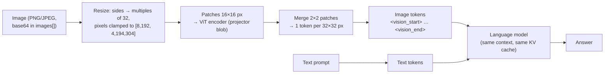

# Lab 07 — Multimodal Models: Images as Tokens

## 1. Core Concept & DevOps Analogy

A vision-language model doesn't "look" at a picture the way you do. A separate network, the **vision encoder** (here a CLIP-style ViT, shipped as the **projector** layer of the model), cuts the image into small square **patches**, turns each patch into a vector, and **projects** those vectors into the same space as the language model's token embeddings. From then on the image is just **more prompt tokens**: they take context, they're prefilled like text, they sit in the KV cache, and the language model attends to them like words.

Three consequences follow, and this lab measures each:
* **An image has a token cost set by its resolution, not its content.** A blank 1024² image costs as much as a busy dashboard of the same size.
* **What the model can read is limited by how many pixels each token covers.** Text smaller than a patch gets blurred together, and the model fills the gap with plausible guesses, which is hallucination with a visual cause.
* **A screenshot is a lossy, expensive encoding of text you may already have.** If you have the text (`kubectl get pods -o json`), send that.

DevOps analogy: the vision encoder is an **ingest sidecar** that transcodes a media upload into the service's internal format before the main container sees it. The transcode has a fixed resolution policy (resize, clamp to a min/max), a cost proportional to input size, and an output that's all the main service ever gets. If the sidecar downsamples your 8 px font, no amount of model intelligence recovers it.

## 2. Prerequisites & Hardware Budget

* Lab 02 (VRAM, context), Lab 03 Step 6 (grounding), Lab 04 Step 3 (JSON-schema output).
* Model: **`qwen3.5:4b`**, already pulled. `ollama show` lists `vision`, and a **projector** layer: CLIP architecture, 333.5M parameters, embedding length 1,024, projected to 2,560 (the language model's width). In the store it's a separate 675 MB blob (`application/vnd.ollama.image.projector`), next to the 2.65 GB weights.
* `qwen3.5:9b` also has vision, with a **different, larger projector** (456M parameters, width 1,152 → 4,096). A later step compares them.
* Python: the venv (D-07) plus **Pillow 12.3.0** (D-13), to generate the test images. Install it with `.\.venv\Scripts\python -m pip install -r requirements.txt`.
* **All images are synthetic**, generated by the scripts: no real dashboards, no screenshots from work.
* VRAM: Lab 02 measured the 4b at ≈3.9 GB at 4K context. The vision encoder adds its own memory; Step 1 measures how much.

## 3. Architecture



**Verified before the experiment (2026-10-31, Ollama 0.40.13):**
* **Which code handles images.** On this machine Ollama's runner is llama.cpp's **`llama-server`** (`ollama ps`: `RUNNER llamacpp`; build `b11963` per `LLAMA_CPP_VERSION` at tag `v0.40.13`). Ollama passes the projector with `--mmproj` and sends images as base64 `multimodal_data` (`llm/llama_server.go`), so resizing and encoding are llama.cpp's **mtmd**/CLIP code, not Ollama's.
* **The source has a Qwen-VL special case that doesn't apply here.** `qwenVLServerArgs` adds `--image-min-tokens 1024` ("Qwen-VL needs at least 1024 image tokens for correct grounding/counting") only for `qwen2vl`, `qwen25vl`, `qwen3vl`, `qwen3vlmoe`. This model's architecture is `qwen35`, so it gets the GGUF defaults.
* **`server.log` at load** (`clip_model_loader` / `load_hparams`):
  * `patch_size: 16`, `n_merge: 2`, so **one token per 32×32 pixels**;
  * `image_min_pixels: 8192`, `image_max_pixels: 4194304` (= 2048², so **at most 4,096 image tokens**);
  * `CLIP using CUDA0 backend`;
  * `estimated worst-case memory usage of mmproj is 892.48 MiB`;
  * `warmup with image size = 1472 x 1472`.
* **The projector can fall back to the CPU.** Ollama disables projector offload (`--no-mmproj-offload`) when the text model is only partly on the GPU, or when free VRAM is below the projector's size + 1 GiB (`shouldDisableMMProjOffload`). On a load OOM it retries once with the projector on the CPU.
* **Probe** (`/api/chat`, `images: [<base64 PNG>]`, a white card with "NODE-7" in large type, think off, temperature 0): prompt tokens with the image minus the same prompt without it (25 tokens):

  | Size | Extra tokens | | Size | Extra tokens |
  |---|---:|---|---|---:|
  | 32², 64² | 11 | | 1024², 2048×512 | 1,026 |
  | 128² | 18 | | 1500×1000 | 1,459 |
  | 256² | 66 | | 1800² | 3,138 |
  | 512² | 258 | | 8000×1000 | 3,984 |

  * Every row is **(width/32 × height/32) + 2** after the resize: the 2 are the start/end markers.
  * Small images are scaled *up* to the minimum (9 tokens).
  * 8000×1000 is scaled *down* to 181×22 tokens, keeping the aspect ratio.
  * **2048² and 4096² both came to 4,123 prompt tokens and failed: HTTP 400** `request (4123 tokens) exceeds the available context size (4096 tokens), try increasing it`. Text over the context is cut silently (Lab 03); an image over it is a **hard error**. llama-server can't drop half an image.
  * `server.log` shows images encoded in batches of 512 tokens (`decoding image batch 1/7, n_tokens_batch = 512 … in 26 ms`).
  * The first image after a load took **11.9 s**; the next ones took 0.1–1.8 s.
  * The no-image prompt ("What text is in the image?") got "The image provided is blank and contains no visible text": **an invented image**.
  * At 512², the model read "NODE-7" as "mod"; at 256², as "NODE7".
* **The resize rule.** `predicted_tokens()` in the script implements a Qwen2-VL-style "smart resize" (round each side to a multiple of 32, then scale into the pixel range). It matched all 12 probe sizes. It's a fitted rule, **not read from llama.cpp's source**, and Step 1 Part 1 checks it on more sizes.

## 4. Step-by-Step Guide

### Step 1 — How an image becomes tokens, and what resolution buys

`vision_basics.py` makes its own images and runs four parts, with think off, temperature 0 and seed 42.

* **Part 1, cost:** the "NODE-7" card at 15 sizes (32² to 4096², wide, tall). For each one: predicted tokens, measured tokens, prompt time. Then 2048² and 4096² again at `num_ctx` 8192, to see the 4,096-token cap without the context error.
* **Part 2, readability:** a synthetic `kubectl get pods -n payments` terminal screenshot (787×348, 16 px Consolas, 12 pods). It includes:
  * near-identical names (`…-x2k4q` / `…-x2k4p`);
  * every common status (Running, CrashLoopBackOff, ImagePullBackOff, Pending, Completed, Error, OOMKilled);
  * kubectl's restart format (`17 (2m14s ago)`).

  The screenshot is read at scales **×2, ×1.5, ×1, ×0.75, ×0.5, ×0.35**, and also given **as text** instead of an image. Answers use a JSON schema and are scored per field against the ground truth, counting invented names.
* **Part 3, controls:** "Which pods in this screenshot are in CrashLoopBackOff?" asked with **no image**, with a **blank** terminal-coloured image, and with the real one.
* **Part 4, VRAM:** `nvidia-smi` before load, after a text-only load, after the first image, after the largest image, and at 8K context. Also `ollama ps`.

```powershell
.\.venv\Scripts\python -m pip install -r requirements.txt     # adds Pillow 12.3.0
.\.venv\Scripts\python scripts\vision_basics.py                 # ≈3 minutes; stops the model at the end
```

Output: the report on screen and in `results\raw\vision-basics-<stamp>\report.md`, with every generated image (`kubectl-x0.5.png`, …) and each raw JSON answer next to it. **Open `kubectl-x0.5.png` and `kubectl-x0.35.png` yourself:** can *you* read them?

**Predictions:**

| Measure | Prediction | Why |
|---|---|---|
| Part 1: tokens | Predicted = measured − 2 for every size; ≤ 4,096 image tokens at any size | Probe; `image_max_pixels` |
| Part 1: 2048², 4096² at 4K | HTTP 400 "exceeds the available context size" | Probe |
| Part 1: same at 8K | Both 4,098 extra tokens (4,096 + markers): a 4096² photo costs the same as a 2048² one | Resize clamp |
| Part 1: speed | Prompt time roughly proportional to image tokens: ≈1.3 s for ≈3,100 tokens | Probe: 1,311 ms for 3,138 |
| First image after load | Several seconds (probe: 11.9 s), then sub-second | Probe; likely one-time CUDA kernel setup for the encoder, as in Lab 02's first load. **Not verified** |
| Part 2: tokens | ×1 = 275 image tokens; ×2 = 1,078; ×0.5 = 60; ×0.35 = 36 | Formula |
| Part 2: text instead of image | ≈350–550 prompt tokens for 1,064 characters: **more than the ×1 image** | Random pod-name suffixes tokenize badly. A screenshot isn't automatically the expensive option |
| Part 2: ×2, ×1.5 | 11–12/12 names exact; statuses 12/12 | Glyphs span ≥ 1 token |
| Part 2: ×1 | Statuses right; a few names wrong by one character (`x2k4q` / `x2k4p`, `zz9kd`) | ≈3.6 characters per token width; similar characters merge |
| Part 2: ×0.5, ×0.35 | Names mostly wrong and **invented but plausible**; statuses partly right (long words survive blur); restart counts guessed | 8 px and 6 px glyphs, 3–5 characters per token |
| Part 2: text | 12/12 on every field | No vision in the path |
| Part 3: no image | Says it can't see an image *or* describes a non-existent one; may invent a pod name | The probe invented "a blank image" |
| Part 3: blank | Says there are no pods or nothing visible | — |
| Part 4: VRAM | Text-only load already includes the projector, about +0.9 GB over a text-only model. The largest images add a few hundred MiB; 8K context adds ≈130 MiB (Lab 02: 32 KiB per token) | `--mmproj` at launch; probe 6,400 → 6,680 MiB after large images |

**Questions to keep in mind:** which is the better input for an agent, a screenshot of `kubectl get pods` or `kubectl get pods -o json`? What does Part 2 say about using a small vision model to read a Grafana panel's numbers?

### Later steps (planned)

* **Step 2 — A dashboard and a diagram, with ground truth:** a synthetic Grafana-style panel (series values, thresholds, trend, legend) and a Kubernetes topology diagram, scored question by question; then `qwen3.5:9b` (bigger projector) on the same images, within the 8.5 GB ceiling.
* **Step 3 — Thinking and counting:** does thinking help reading and counting (pods, nodes, spikes), or only add tokens?
* **Step 4 — Prompt injection through pixels:** instructions written *inside* an image (a log line in a screenshot, a sticky note on a diagram) given to Lab 06's agent. Does the image channel bypass the hardened system prompt?

## 5. Hypotheses → Observed Metrics

No runs yet. The probe numbers in §3 are from 2026-10-31 setup checks.

## 6. Troubleshooting & Failure Modes

| Symptom | Cause | Check / fix |
|---|---|---|
| HTTP 400 `request (N tokens) exceeds the available context size` with an image | The image's tokens (up to 4,096) + text don't fit `num_ctx`; images aren't truncated | Downscale the image (tokens ≈ w×h / 1,024), or raise `num_ctx` |
| A large image costs no more than a medium one | Resized down to `image_max_pixels` (2048² equivalent) | Formula in `vision_basics.py`; crop to the region you care about instead |
| Confident but wrong text from a screenshot | Glyphs smaller than a token patch; the model fills in plausible text | Upscale or crop; prefer the source text |
| First image request after a load takes ≈10 s | One-time cost on the first image (not yet explained) | Warm up with a small image |
| Image requests slow or out of memory with a big context | Projector moved to the CPU (`--no-mmproj-offload`) when the text model doesn't fully fit or free VRAM < projector + 1 GiB | `server.log`: `disabling multimodal projector offload` |

## 7. Cleanup

```powershell
ollama stop qwen3.5:4b
Remove-Item -Recurse results\raw\vision-basics-*      # optional: generated images and reports (gitignored)
```

## 8. Check Your Understanding

1. A 4000×3000 phone photo and a 2048×1536 crop of it are sent to the 4b. Roughly how many image tokens does each cost, and why?
2. Why does an image over the context limit fail with HTTP 400, when an over-long text prompt was cut silently in Lab 03?
3. Where does the vision encoder's memory show up, and what happens to image requests when the text model only partly fits on the GPU?
4. Your agent can either take a screenshot of a dashboard or call the metrics API behind it. Give two reasons, beyond cost, to prefer the API.
