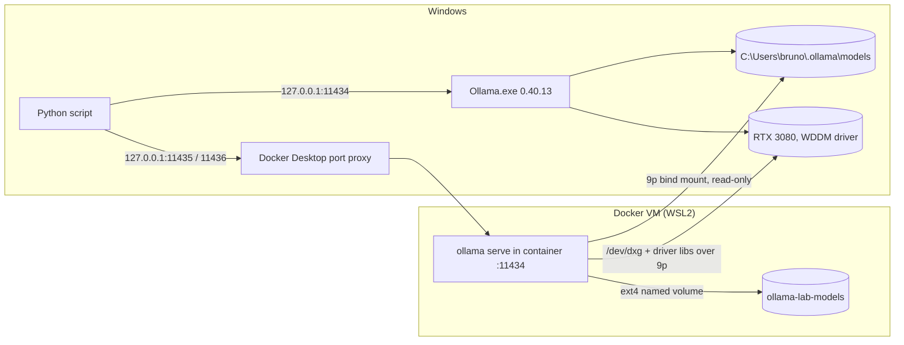

# Lab 08 — Operations: Ollama in Containers and Kubernetes

## 1. Core Concept & DevOps Analogy

So far Ollama has been a desktop process: a tray app on Windows, listening on `127.0.0.1:11434`, with its models in `%USERPROFILE%\.ollama\models`. To run it like any other service, it goes into a container and then into a cluster. That raises the usual platform questions, plus one GPU-specific one:

| Question | Container world | What's special for inference |
|---|---|---|
| Where does the state live? | Volumes, bind mounts, PVCs | The "state" is 3–7 GB of weights per model; how fast you can read it decides cold-start time |
| Who can reach it? | Published ports, Services, NetworkPolicies | Ollama has **no authentication**; the port *is* the access control |
| How does it get hardware? | `--gpus`, `nvidia.com/gpu` limits, device plugins | On Windows the GPU reaches Linux through a paravirtualized device (`/dev/dxg`), not `/dev/nvidia0` |
| What if two services share a node? | Requests and limits | VRAM isn't managed by the kernel or by Kubernetes; two Ollama instances only see each other as "less free memory" |

The analogy from Lab 01 still holds: weights are the image layers, Ollama is the runtime. This lab puts that runtime inside another runtime.

## 2. Prerequisites & Hardware Budget

* Docker Desktop 4.97.0 (engine 29.9.2), WSL2 backend, started by hand (AutoStart is off). The RoadMap's "Docker Desktop is unable to start" (2026-10-10) is no longer true: the engine reached `running` on 2026-10-14 and 2026-10-27.
* The Docker VM: 16 CPUs, 31.3 GiB RAM (half the host), kernel 6.18.54.1-microsoft-standard-WSL2, an `nvidia` runtime registered by Docker Desktop.
* Image `ollama/ollama:0.40.13`, the same version as the Windows install (pulled 2026-11-04, 3.39 GB compressed, 5.06 GB on disk, digest `sha256:b2f0122c476b…`, matches Docker Hub).
* No model downloads: the container reads the Windows store read-only (D-14).
* VRAM: each step runs **one** model on the GPU at a time, except Step 1 Part D (the 4b + a 0.6 GB embedding model, ≈6.8 GB in total). Loading the 4b in both instances is opt-in (`--contend`) and goes past the 8,500 MiB ceiling.
* **Your kubeconfig has a real AKS admin context** (`c8-aks-demo-admin`). No current context is set. Every `kubectl` and `helm` command in this lab passes `--context` explicitly, for a local cluster only.

**Existing Docker state, left alone:** 79 images (30 GB), 48 volumes (50 GB), 9 stopped containers (a k3d cluster `argolab`, localstack, moto, …), an older `ollama/ollama:latest` (0.23.1, May 2026) and a volume named `ollama` holding `qwen2.5-coder`. This lab uses its own names (`ollama-lab-*`) and label `ollama-lab=step1`, and refuses to run if those names exist without its label.

## 3. Architecture



**Verified before Step 1 (2026-11-04):**
* **GPU passthrough works with no extra setup.** `docker run --gpus=all debian:bookworm-slim nvidia-smi` shows the RTX 3080 and driver 591.86. With `--gpus=all` the container gets `/dev/dxg` and the Windows driver files (`libcuda.so.1.1`, `nvidia-smi`) mounted read-only from the host over 9p. Without the flag it gets neither. There's no `/dev/nvidia0`: that matters later for Kubernetes device plugins.
* **The container uses the same GPU stack as Windows:** `library=CUDA compute=8.6 … libdirs=ollama,cuda_v13 driver=13.1`, 8.9 GiB available, default context 4,096, and the same runner flags (`--mmproj …`, `--flash-attn auto`). The llama.cpp builds differ: the Windows one has OpenMP and a different list of CUDA architectures.
* **Ollama in the container listens on `[::]:11434`** (`OLLAMA_HOST=0.0.0.0:11434` is baked into the image). Who can reach it is decided by `-p`, not by Ollama. Ollama's Docker docs use `-p 11434:11434`, which publishes on every host interface. This lab uses `-p 127.0.0.1:11435:11434` (D-06).
* **On start, Ollama prunes "unused blobs"** (`total unused blobs removed: 0`). With a read-write mount of the Windows store, a container could delete files the Windows install uses. Read-only removes that risk.
* **The container generates its own identity key** (`Couldn't find '/root/.ollama/id_ed25519'. Generating new private key.`) because only `models/` is mounted. It's a different identity from the Windows install, and it's lost when the container is removed.
* **Probe timings** (qwen3.5:4b, 23-token prompt, 57 tokens out, temperature 0):

| | load | wall | generation |
|---|---:|---:|---:|
| container, first load ever, bind mount | 77.5 s | 119.9 s | 74.1 tok/s |
| container, reload, bind mount | 26.1 s | 27.3 s | 97.2 tok/s |
| container, warm | 0.15 s | 1.3 s | 97.4 tok/s |
| Windows native, reload | 3.7–6.4 s | 4.7–7.5 s | 115.6–117.6 tok/s |
| Windows native, warm | 0.01 s | 1.0 s | 120.3 tok/s |

Two surprises that Step 1 is built to measure properly: **loading over the bind mount is ≈5× slower**, and **generation in the container is ≈18% slower** even with the model fully on the GPU.

## 4. Step-by-Step Guide

### Step 1 — Ollama in a container next to the Windows install

**What we're learning:**
* how a container gets the GPU on Docker Desktop;
* how the storage choice decides cold-start time;
* what a published port really exposes;
* what happens when two Ollama instances share one GPU.

**Three backends,** all running Ollama 0.40.13 with `qwen3.5:4b`, the same prompts, temperature 0, seed 42 and thinking off, measured one at a time:

| backend | where the weights come from | port |
|---|---|---|
| `windows` | native install, NTFS | 127.0.0.1:11434 |
| `bind` | container; Windows store bind-mounted **read-only** (9p across the VM boundary) | 127.0.0.1:11435 |
| `volume` | container; the 4b **copied locally** (no download) into the named volume `ollama-lab-models` (ext4 inside the Docker VM's disk) | 127.0.0.1:11436 |

**Parts:**
* **A. Exposure:** the container's `PortBindings`, `OLLAMA_HOST` inside it, and which address Windows is actually LISTENING on.
* **B. Load:**
  * reload time ×3 per backend (unload with `keep_alive: 0`, then the same request);
  * `docker run` → API answering;
  * `docker restart` → API answering, with the models still listed;
  * the copy into the volume, in MB/s.
* **C. Speed:**
  * warm generation (median of 5, 256 tokens);
  * prompt evaluation (median of 3, ≈1.5K-token prompt; the run number up front defeats the prefix cache);
  * whether the containers give the same text as Windows.
* **D. Two instances on one GPU:** Windows holds the 4b while the bind container loads `embeddinggemma:300m`. The measures are VRAM after each load, each instance's `/api/ps`, and whether Windows' tok/s changes.

```powershell
# Docker Desktop running; the Windows Ollama running with no model loaded (the script checks)
.\.venv\Scripts\python scripts\container_ollama.py              # ≈5–8 min
.\.venv\Scripts\python scripts\container_ollama.py --contend    # optional: both instances load the 4b (overflow past 8,500 MiB)
```

Output: `results\raw\container-ollama-<stamp>\` with `report.md` and `data.json` (every request, including the text). The script removes its containers at the end and keeps the 3.3 GB volume for later steps (§7 removes it).

**Predictions:**

| Measure | Prediction | Why |
|---|---|---|
| A: bindings | `HostIp 127.0.0.1` for 11435/11436; Windows LISTENING on `127.0.0.1:` only, owned by Docker's backend process, not by a container | Docker Desktop publishes ports through a Windows-side proxy; `OLLAMA_HOST=0.0.0.0` only means "all interfaces *inside* the container's network namespace" |
| B: reload, Windows | 3–7 s | Probe |
| B: reload, bind | 20–30 s | Probe: 26 s. Every load reads 3.3 GB through 9p (≈130 MB/s) |
| B: reload, volume | 2–6 s (similar to Windows) | ext4 inside the VM, and the VM's page cache keeps the file after the first read |
| B: copy into the volume | 20–40 s (100–170 MB/s) | The same 9p read, once |
| B: `docker run` → API | 3–6 s | GPU discovery took ≈3 s after listen in the probe |
| B: restart | models still listed (6), nothing downloaded | The bind mount is outside the container's writable layer |
| VRAM Δ per load | ≈3,850 MiB on all three, within ±50 | Same weights, same context, same CUDA library |
| C: generation | containers 15–20% below Windows; **bind = volume** | Probe 97 vs 116–120. Storage can't matter once the weights are on the GPU; the cause (the `/dev/dxg` path, or the different build) isn't known |
| C: prompt eval | containers also lower; gap size unknown | Same open cause |
| C: same text | identical to Windows (low confidence) | Same version and CUDA library; but the builds differ, and Lab 03 showed byte-identity depends on the exact kernels |
| D: VRAM | +≈3,850 (Windows 4b), then +600–900 (embedding in the container); both `size == size_vram` (100% GPU) | Each instance sees only what's free when it loads |
| D: Windows tok/s with both loaded | unchanged (±3%) | The embedding model sits idle; memory, not compute, is shared |

## 5. Hypotheses → Observed Metrics

*(Filled in after each run.)*

## 6. Troubleshooting & Failure Modes

| Symptom | Cause | Check / fix |
|---|---|---|
| `failed to connect to the docker API at npipe:////./pipe/dockerDesktopLinuxEngine` | Docker Desktop isn't running (AutoStart is off) | Start Docker Desktop; wait for the engine (`docker version` shows a Server section) |
| `nvidia-smi: not found` in a container | Started without `--gpus=all` | Add `--gpus=all`; check `/dev/dxg` exists inside |
| The first load in a container takes minutes | The weights are read across the VM boundary (9p bind mount) | Copy them into a named volume, or accept a one-time cost |
| A container can reach Ollama but the LAN can too | `-p 11434:11434` publishes on every interface | Always `-p 127.0.0.1:<port>:11434`; check with `netstat -ano` for `LISTENING` |
| Blobs disappear from the Windows store | A container with a **read-write** mount pruned them as "unused" on start | Mount the shared store `:ro`; one writer per store |
| `docker run --entrypoint /bin/ollama …` fails from Git Bash | Git Bash rewrites `/bin/ollama` to `C:/Program Files/Git/bin/ollama` | `MSYS_NO_PATHCONV=1`, or use PowerShell |

## 7. Cleanup

```powershell
docker rm -f ollama-lab-bind ollama-lab-volume 2>$null   # the script already does this
docker volume rm ollama-lab-models                          # the 3.3 GB copy of the 4b
docker image rm ollama/ollama:0.40.13                       # optional: 5 GB; keep it for later steps
ollama stop qwen3.5:4b
```

Docker Desktop can stay running or be quit from the tray. Nothing in this lab changes its settings.

## 8. Check Your Understanding

1. The image sets `OLLAMA_HOST=0.0.0.0:11434`, yet the API in Step 1 isn't reachable from the LAN. Which setting decides that, and what would `-p 11434:11434` change?
2. Why can't the container see the GPU without `--gpus=all`, and what does it get when you add the flag?
3. Why does a reload take ≈26 s from the bind mount, but only seconds from a named volume or on Windows? Which of those numbers matters for a Kubernetes pod that's rescheduled?
4. Why must a model store shared by two Ollama instances be mounted read-only in at least one of them?
