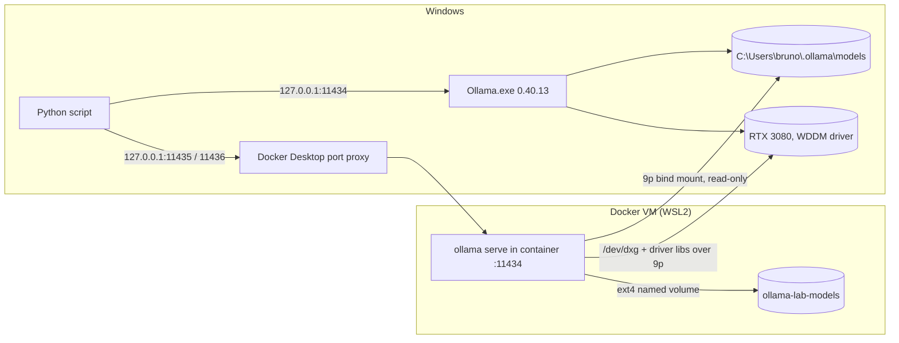

# Lab 08 — Operations: Ollama in Containers and Kubernetes

## 1. Core Concept & DevOps Analogy

So far Ollama has been a desktop process: a tray app on Windows, listening on `127.0.0.1:11434`, with its models in `%USERPROFILE%\.ollama\models`. To run it like any other service, it goes into a container and then into a cluster. That raises the usual platform questions, plus one GPU-specific one:

| Question | Container world | What's special for inference |
|---|---|---|
| Where does the state live? | Volumes, bind mounts, PVCs | The "state" is 3–7 GB of weights per model; how fast you can read it decides cold-start time |
| Who can reach it? | Published ports, Services, NetworkPolicies | Ollama has **no authentication**; the port *is* the access control |
| How does it get hardware? | `--gpus`, `nvidia.com/gpu` limits, device plugins | On Windows the GPU reaches Linux through a paravirtualized device (`/dev/dxg`), not `/dev/nvidia0` |
| What if two services share a node? | Requests and limits | VRAM isn't managed by the kernel or by Kubernetes; two Ollama instances only see each other as "less free memory" |

The analogy from Lab 01 still holds: weights are the image layers, Ollama is the runtime. This lab puts that runtime inside another runtime.

## 2. Prerequisites & Hardware Budget

* Docker Desktop 4.97.0 (engine 29.9.2), WSL2 backend, started by hand (AutoStart is off). The RoadMap's "Docker Desktop is unable to start" (2026-10-10) is no longer true: the engine reached `running` on 2026-10-14 and 2026-10-27.
* The Docker VM: 16 CPUs, 31.3 GiB RAM (half the host), kernel 6.18.54.1-microsoft-standard-WSL2, an `nvidia` runtime registered by Docker Desktop.
* Image `ollama/ollama:0.40.13`, the same version as the Windows install (pulled 2026-11-04, 3.39 GB compressed, 5.06 GB on disk, digest `sha256:b2f0122c476b…`, matches Docker Hub).
* No model downloads: the container reads the Windows store read-only (D-14).
* VRAM: each step runs **one** model on the GPU at a time, except Step 1 Part D (the 4b + a 0.6 GB embedding model, ≈6.8 GB in total). Loading the 4b in both instances is opt-in (`--contend`) and goes past the 8,500 MiB ceiling.
* **Your kubeconfig has a real AKS admin context** (`c8-aks-demo-admin`). No current context is set. Every `kubectl` and `helm` command in this lab passes `--context` explicitly, for a local cluster only.

**Existing Docker state, left alone:** 79 images (30 GB), 48 volumes (50 GB), 9 stopped containers (a k3d cluster `argolab`, localstack, moto, …), an older `ollama/ollama:latest` (0.23.1, May 2026) and a volume named `ollama` holding `qwen2.5-coder`. This lab uses its own names (`ollama-lab-*`) and label `ollama-lab=step1`, and refuses to run if those names exist without its label.

## 3. Architecture



**Verified before Step 1 (2026-11-04):**
* **GPU passthrough works with no extra setup.** `docker run --gpus=all debian:bookworm-slim nvidia-smi` shows the RTX 3080 and driver 591.86. With `--gpus=all` the container gets `/dev/dxg` and the Windows driver files (`libcuda.so.1.1`, `nvidia-smi`) mounted read-only from the host over 9p. Without the flag it gets neither. There's no `/dev/nvidia0`: that matters later for Kubernetes device plugins.
* **The container uses the same GPU stack as Windows:** `library=CUDA compute=8.6 … libdirs=ollama,cuda_v13 driver=13.1`, 8.9 GiB available, default context 4,096, and the same runner flags (`--mmproj …`, `--flash-attn auto`). The llama.cpp builds differ: the Windows one has OpenMP and a different list of CUDA architectures.
* **Ollama in the container listens on `[::]:11434`** (`OLLAMA_HOST=0.0.0.0:11434` is baked into the image). Who can reach it is decided by `-p`, not by Ollama. Ollama's Docker docs use `-p 11434:11434`, which publishes on every host interface. This lab uses `-p 127.0.0.1:11435:11434` (D-06).
* **On start, Ollama prunes "unused blobs"** (`total unused blobs removed: 0`). With a read-write mount of the Windows store, a container could delete files the Windows install uses. Read-only removes that risk.
* **The container generates its own identity key** (`Couldn't find '/root/.ollama/id_ed25519'. Generating new private key.`) because only `models/` is mounted. It's a different identity from the Windows install, and it's lost when the container is removed.
* **Probe timings** (qwen3.5:4b, 23-token prompt, 57 tokens out, temperature 0):

| | load | wall | generation |
|---|---:|---:|---:|
| container, first load ever, bind mount | 77.5 s | 119.9 s | 74.1 tok/s |
| container, reload, bind mount | 26.1 s | 27.3 s | 97.2 tok/s |
| container, warm | 0.15 s | 1.3 s | 97.4 tok/s |
| Windows native, reload | 3.7–6.4 s | 4.7–7.5 s | 115.6–117.6 tok/s |
| Windows native, warm | 0.01 s | 1.0 s | 120.3 tok/s |

Two surprises that Step 1 is built to measure properly: **loading over the bind mount is ≈5× slower**, and **generation in the container is ≈18% slower** even with the model fully on the GPU.

## 4. Step-by-Step Guide

### Step 1 — Ollama in a container next to the Windows install

**What we're learning:**
* how a container gets the GPU on Docker Desktop;
* how the storage choice decides cold-start time;
* what a published port really exposes;
* what happens when two Ollama instances share one GPU.

**Three backends,** all running Ollama 0.40.13 with `qwen3.5:4b`, the same prompts, temperature 0, seed 42 and thinking off, measured one at a time:

| backend | where the weights come from | port |
|---|---|---|
| `windows` | native install, NTFS | 127.0.0.1:11434 |
| `bind` | container; Windows store bind-mounted **read-only** (9p across the VM boundary) | 127.0.0.1:11435 |
| `volume` | container; the 4b **copied locally** (no download) into the named volume `ollama-lab-models` (ext4 inside the Docker VM's disk) | 127.0.0.1:11436 |

**Parts:**
* **A. Exposure:** the container's `PortBindings`, `OLLAMA_HOST` inside it, and which address Windows is actually LISTENING on.
* **B. Load:**
  * reload time ×3 per backend (unload with `keep_alive: 0`, then the same request);
  * `docker run` → API answering;
  * `docker restart` → API answering, with the models still listed;
  * the copy into the volume, in MB/s.
* **C. Speed:**
  * warm generation (median of 5, 256 tokens);
  * prompt evaluation (median of 3, ≈1.5K-token prompt; the run number up front defeats the prefix cache);
  * whether the containers give the same text as Windows.
* **D. Two instances on one GPU:** Windows holds the 4b while the bind container loads `embeddinggemma:300m`. The measures are VRAM after each load, each instance's `/api/ps`, and whether Windows' tok/s changes.

```powershell
# Docker Desktop running; the Windows Ollama running with no model loaded (the script checks)
.\.venv\Scripts\python scripts\container_ollama.py              # ≈5–8 min
.\.venv\Scripts\python scripts\container_ollama.py --contend    # optional: both instances load the 4b (overflow past 8,500 MiB)
```

Output: `results\raw\container-ollama-<stamp>\` with `report.md` and `data.json` (every request, including the text). The script removes its containers at the end and keeps the 3.3 GB volume for later steps (§7 removes it).

**Predictions:**

| Measure | Prediction | Why |
|---|---|---|
| A: bindings | `HostIp 127.0.0.1` for 11435/11436; Windows LISTENING on `127.0.0.1:` only, owned by Docker's backend process, not by a container | Docker Desktop publishes ports through a Windows-side proxy; `OLLAMA_HOST=0.0.0.0` only means "all interfaces *inside* the container's network namespace" |
| B: reload, Windows | 3–7 s | Probe |
| B: reload, bind | 20–30 s | Probe: 26 s. Every load reads 3.3 GB through 9p (≈130 MB/s) |
| B: reload, volume | 2–6 s (similar to Windows) | ext4 inside the VM, and the VM's page cache keeps the file after the first read |
| B: copy into the volume | 20–40 s (100–170 MB/s) | The same 9p read, once |
| B: `docker run` → API | 3–6 s | GPU discovery took ≈3 s after listen in the probe |
| B: restart | models still listed (6), nothing downloaded | The bind mount is outside the container's writable layer |
| VRAM Δ per load | ≈3,850 MiB on all three, within ±50 | Same weights, same context, same CUDA library |
| C: generation | containers 15–20% below Windows; **bind = volume** | Probe 97 vs 116–120. Storage can't matter once the weights are on the GPU; the cause (the `/dev/dxg` path, or the different build) isn't known |
| C: prompt eval | containers also lower; gap size unknown | Same open cause |
| C: same text | identical to Windows (low confidence) | Same version and CUDA library; but the builds differ, and Lab 03 showed byte-identity depends on the exact kernels |
| D: VRAM | +≈3,850 (Windows 4b), then +600–900 (embedding in the container); both `size == size_vram` (100% GPU) | Each instance sees only what's free when it loads |
| D: Windows tok/s with both loaded | unchanged (±3%) | The embedding model sits idle; memory, not compute, is shared |

### Step 2 — Kubernetes (k3d) with the GPU, and no device plugin

**What we're learning:** what it takes to give a pod a GPU, and what Kubernetes stops knowing when you take a shortcut. This is the RoadMap's open "kind vs k3s" decision, settled by measurement:
* **kind** has no way to pass `--gpus` to its node containers (`kind create cluster --help` has no GPU option; NVIDIA's nvkind wrapper needs the NVIDIA Container Toolkit, community-tested only on Docker Desktop);
* **k3d** (k3s in Docker) has `--gpus all`, which Docker forwards to the node container. **D-15: k3d.**

**Verified before the run (2026-11-04, probe cluster created and deleted):**
* **The node gets the GPU, Kubernetes doesn't.** In the node: `/dev/dxg`, the driver libraries in `/usr/lib64` (Docker picks the image's library directory; `/usr/lib/x86_64-linux-gnu` in Debian), and `nvidia-smi`. `nvidia-smi` can't run in the node itself, because the k3s image has no glibc. There's no NVIDIA runtime in containerd, and the node's allocatable has **no `nvidia.com/gpu`**.
* **No device plugin means privileged.** A pod that mounts `/dev/dxg` and the libraries with `hostPath` gets `Failed to initialize NVML: GPU access blocked by the operating system` (the device cgroup). The same pod with `privileged: true` prints `NVIDIA GeForce RTX 3080`. Privileged widens access from 17 to 186 devices in `/dev` and gives every Linux capability (`CapEff 000001ffffffffff`, against `00000000a80425fb`): it's root on the node.
* **Ollama runs that way.** The node's `/usr/lib64` is mounted at `/usr/local/nvidia/lib64`, which is already on the image's `LD_LIBRARY_PATH`. The pod reports `library=CUDA … RTX 3080` and generates at 97.6 tok/s, the same as the Docker container in Step 1.
* **Ollama writes to its store when it starts.** With the volume read-only the pod crash-looped: `Error: remove /root/.ollama/models/manifests-v2: read-only file system`. The Windows store has already been migrated to the `manifests-v2` layout, but Step 1's copy took only the old `manifests/`. The pod is the volume's single writer.
* **Ready ≠ able to answer:** the readiness probe on `/api/version` passed after 5.6 s, and the first answer came 84 s later.
* NVIDIA's device plugin has had a WSL mode since v0.19.1 ("report a single 'all' device to kubelet"; latest v0.20.1). It still needs a runtime or CDI to inject the device into pods. That's Step 3, after this step shows what it would add.

**What runs** (`scripts/k8s_ollama.py`, manifests in `k8s/`):
* **The cluster:** `ollama-lab`, 1 server, `rancher/k3s:v1.36.4-k3s1` (cached), `--gpus all`, API on `127.0.0.1:6445`, Step 1's volume mounted into the node, and its own kubeconfig file. Your kubeconfigs and the `argolab` cluster aren't touched. The images go in with `k3d image import`, so nothing is pulled.
* **A. The cluster:** create and import times, the API binding, what the node advertises.
* **B. GPU without a device plugin:** `k8s/gpu-probe.yaml`, unprivileged vs privileged.
* **C. Ollama Deployment:** `k8s/ollama.yaml`, privileged, `strategy: Recreate`, the model store on `hostPath`. Measured:
  * pod Ready vs first answer;
  * warm speed;
  * deleting the pod (a stand-in for a reschedule), then the same with a node-local `hostPath` for `/root/.nv`, the CUDA kernel cache from Step 1.
* **D. `replicas: 2`:** where they land and whether both get the GPU. `--contend` also loads the 4b in both (overflow, announced).

```powershell
.\.venv\Scripts\python scripts\k8s_ollama.py              # ≈10–12 min; deletes the cluster at the end
.\.venv\Scripts\python scripts\k8s_ollama.py --contend    # optional: both replicas load the 4b (past 8,500 MiB)
.\.venv\Scripts\python scripts\k8s_ollama.py --keep       # optional: keep the cluster to explore (§7 deletes it)
```

**Predictions** (A, B and pod 1 were already seen in the smoke run, `k8s-ollama-20261104-150213`):

| Measure | Prediction | Why |
|---|---|---|
| A | create 10–15 s; import 120–150 s; API `127.0.0.1:6445`; no `nvidia.com/gpu` | Smoke run: 11.3 s, 128 s |
| B | unprivileged blocked; privileged works (17 vs 186 devices) | Smoke run |
| C pod 1 | Ready ≈5 s; first answer 85–100 s; warm ≈97 tok/s; +≈3,900 MiB | Step 1: a new container compiles its CUDA kernels |
| C pod 2 (pod deleted, no cache) | first answer 85–100 s again | The cache lives in the pod's writable layer, which is gone |
| C pod 3 (empty cache volume) | 85–100 s | Nothing cached yet |
| C pod 4 (pod deleted, cache on the node) | first answer ≤ 10 s | Step 1: a restart with the cache took 3.9 s |
| D | both replicas Running on the one node, both see `/dev/dxg`; nothing Pending | Nothing tells the scheduler a GPU is involved |
| D `--contend` | the second load succeeds; ≈9.7 GB used | Step 1: each instance plans with what's free |

## 5. Hypotheses → Observed Metrics

### Step 1 — runs 1 and 2 (2026-11-04, `qwen3.5:4b`, temperature 0, seed 42, think off; run 2 with `--contend`)

Runs: `container-ollama-20261104-124536` and `…-133051`. Afterwards I ran three follow-up probes by hand: the CUDA kernel cache, reachability from the LAN address, and Windows tok/s in each Part D state (5 samples each).

**1. The port is the access control, and it held.**
* `PortBindings` was `{'11434/tcp': [{'HostIp': '127.0.0.1', 'HostPort': '11435'}]}`, while inside the container `OLLAMA_HOST=0.0.0.0:11434`.
* The Windows-side listener is `127.0.0.1:11436`, owned by `com.docker.backend`, not by a container process.
* Connecting to the machine's Wi-Fi address (`10.0.0.202`) was **refused** on both 11434 (Windows Ollama) and 11436 (the container). Connecting to `127.0.0.1` answered.
* **Tooling caveat:** `netstat -ano` didn't list Docker's listener at all, so run 1's "listening" list was empty. Later in the session it stopped listing Ollama's own listener too, and `Get-NetTCPConnection` reported that one with state `0`. The cause is not known; this is a Windows 11 build 26300 machine. The script now checks reachability by connecting to the LAN address instead of reading listener tables.

**2. Storage decides the cold start.** Both runs:

| backend | first request in a new container (load / wall) | reloads 2–3 (load) | copy / start |
|---|---|---:|---|
| windows | 5.4–8.3 s / 6.3–9.3 s | 4.05–4.47 s | – |
| bind (9p, read-only) | 65.7–68.0 s / 108–109 s | 25.4–27.1 s | `docker run` → API 5.2–7.6 s; `docker restart` → API 4.1–4.4 s, 6 models listed |
| volume (ext4) | 42.6–48.9 s / 85–94 s | **2.85–3.16 s** | copy 3.32 GB in 21.1–21.4 s (155–158 MB/s); `docker run` → API 3.6–3.9 s |

* **Every reload from the bind mount re-reads 3.3 GB across the VM boundary** (≈130 MB/s). From the volume it's faster than native Windows. The VM's page cache keeps the file, and the VM has 31 GiB of RAM to do it.
* Copying into the volume took one 21 s read, and it pays back after the first reload.

**3. A new container pays ≈80–90 s once, whatever the storage.** That's the first-request wall time minus a normal reload. The first long prompt also ran at 2.0–2.3K tok/s instead of ≈6K. The follow-up probe showed why:
* the container's `/root/.nv/ComputeCache` is empty at start (4 KB);
* it holds **78 MB after the first request**: the CUDA driver compiles GPU kernels on first use;
* after a `docker restart`, which keeps the container's filesystem, the first request took **2.7 s load / 3.9 s wall**.

So the cost is tied to the container's writable layer. Every `docker rm` + `run`, every new image version, and every rescheduled pod pays it again. Windows keeps its own cache across restarts, so it doesn't pay this.

**4. Speed: generation 18–20% slower in a container; prompt processing the same.**

| backend | gen tok/s, run 1 / run 2 (median of 5, 256 tokens) | prompt tok/s, run 1 / run 2 (median of 3, ≈1.5K tokens) | VRAM Δ per load |
|---|---:|---:|---:|
| windows | 118.4 / 120.9 | 5,859 / 6,115 | 3,818 / 3,901 MiB |
| bind | 97.3 / 96.8 | 5,951 / 5,727 | 3,901 / 3,899 MiB |
| volume | 96.2 / 97.0 | 6,035 / 5,969 | 3,901 / 3,900 MiB |

* **bind = volume:** storage doesn't matter once the weights are on the GPU.
* **Prompt processing is within ±5% of Windows, and generation isn't.** Processing a prompt is a few large batched GPU operations. Generating is one small step per token, so a fixed overhead per GPU call shows up there and not in prefill. That pattern fits a per-call cost on the `/dev/dxg` path into the Windows driver. It's a hypothesis: the two llama.cpp builds also differ, and I haven't separated the two causes.
* **All three backends gave byte-identical text** on the short prompt, and the same answers to the long one (`3, 3, 13`). Those long-prompt answers are also wrong: the true count is 6. That's Lab 07 Step 3's counting failure again, in text this time.
* `/api/ps` said 2,995 MiB on all three, against ≈3,900 measured. It's the same gap as in Lab 07, and the container didn't change it.
* **Container RAM:** bind 2.7–3.2 GiB, volume 770 MiB (`docker stats`), with the weights in VRAM in both cases. The likely reason is that the bind-mounted file's pages are charged to the container. That's not verified.

**5. Two instances on one GPU: memory adds up, and neither instance knows about the other.**
* GPU memory went idle 2,203 → Windows 4b **6,104** → plus the container's embedding model **7,017 MiB** (run 2: 2,061 → 5,964 → 6,875). That's +3,901 and +913. Both instances reported 100% GPU (`size == size_vram`).
* **Windows tok/s didn't change.** The script's single sample said 94.9 and 104.8 tok/s, which looked like a 12–20% drop. The follow-up probe, 5 samples per state, gave medians of **119.0** (no container), **118.8** (container idle), **119.4** (container + embedding model), 118.3 (unloaded) and 120.3 (removed). The first request after a change was sometimes 101–106. The script now takes the median of 5.
* **`--contend`** (the 4b in both instances) put **9,730 MiB in use, 510 MiB free**. Both instances still said 100% GPU, and nothing failed or warned. Step 1 didn't log the free memory the container planned against. In Step 2 the pods turned out to plan against a fixed number, not what was actually free (§5 Step 2, point 4). The container's 4b generated 74.9 tok/s and Windows 106.1, but those are single samples, not a measured slowdown.
* On a 10 GB card that's a working configuration with no headroom: one longer context in either instance would spill. **No scheduler, kernel or Kubernetes object accounts for this.**

**Predictions vs observed:**

| Prediction | Observed |
|---|---|
| A: `127.0.0.1` only, owned by Docker's backend | ✅ (and refused on the LAN address); ❌ `netstat` couldn't show it |
| B: reload windows 3–7 s / bind 20–30 s / volume 2–6 s | ✅ 4.1–4.5 / 25.4–27.1 / 2.9–3.2 s |
| B: copy 20–40 s | ✅ 21 s (156 MB/s) |
| B: `docker run` → API 3–6 s | ✅ 3.6–5.2 s, one 7.6 s |
| B: restart keeps the models | ✅ 6 listed, nothing downloaded |
| (not predicted) | ❌ first request in a new container: +80–90 s, the CUDA kernel cache |
| VRAM Δ ≈3,850 ± 50 on all three | ✅ 3,818–3,901 |
| C: containers 15–20% slower; bind = volume | ✅ 18–20%; bind = volume |
| C: prompt eval lower in containers | ❌ the same within ±5% |
| C: identical text (low confidence) | ✅ byte-identical |
| D: +3,850 then +600–900, both 100% GPU | ✅ +3,901, +911–913 |
| D: Windows tok/s unchanged | ✅ medians 118–120 (the script's single sample said otherwise) |

**What Step 1 teaches:**
1. **On Docker Desktop, the GPU needs only `--gpus=all`.** The container gets `/dev/dxg` and the host's driver files, and the CUDA stack and VRAM look the same as on Windows.
2. **Put the weights inside the VM.** A named volume reloaded in ≈3 s, against ≈26 s through a bind mount. In Kubernetes terms: a node-local PVC or a pre-pulled cache beats a network share on every reschedule.
3. **Cold start = reading the weights + compiling GPU kernels.** The kernel cache lives in the container's writable layer. Persist `/root/.nv` (a volume), or warm up before taking traffic. A readiness probe on `/api/version` would say "ready" ≈90 s too early.
4. **The port, not Ollama, is the access control.** Ollama listens on every interface inside the container, so `-p 127.0.0.1:…` is what kept it off the LAN. Verify by connecting from the LAN address; listener tables can be wrong.
5. **VRAM is shared without any accounting.** Two instances filled the card to 510 MiB free without a warning. Budget VRAM per node by hand, and expect the same in Kubernetes: `nvidia.com/gpu: 1` hands out whole devices and doesn't track memory.
6. **Measure speed with several samples.** One request after a state change was up to 15% slow, and a single sample turned that into a false finding.

### Step 2 — runs 1–3 (2026-11-04/05, `qwen3.5:4b`, temperature 0, seed 42, think off; runs 2 and 3 with `--contend`)

Runs: `k8s-ollama-20261104-154245` (full) and `…-155942` (`--contend`). Run 2 crashed in Part D. Its folder holds the two pods' logs, saved afterwards from the leftover cluster, plus a note. A manual reproduction ran on that cluster before I deleted it. Run 3, `k8s-ollama-20261105-091225`, used the fixed script and was a full `--contend` run, with both pods' logs saved by the script.

**1. The cluster and the GPU probe matched the smoke run.**
* Create took 11.2–11.3 s and the image import 125–144 s. The API was published on `127.0.0.1:6445`.
* The node advertised 16 CPUs and 31.3 GiB, the whole Docker VM, and **no `nvidia.com/gpu`**.
* The unprivileged probe got `GPU access blocked by the operating system`. The privileged one saw 186 devices, had every capability, and read `RTX 3080`.

**2. Ready is not the same as able to answer. The gap is the kernel cache, and a node-local `hostPath` removes it.**

| pod | `/root/.nv` | Ready | first request (load) | Ready → answered |
|---|---|---:|---:|---:|
| 1, new | in the pod's writable layer | 5.0 / 5.4 / 5.2 s | 89.5 / 86.0 / 81.9 s (45.4 / 43.1 / 42.4) | 94.9 / 91.8 / 89.5 s |
| 2, pod 1 deleted | in the pod's writable layer | 4.6 / 4.8 / 3.0 s | 85.7 / 86.1 / 80.5 s (43.7 / 43.1 / 41.1) | 90.5 / 91.2 / 85.8 s |
| 3, cache `hostPath`, empty | node `/var/lib/ollama-nv` | 4.5 / 5.0 / 4.7 s | 85.5 / 86.1 / 80.0 s (42.8 / 44.7 / 40.6) | 90.4 / 91.4 / 87.0 s |
| 4, pod 3 deleted | node `/var/lib/ollama-nv`, kept | 3.5 / 4.1 / 4.1 s | **3.8 / 3.8 / 3.7 s (2.7 / 2.7 / 2.7)** | **7.6 / 8.1 / 10.1 s** |

* **Each pod without a kept cache paid 80–89 s on its first request and held 78,948 KB in `/root/.nv` afterwards.** That's the same size as Step 1's container, written again by each pod.
* **Pod 4 reused the node's cache and answered in 3.7–3.8 s,** the same as Step 1's `docker restart` (3.9 s).
* **The readiness probe passed 80–90 s before the pod could answer.** A Service would have sent traffic to it during that time.
* A `hostPath` cache works only because there is one node. On a real cluster the cache is per node, and also per GPU model and driver version. A rescheduled pod pays again on any node it hasn't run on yet.

**3. Speed and memory were the same as the Step 1 container.**
* Warm generation was 89.3 tok/s in run 1, 98.3 in run 2 and 98.9 in run 3 (the smoke run gave 97.6), each a median of 5.
* The 89.3 is unexplained: the script keeps only the median, so I can't tell which samples were slow.
* Each load added 3,899–3,975 MiB, and `/api/ps` said 100% GPU (`size == size_vram`).

**4. Two replicas: the scheduler put both on the one node, and Ollama can't see the other pod's memory.**
* **Placement:** both replicas were Ready in 3.4–4.3 s on `k3d-ollama-lab-server-0`, and both see `/dev/dxg`. Nothing went Pending, and nothing in the API mentions a GPU.
* **`--contend`, run 2:** the first replica loaded the 4b (2.7 s, 95.9 tok/s; GPU 5,811 MiB used). The second replica answered **HTTP 500**: `cudaMalloc failed: out of memory` on its first 2,515 MiB allocation. Ollama retried with the vision projector on the CPU, failed the same way, and gave up within 3 s. The script then crashed on the error body.
* **Ollama planned every load against the same 9,071 MiB of free VRAM.** That was llama.cpp's `projected to use 2771 MiB … vs. 9071 MiB of free device memory`, in all 10 loads across both pods of run 2, and in all 3 of run 3. That includes the second-replica loads, made while the other pod held ≈3.9 GiB. At idle, `nvidia-smi` on Windows reported 8,477–8,540 MiB free, and with one pod loaded 4,641 MiB.
* So inside these pods Ollama's free-memory number is fixed and higher than reality. With nothing else on the card it happens to be harmless. When the card is shared, Ollama **can't plan a partial CPU offload**, which Lab 02 showed it doing on Windows. The load either fits by luck or fails.
* **Manual reproduction** on the same cluster, the 4b in replica A and then B, in both orders: **both loads succeeded each time**, at 9,312–9,314 MiB used and 740–742 free.
  * The desktop was using ≈400 MiB less than at the failed load: 1,514 against 1,910 MiB idle.
  * At the failure the second pod had ≈4.2 GiB nominally free for a ≈3.9 GiB load, and its *first* 2.5 GiB allocation failed.
* **`--contend`, run 3 (fixed script):** the second load **succeeded**.
  * The new replica loaded first: GPU 1,653 → 5,554 MiB, 98.7 tok/s. Then pod 4 loaded next to it: 5,554 → **9,455 MiB**, about 600 MiB free, 97.4 tok/s. Both said 100% GPU.
  * Pod 4's planning line still said 9,071 MiB free, with 3.9 GiB already taken by the other pod.
  * The desktop's idle use was 1,644 MiB.
  * Across the three tries the pattern is one failure at 1,910 MiB idle and five successes at 1,514 and 1,644 MiB. That fits a margin effect but proves nothing.
  * Why it failed at that margin isn't known. Two candidates are WDDM's per-process budget and the memory the desktop held at that moment. Neither is verified.
* **The reproduction's first attempt was invalid.** The crashed script had left its `kubectl port-forward` running and holding `127.0.0.1:11437`. The reproduction's new port-forwards couldn't bind, and every request went silently to the old pod. That showed as a "second load" that took 0.0 s and added no VRAM. The script now refuses to start a port-forward on a busy port, and closes its port-forwards on exit.

**Predictions vs observed:**

| Prediction | Observed |
|---|---|
| A: create 10–15 s, import 120–150 s, `127.0.0.1:6445`, no `nvidia.com/gpu` | ✅ 11.2–11.3 s, 125–144 s |
| B: unprivileged blocked, privileged works | ✅ |
| C pod 1: Ready ≈5 s, first answer 85–100 s, ≈97 tok/s, +≈3,900 MiB | ✅ 5.0–5.4 s, +3,899–3,975; first answer ✅ 86–89 s, ≈ 81.9 in run 3 (just under); speed ✅ 98.3 / 98.9, ❌ 89.3 in run 1 |
| C pod 2: 85–100 s again | ✅ 85.7–86.1 s; ≈ 80.5 in run 3 |
| C pod 3 (empty cache volume): 85–100 s | ✅ 85.5–86.1 s; ≈ 80.0 in run 3 |
| C pod 4 (cache on the node): ≤ 10 s | ✅ 3.7–3.8 s |
| D: both on the one node, both see `/dev/dxg`, nothing Pending | ✅ |
| D `--contend`: the second load succeeds, ≈9.7 GB | ½ failed in run 2 (HTTP 500, OOM); succeeded 4/4 in the manual reproduction (9.3 GB) and in run 3 (9.5 GB) |
| (not predicted) | ❌ Ollama in the pods planned with a fixed 9,071 MiB free |

**What Step 2 teaches:**
1. **Without a device plugin, a GPU pod is privileged and the GPU is invisible to Kubernetes.** The node advertises no `nvidia.com/gpu`, so requests, limits, quotas and scheduling can't see it. Two GPU pods landed on one node with no complaint, and so would twenty.
2. **Readiness has to mean "can answer".** `/api/version` is up 85–90 s before the first token. Use an exec or HTTP probe that runs a small generation, or a warm-up step, and keep `/root/.nv` on the node.
3. **Ollama's VRAM planning trusts a number that, in these pods, didn't move.** On shared GPUs, decide the budget outside Ollama: one model-serving pod per GPU, or a hard memory split such as MIG on GPUs that have it (the 3080 doesn't), not two pods relying on luck. The device plugin's time-slicing shares a GPU between pods but doesn't split its memory. The failure mode is a 500 on the request that triggers the load, not a slow request.
4. **Check that a result came from the target you meant.** A leftover port-forward made the wrong pod answer without any error. The "0.0 s load" was the only sign.

## 6. Troubleshooting & Failure Modes

| Symptom | Cause | Check / fix |
|---|---|---|
| `failed to connect to the docker API at npipe:////./pipe/dockerDesktopLinuxEngine` | Docker Desktop isn't running (AutoStart is off) | Start Docker Desktop; wait for the engine (`docker version` shows a Server section) |
| `nvidia-smi: not found` in a container | Started without `--gpus=all` | Add `--gpus=all`; check `/dev/dxg` exists inside |
| The first load in a container takes minutes | The weights are read across the VM boundary (9p bind mount) | Copy them into a named volume, or accept a one-time cost |
| A container can reach Ollama but the LAN can too | `-p 11434:11434` publishes on every interface | Always `-p 127.0.0.1:<port>:11434`; check with `netstat -ano` for `LISTENING` |
| Blobs disappear from the Windows store | A container with a **read-write** mount pruned them as "unused" on start | Mount the shared store `:ro`; one writer per store |
| The first request in a new container takes ≈90 s; restarts are fast | The CUDA driver compiles kernels into `/root/.nv/ComputeCache` (empty → 78 MB) inside the container's writable layer | Mount a volume at `/root/.nv`, or send a warm-up request before marking the pod ready |
| Generation 18–20% slower in a container than native, prompt eval the same | Per-token overhead on the container's GPU path (hypothesis: `/dev/dxg` GPU-PV, or the different build) | Expect it on Docker Desktop; compare on a native Linux host before blaming Ollama |
| `netstat -ano` shows nothing on a published port that answers | Listener tables mis-reported on this Windows build (Docker's backend missing; Ollama's state `0`) | Test reachability: connect from the LAN address, not only `127.0.0.1` |
| Two instances both say 100% GPU and the card is nearly full | Nothing coordinates them; in the k3d pods Ollama also planned with a fixed 9,071 MiB free (Step 2) | Budget per GPU by hand; leave headroom for context growth |
| The second Ollama pod on a GPU: HTTP 500 `cudaMalloc failed: out of memory` | The other pod holds VRAM that this pod's planning number doesn't show, so it doesn't offload layers to the CPU; one retry moves only the projector | One model-serving pod per GPU; check the planning line, `projected to use … vs. … MiB of free device memory` |
| A request "loads" in 0.0 s and VRAM doesn't change | A leftover `kubectl port-forward` holds the local port; the new forward can't bind, and the old one answers for the wrong pod | Check the port is free before forwarding; find leftovers with `Get-CimInstance Win32_Process -Filter "Name='kubectl.exe'"` and their command lines |
| A script crashed and its run folder is empty | The report was written only at the end | `k8s_ollama.py` now saves at exit; a crash leaves the cluster for inspection (§7 deletes it) |
| A tok/s figure 10–20% off from one request | The first request after a load or state change is sometimes slow | Median of ≥5 requests |
| Pod: `Failed to initialize NVML: GPU access blocked by the operating system` | `/dev/dxg` mounted by `hostPath` but the device cgroup denies it | `privileged: true` (root on the node), or a device plugin that injects the device (Step 3) |
| Pod CrashLoopBackOff: `remove /root/.ollama/models/manifests-v2: read-only file system` | Ollama migrates/prunes its store on start | Give the store one read-write owner, or mount a store already in the `manifests-v2` layout |
| Pod Ready in seconds, first answer after ≈90 s | The readiness probe checks the HTTP server, not the model or the kernel cache | Warm up before Ready (exec probe that runs a request), and persist `/root/.nv` |
| A GPU Deployment update briefly needs twice the VRAM | `RollingUpdate` starts the new pod before stopping the old one | `strategy: Recreate` (or `maxSurge: 0`) |
| `docker run --entrypoint /bin/ollama …` fails from Git Bash | Git Bash rewrites `/bin/ollama` to `C:/Program Files/Git/bin/ollama` | `MSYS_NO_PATHCONV=1`, or use PowerShell |

## 7. Cleanup

```powershell
wsl -d Ubuntu -- k3d cluster delete ollama-lab             # Step 2 (the script already does this unless --keep)
Remove-Item $HOME\.kube\ollama-lab.yaml -ErrorAction SilentlyContinue
docker rm -f ollama-lab-bind ollama-lab-volume 2>$null   # the script already does this
docker volume rm ollama-lab-models                          # the 3.3 GB copy of the 4b
docker image rm ollama/ollama:0.40.13                       # optional: 5 GB; keep it for later steps
ollama stop qwen3.5:4b
```

Docker Desktop can stay running or be quit from the tray. Nothing in this lab changes its settings.

## 8. Check Your Understanding

1. The image sets `OLLAMA_HOST=0.0.0.0:11434`, yet the API in Step 1 isn't reachable from the LAN. Which setting decides that, and what would `-p 11434:11434` change?
2. Why can't the container see the GPU without `--gpus=all`, and what does it get when you add the flag?
3. Why does a reload take ≈26 s from the bind mount, but only seconds from a named volume or on Windows? Which of those numbers matters for a Kubernetes pod that's rescheduled?
4. Why must a model store shared by two Ollama instances be mounted read-only in at least one of them?
5. A new container's first request took ≈90 s, and after `docker restart` it took 4 s. Where did the time go, and how would you make a rescheduled Kubernetes pod avoid it?
6. Generation was 18–20% slower in the container but prompt processing wasn't. What does that pattern suggest about where the overhead is?
7. With both instances holding the 4b, the GPU had 510 MiB free and both still said 100% GPU. What would happen if one of them got a 32K-context request, and what in Kubernetes would have prevented this?
8. The readiness probe passed 85–90 s before the pod could answer. Write the probe you'd use instead, and explain why the `hostPath` kernel cache helps on this cluster but not after a reschedule to a new node.
9. Why did the scheduler put two GPU pods on a node with one GPU, and what would `resources.limits: nvidia.com/gpu: 1` change, given what a device plugin advertises?
10. The second replica failed with a CUDA out-of-memory error instead of offloading layers to the CPU, as Lab 02 saw on Windows. Which logged number explains that, and why couldn't it be right?
