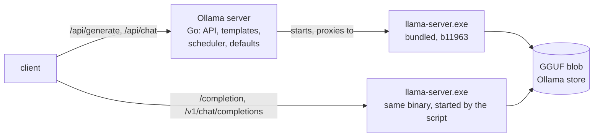

# Lab 09 — Runtime Comparison: Ollama, llama.cpp and LM Studio

## 1. Core Concept & DevOps Analogy

Ollama, llama.cpp's `llama-server` and LM Studio all run GGUF models. The question is what each one adds or takes away around the same inference engine.

* **llama.cpp** is the engine: model loading, the GPU kernels, the KV cache, sampling and an HTTP server. It's the equivalent of `containerd` or `runc`.
* **Ollama** is the platform around it: a model registry and store, an API, chat templates, a scheduler that loads and unloads models, and defaults. It's the equivalent of Docker, or a small kubelet. **On this machine, Ollama 0.40.13 literally runs llama.cpp's `llama-server.exe`** as its runner.
* **LM Studio** is a desktop application with its own model catalog, GUI and API server, also built on llama.cpp (among other engines).

So a fair comparison holds the engine constant where it can, then asks what changes: speed, memory, defaults, concurrency, APIs, and what's left for the operator to do.

## 2. Prerequisites & Hardware Budget

* Windows Ollama 0.40.13 running, with **nothing loaded** (each script checks). The same `qwen3.5:4b` GGUF from the Ollama store is used everywhere: no model download.
* Only one engine holds the model at a time: ≈3.9 GB of VRAM, within the 8,500 MiB ceiling.
* No lab containers or clusters running (each script checks).
* Downloads, each approved in advance (2026-11-05):
  * Step 1: none.
  * Step 2: the official llama.cpp b11963 CUDA 13.4 build (165 MB + 424 MB cudart, checked against GitHub's sha256).
  * LM Studio: shown and approved at its own step.

## 3. Architecture



**Verified before Step 1 (2026-11-05):**
* **Nothing else is installed:**
  * `llama-server`, `llama-cli` and `lms` are not on `PATH`;
  * LM Studio is not installed (no `%LOCALAPPDATA%\Programs\LM Studio`, no `~/.lmstudio`);
  * winget lists only Ollama 0.40.13 (0.40.14 is available, not applied).
* **Ollama ships llama.cpp:**
  * `lib\ollama\llama-server.exe`, with `libllama.dll`, `libmtmd.dll`, `ggml-*.dll`, and GPU variants in `cuda_v12`, `cuda_v13`, `rocm_v7_1` and `vulkan`. `cuda_v13` (903 MB) is used on this machine.
  * `llama-server --version` gives `0.8.0-dev (build 1, commit 39febd2ad)`, which is upstream commit `39febd2adb94`, 2026-10-28, "sycl: work-group argmax for short TOP_K rows". That's exactly release **b11963**.
* **Ollama's command line** (server.log): `llama-server.exe --model <blob> --port <random> --host 127.0.0.1 --no-webui --offline -c 4096 -np 1 --log-verbosity 4 --no-log-prefix --no-log-timestamps --no-jinja --chat-template chatml --mmproj <projector blob> --load-mode none --flash-attn auto -b 512 -ub 512 --context-shift --keep 4`.
* **Its environment** (`llm/llama_server.go`): `PATH` = the exe's folder, then the GPU variant's folder. It also sets **`GGML_BACKEND_PATH`** = that variant's `ggml-cuda.dll`.
  * Without `GGML_BACKEND_PATH`, the same binary loaded the model **on the CPU without any error** (`n_threads = 8`, VRAM unchanged).
* **The model is a plain GGUF:**
  * the 4b's model layer `sha256-a9d0a3e1…` (2.65 GB) and projector layer `sha256-e56a899b…` (676 MB) both start with `GGUF`;
  * the template layer is just `{{ .Prompt }}`;
  * **the params layer is `{"presence_penalty":1.5,"temperature":1,"top_k":20,"top_p":0.95}`**. Ollama applies these to every request that doesn't override them.
* **llama-server standalone** (127.0.0.1:11440): healthy 5.2 s after process start, +≈3,900 MiB.
  * It warns `security: no API key is set and CORS allows all origins`. Ollama restricts `OLLAMA_ORIGINS` to localhost-style origins by default.
* **The probe: the same raw ChatML prompt to both engines, temperature 0, median of 5:**

  | sampler settings | llama-server | Ollama | text |
  |---|---:|---:|---|
  | none given: each engine's own defaults | 144.7 tok/s, 61 tokens | 122.7 tok/s, 57 tokens | different from character 94 |
  | Ollama's (`presence_penalty 1.5, top_k 20, top_p 0.95`) | 118.0, 57 | 120.8, 57 | **byte-identical** |
  | llama-server's (`presence_penalty 0, top_k 40, top_p 0.95`) | 143.0, 61 | 145.1, 61 | **byte-identical** |

  The 18% gap and the different text both come from **sampler defaults, not the runtime**: about 1.2 ms per token. Every Ollama tok/s in Labs 02–08 was measured with `presence_penalty 1.5` on, and every "temperature 0" answer still had the penalty applied.
* **LM Studio:** 0.4.28-2 for Windows x64, a 626 MB installer (`installers.lmstudio.ai`, built 2026-10-31). It has a headless daemon (`llmster`) and a CLI (`lms`). Not installed yet.
* **Official llama.cpp b11963 Windows assets:**
  * `llama-b11963-bin-win-cuda-13.4-x64.zip`, 165.0 MB, `sha256:36e5f512…`;
  * `cudart-llama-bin-win-cuda-13.4-x64.zip`, 423.5 MB, `sha256:738f8c25…`.

## 4. Step-by-Step Guide

### Step 1 — Ollama vs its own engine

**What we're learning:** what Ollama costs and adds when the engine, the binary and the weights are identical. If the numbers differ, the cause is in Ollama's layer: defaults, templates, API, scheduler. It isn't in llama.cpp.

**What runs** (`scripts/engine_compare.py`, ≈8 min, no downloads):
* **The engine:** the bundled `llama-server.exe` started by the script on `127.0.0.1:11440`, with Ollama's flags and environment and the same GGUF blobs. It's stopped through its own process handle. One engine at a time holds the model.
* **A. Cold start:** an Ollama load, against llama-server from process start to healthy; VRAM for each.
* **B. The same raw prompt** under four sampler settings, on both engines: Ollama's defaults, llama-server's defaults, the penalty alone, and `top_k 20` alone. Speed and byte-identity are compared, plus prompt-eval speed on a ≈2.5K-token prompt.
* **C. Chat:** Ollama `/api/chat` (`think: false`) against llama-server `/v1/chat/completions` (chatml template): prompt tokens and text.
* **D. 4 concurrent requests:** llama-server with `-np 1`, `2` and `4`, against Ollama (which runs qwen3.5 with `-np 1`, Lab 04). Aggregate and per-request tok/s, and VRAM.
* **E. Per-request overhead:** 1-token requests, median of 20.

```powershell
ollama stop qwen3.5:4b                                   # nothing loaded (the script checks)
.\.venv\Scripts\python scripts\engine_compare.py         # ≈8 min
```

**Predictions** (A–C partly from the probe; D and E written before any run):

| Measure | Prediction | Why |
|---|---|---|
| A | Ollama first request 5–8 s; llama-server healthy in 5–6 s; +≈3,900 MiB for both | Lab 08 Step 1: Windows reload 4–5 s; probe 5.2 s |
| B: Ollama's / llama-server's defaults | ≈120 / ≈144 tok/s on **both** engines; byte-identical text within each row | Probe |
| B: penalty alone / `top_k 20` alone | the penalty carries the cost (≈120 tok/s); `top_k 20` alone ≈144 (low confidence) | A presence penalty touches every token in the 248K vocabulary; `top_k` should be cheaper |
| B: long prompt | prompt eval equal within ±5% | The same kernels; Lab 08 Step 1 (prompt eval equal across builds) |
| C | prompt tokens differ; text not byte-identical (low confidence) | Ollama renders qwen3.5 with its own renderer (`renderer=qwen3.5`, Lab 08 logs), llama-server with the generic chatml template; with `think: false` Ollama may add an empty think block |
| D: llama-server `-np 1` and Ollama | serialized: aggregate ≈ one stream (≈140 tok/s), per-request walls staggered | One slot |
| D: `-np 2` / `-np 4` | aggregate ≈1.6× / ≈2.5× of one stream; per-request tok/s lower; VRAM +100–300 MiB per extra slot (low confidence: whether qwen3.5's recurrent layers batch well at all) | Batched decoding shares each weight read; the hybrid model's per-slot state is small (Lab 01: 50 MiB recurrent + 32 KiB/token KV) |
| E | Ollama adds 5–20 ms per request | Go HTTP, template render, scheduler lookup, proxying to the runner |

### Step 2 — Two builds of the same commit: Ollama's bundled llama-server vs the official b11963

**What we're learning:** whether "llama.cpp" is one thing. The same source can be built with different compilers, CUDA toolkits and GPU-architecture lists. This step holds the commit constant and varies only the build, the way you'd compare two images built from one Dockerfile on different base images.

**Download** (approved 2026-11-05, D-17): into `tools\` (gitignored), from `github.com/ggml-org/llama.cpp/releases/tag/b11963`:
* `llama-b11963-bin-win-cuda-13.4-x64.zip`, 164,987,385 bytes, sha256 `36e5f512b29879031eb6693a79a9caa4bf9c82fb50523edd0899273359627817`;
* `cudart-llama-bin-win-cuda-13.4-x64.zip`, 423,535,356 bytes, sha256 `738f8c251ac22b70c3ae6f83a10cf222725df0395246a2cf58f32bdb85fbe668`.

Both hashes match the release's published digests. They were extracted together into `tools\llama.cpp-b11963\`: 731 MB, including `llama-bench`, `llama-batched-bench`, `llama-cli` and `llama-perplexity`, none of which Ollama ships.

```powershell
# what was run (Git Bash); repeat only if tools\ is gone
curl -sL -o tools/downloads/<zip> https://github.com/ggml-org/llama.cpp/releases/download/b11963/<zip>
sha256sum tools/downloads/*.zip        # compare with the hashes above
unzip -q <zip> -d tools/llama.cpp-b11963
```

**Verified before the run:**

| | bundled with Ollama | official b11963 |
|---|---|---|
| `--version` | `0.8.0-dev (build 1, commit 39febd2ad)` | `0.8.0-dev (build 11963, commit 39febd2ad)` |
| compiler | Clang 18.1.8 | Clang 20.1.8 |
| CUDA runtime (`cudart64_13.dll`) | 6.14.11.**13000** (13.0) | 6.14.11.**13040** (13.4) |
| cuBLAS / cuBLASLt | 13.0 (50.3 / 477.9 MB) | 13.7 (54.9 / 492.8 MB) |
| `ggml-cuda.dll` | 141.0 MB | 155.0 MB |
| backend loading | needs `GGML_BACKEND_PATH` (Step 1) | self-contained: backends next to the exe |

* **The official build runs on the GPU** with the driver's CUDA 13.1, so CUDA's minor-version compatibility covers the 13.4 runtime. It was healthy in 6.2 s on its first start, used +≈3,900 MiB, and generated 140.9–143.1 tok/s with llama-server's sampler defaults. The bundled build gave 142.8 in Step 1.
* **A mistake of mine in the probe:** PowerShell variable names aren't case-sensitive, so `$P = '<prompt>'` overwrote `$p`, the process handle. The server kept running until I stopped it by its executable path, `tools\llama.cpp-b11963\llama-server.exe`, which only the lab's copy has. The script uses Python and its own process handles.

**What runs** (`scripts/build_compare.py`, ≈8 min):
* **A + B, 4 server processes in turn** (bundled, official, bundled, official), with Step 1's flags and the same GGUF blobs. For each:
  * process → healthy, and VRAM;
  * generation with Ollama's and with llama-server's sampler options (median of 5);
  * prompt processing on unique 1,640-token prompts (median of 3);
  * whether the text is byte-identical across all 4 processes.
* **C.** Each build with `-np 4` and 4 concurrent requests.
* **D.** `llama-bench -p 512 -n 128 -r 5 -fa auto` on the official build, the figure llama.cpp's own tooling reports.

```powershell
ollama stop qwen3.5:4b
.\.venv\Scripts\python scripts\build_compare.py          # ≈8 min
```

**Predictions** (written before the first full run):

| Measure | Prediction | Why |
|---|---|---|
| A | healthy in 4.5–6.5 s for both; VRAM within ±50 MiB | Same model, same buffers; the cuBLAS workspace may differ slightly |
| B: generation | equal within ±3% for both sampler settings | Decoding one token uses llama.cpp's own CUDA kernels (quantized matrix-vector), compiled from the same source |
| B: prompt processing | may differ by up to ±10% (low confidence) | Batched prefill can go through cuBLAS, and the versions differ (13.0 vs 13.7) |
| B: text | byte-identical across all 4 processes (moderate confidence) | Same kernels; Lab 08 Step 1 found even the Linux container build byte-identical. A different cuBLAS could change rounding in prefill |
| C | aggregate within ±5% (≈290 tok/s) | Step 1: 288–294 for the bundled build |
| D | tg128 ≈ 145–155 tok/s (a little above the server: no HTTP, no sampler); pp512 ≈ 5–7K tok/s | Step 1: server 143 and ≈5.6K at 1,640 tokens |

## 5. Hypotheses → Observed Metrics

### Step 1 — runs 1–3 (2026-11-05, `qwen3.5:4b` from the Ollama store, temperature 0, seed 42)

Runs: `engine-compare-20261105-111624`, `…-111808` and `…-111947`, all mine.
* **Runs 1–2 repeated the long prompt verbatim.** Ollama answered the repeats from its prompt cache, which showed as ≈39K prompt "tok/s" against 5.6–5.7K for llama-server, which ran with `cache_prompt: false`. That's a flaw in the script, not an engine difference.
* **Run 3 gives each long prompt a unique first line** and records `prompt_eval_cached_count`.
* Everything else agreed across the three runs within ≈2%. Values below are from run 3, with runs 1–2 in brackets where they add something.

**1. Same engine, same memory, similar cold start.**
* **Ollama:** the first request took 3.66 s (load 3.39 s), +3,902 MiB.
* **llama-server:** 4.82 s from process start to healthy, then 0.25 s for the first request, +3,899 MiB.
* Both read the 2.65 GB blob from Windows' page cache and hold the same buffers. Ollama's process was already running, so its time is load only.

**2. The sampler settings, not the runtime, decide the speed.** Medians of 5; the text was byte-identical between the engines in every row:

| sampler settings | llama-server | Ollama | tokens |
|---|---:|---:|---:|
| Ollama's defaults: `presence_penalty 1.5, top_k 20, top_p 0.95` | 119.3 | 120.7 | 57 |
| llama-server's defaults: `presence_penalty 0, top_k 40, top_p 0.95` | 142.8 | 144.8 | 61 |
| the penalty only (`top_k 40`) | 118.9 | 120.5 | 57 |
| `top_k 20` only (penalty 0) | 142.6 | 142.7 | 61 |

* **The presence penalty costs ≈17% (≈1.3 ms per token). `top_k 20` against 40 costs nothing measurable.** The penalty also changes the text: 57 tokens instead of 61, diverging at character 94.
* **With identical options Ollama was 0–1.7% faster** (runs 1–2: 0.3–3.5%). That's small but consistent; the cause isn't known.
* **Prompt processing, 1,640 tokens, nothing cached:** 5,553 vs 5,596 tok/s (+0.8%).
* So "Ollama is slower than llama.cpp" on this machine is entirely Ollama's default `presence_penalty: 1.5`, which comes from the model's params layer. It's not overhead.
* That also re-labels earlier labs: every Ollama tok/s from Lab 02 to Lab 08 includes the penalty, and every "temperature 0" answer had it applied.

**3. Chat templates: Ollama's renderer and llama-server's generic template differ.**
* With `think: false`, Ollama's `/api/chat` built **23 prompt tokens**. That's the same token count as B's raw prompt, which ends in an empty `<think>\n\n</think>\n\n`. Its answer matched B's text.
* llama-server's `/v1/chat/completions` with `--chat-template chatml` built **19 tokens**: no think block. The model then **wrote `<think>\n\n</think>\n\n` into the answer itself**, 61 completion tokens, and the text differed.
* So the same "chat" request isn't the same prompt across runtimes. Ollama ships a model-specific renderer, `renderer=qwen3.5` in its logs. With a generic template, the thinking control leaks into the content, and a client has to strip it.

**4. Concurrency: llama-server can batch qwen3.5; Ollama, as configured, can't.** 4 requests at once, up to 128 tokens each, llama-server's sampler defaults:

| engine | wall for all 4 | aggregate tok/s | per request tok/s | GPU MiB |
|---|---:|---:|---:|---:|
| llama-server `-np 1` | 1.88 s | 129.8 | 142 | 5,441 |
| llama-server `-np 2` | 1.18 s | **203.0** | 120–121 | 5,623 |
| llama-server `-np 4` | 0.83 s | **293.1** | 87 | 5,966 |
| Ollama (`-np 1`) | 1.90 s | 128.3 | 142–143 | 5,435 |

* **The hybrid model batches well.** Two slots gave 1.56× the aggregate (runs 1–2: 1.57×) and four gave 2.26× (2.25×, 2.21×). The text was identical in every slot.
* **Each extra slot cost ≈175–180 MiB** (+182 for 2, +525 for 4): a 4,096-token KV cache plus recurrent state per slot.
* **Per-request speed fell to 61% at 4 slots,** so batching trades single-user latency for total throughput.
* **Ollama serialized the 4,** exactly like `-np 1`. Lab 04 found `OLLAMA_NUM_PARALLEL=2` ignored for qwen3.5 (`-np 1`). Standalone llama-server shows the engine itself can do it.

**5. Ollama adds ≈14 ms per request.** For 1-token requests, median of 20, it was 8.4 ms on llama-server `/completion` against 22.8 ms on Ollama `/api/generate` (raw) (runs 1–2: 14.9, 14.3). That's Go HTTP, the scheduler lookup and the proxy hop to the runner. Next to a 0.5 s answer it's ≈3%; for an embeddings or classification service sending 1-token requests, it's most of the latency.

**Predictions vs observed:**

| Prediction | Observed |
|---|---|
| A: Ollama 5–8 s; llama-server healthy 5–6 s; +≈3,900 MiB both | ❌ Ollama 3.7 s (faster); ≈ llama-server 4.8 s; ✅ +3,902 / +3,899 |
| B: ≈120 / ≈144 on both; byte-identical | ✅ 119–121 / 143–145; identical in all 4 rows |
| B: the penalty carries the cost, `top_k 20` ≈ free | ✅ |
| B: long-prompt prompt eval within ±5% | ✅ +0.8% (run 3; runs 1–2 invalid: prompt cache) |
| C: prompt tokens differ, text not identical | ✅ 19 vs 23; the model wrote the think tags itself |
| D: `-np 1` and Ollama serialized ≈140 tok/s | ✅ serialized; ≈130 aggregate (gaps between requests) |
| D: `-np 2` / `-np 4` ≈1.6× / ≈2.5×; +100–300 MiB per slot | ✅ 1.56×; ❌ 2.26× (a little under); ✅ ≈175 MiB per slot |
| E: Ollama adds 5–20 ms | ✅ 14.3–14.9 ms |

**What Step 1 teaches:**
1. **Ollama is llama.cpp plus defaults, templates and a scheduler.** With identical options the two engines produced the same bytes at the same speed, within 2%. Benchmarks that compare their defaults compare settings, not engines.
2. **Read a model's params layer before any benchmark.** `presence_penalty 1.5` costs 17% of generation speed and changes the text, at temperature 0 too. Pin every sampler option explicitly in comparisons.
3. **Templates are part of the model.** Ollama's qwen3.5 renderer and llama-server's generic `chatml` build different prompts for the same chat. Where Ollama's renderer adds an empty think block, the generic template leaves the model to write its own into the answer.
4. **Batching is where llama-server pulls ahead.** 4 slots gave 2.26× the throughput for ≈525 MiB more, a configuration Ollama doesn't offer for this model. For one user that's irrelevant; for a shared service it's the main difference.
5. **Check your cache.** A repeated prompt measured Ollama's prompt cache, not its prompt processing: 39K against 5.6K tok/s.

### Step 2 — run 1 (2026-11-05, `qwen3.5:4b` GGUF, temperature 0, seed 42)

Run: `build-compare-20261105-114941`, mine. 4 server processes in turn, then `-np 4` once per build, then `llama-bench`.

**1. Same commit, same output, same memory.**

| build | round | process → healthy | VRAM Δ | gen tok/s, Ollama's options | gen tok/s, llama-server's | prompt tok/s, 1,640 tokens |
|---|---:|---:|---:|---:|---:|---:|
| bundled | 1 | 5.59 s | 3,897 MiB | 120.0 | 143.6 | 5,755 |
| official | 1 | 5.04 s | 3,897 MiB | **127.8** | 142.6 | 5,691 |
| bundled | 2 | 4.56 s | 3,899 MiB | 119.8 | 142.7 | 5,706 |
| official | 2 | 4.81 s | 3,899 MiB | **127.4** | 142.2 | 5,694 |

* **The text was byte-identical across all 4 processes,** for both sampler settings (57 and 61 tokens). Different compilers and CUDA 13.0 against 13.4 changed no output bytes.
* **Memory was identical** (3,897–3,899 MiB). Prompt processing was within 1.1%, and generation with llama-server's options within 1%.

**2. The difference is in the presence-penalty sampler, on the CPU.**
* With Ollama's options (`presence_penalty 1.5`), the official build was **6.5% faster** in both rounds: 127.4–127.8 against 119.8–120.0.
* Per token, the penalty costs ≈1.35 ms in the bundled build and ≈0.81 ms in the official one (1/120 − 1/143 against 1/127.6 − 1/142.4).
* The GPU work is the same in both builds: the same generation speed without the penalty, and the same bytes with it. So the difference is the CPU code that applies the penalty to all 248K token scores. The compiler (Clang 20.1.8 against 18.1.8) or its flags are plausible causes, but **neither is verified**.
* **Lesson:** "the same llama.cpp" can differ by 6% because of how it was built, and only in some configurations. Benchmark the binary you'll actually run, with the options you'll actually use.

**3. Batching and llama-bench.**
* **`-np 4` with 4 concurrent requests:**
  * bundled: 296.5 tok/s aggregate (88 per request);
  * official: 289.9 (86 per request), 2.2% lower;
  * both +4,441 MiB, and the same text in every slot.
* **`llama-bench`** (official only): **pp512 6,784 ± 89 tok/s, tg128 154.5 ± 0.7 tok/s.**
  * That's 8% above the server's generation speed (142–143), with no HTTP, no sampler and no detokenizing.
  * It's also above the server's 5.7K prompt rate, measured at 1,640 tokens and per request.
  * Figures from llama.cpp's own tooling are therefore an upper bound for what a served API delivers.

**Predictions vs observed:**

| Prediction | Observed |
|---|---|
| A: healthy 4.5–6.5 s; VRAM ±50 MiB | ✅ 4.56–5.59 s; identical (3,897–3,899) |
| B: generation equal ±3% | ✅ with llama-server's options (≤1%); ❌ with Ollama's: official +6.5% |
| B: prompt processing ±10% (low confidence) | ✅ within 1.1% |
| B: byte-identical across all 4 | ✅ |
| C: aggregate ±5% (≈290) | ✅ 296.5 / 289.9 |
| D: tg128 145–155; pp512 5–7K | ✅ 154.5; 6,784 |

**What Step 2 teaches:**
1. **A llama.cpp version doesn't determine its speed; the build does.** The same commit with a different compiler and CUDA toolkit gave the same bytes and the same GPU speed, but a 6.5% difference in the CPU-side sampler.
2. **The difference only shows in some configurations.** Without a presence penalty the builds were equal. A benchmark with one sampler setting would have called them identical, and one with Ollama's defaults would have called the official build faster.
3. **Ollama's 18% gap from Step 1 had two parts:** its default penalty (≈17%), and on top of that a build whose penalty path is slower than the official one.
4. **Synthetic benchmarks set the ceiling.** `llama-bench`'s tg128 was 8% above a served request. Quote them as the engine's limit, not as an API's throughput.

## 6. Troubleshooting & Failure Modes

| Symptom | Cause | Check / fix |
|---|---|---|
| Ollama's bundled `llama-server.exe` runs, but on the CPU (VRAM unchanged, `n_threads = 8`, no CUDA lines) | ggml didn't find its CUDA backend; Ollama passes `GGML_BACKEND_PATH` | Set `GGML_BACKEND_PATH=<lib\ollama\cuda_v13\ggml-cuda.dll>` and put that folder on `PATH` |
| "llama.cpp is 18% faster than Ollama" on the same model | Different sampler defaults: Ollama applies the model's params layer (`presence_penalty 1.5`, `top_k 20`) | Compare with explicit, identical sampling options |
| The same model and prompt give different text on two engines at temperature 0 | Different penalties or templates, not randomness | Send identical raw prompts and options; compare byte by byte |
| llama-server: `no API key is set and CORS allows all origins` | llama-server's defaults | Keep `--host 127.0.0.1`; set `--api-key` if anything else can reach it |
| Ollama's prompt eval is 7× faster than llama-server's on the same prompt | The prompt was repeated: Ollama reused its prompt cache (`prompt_eval_cached_count`), and the other side ran with `cache_prompt: false` | Make every benchmark prompt unique; check `prompt_eval_cached_count` |
| Chat answers through llama-server start with `<think>\n\n</think>` | The generic `chatml` template has no thinking control, so the model writes the empty block itself | Use the model's own template (`--jinja` with the GGUF's template, or Ollama's renderer), or strip it in the client |
| Two builds of one llama.cpp commit differ in tok/s for some settings only | CPU-side code (e.g. the presence-penalty sampler) built by different compilers or flags; GPU kernels and output are the same | Benchmark the binary and options you'll run; compare with and without penalties |
| A PowerShell script loses its process handle (`Stop-Process: … 'Id' because it is null`) | PowerShell variable names aren't case-sensitive: `$P` and `$p` are the same variable | Use distinct names; stop a lab process by its full executable path |
| `OLLAMA_NUM_PARALLEL` has no effect for qwen3.5 | Ollama starts its runner with `-np 1` for this model (Lab 04) | Run llama-server with `-np N` directly if you need batching |

## 7. Cleanup

```powershell
ollama stop qwen3.5:4b
Get-Process llama-server -ErrorAction SilentlyContinue | Select-Object Id, Path   # check before stopping: Ollama's own runner has the bundled path
Remove-Item -Recurse tools\downloads, tools\llama.cpp-b11963   # optional: the official build (589 MB of zips + 731 MB); needed for Step 2 reruns
```

The scripts stop the llama-server they started. Ollama's own runner uses the bundled executable, so check before stopping one by hand. Nothing in Steps 1–2 is installed: the official build is a folder of files under `tools\`, with no installer, registry entries or PATH change.

## 8. Check Your Understanding

1. Ollama runs llama.cpp's `llama-server.exe`. What, then, is Ollama, in the container-runtime analogy, and what does it add that you'd otherwise build yourself?
2. Same binary, same GGUF, same prompt, temperature 0: one engine was 18% faster and wrote different text. What was different, and how did the probe prove it?
3. Why did the bundled binary silently run on the CPU, and which environment variable fixed it?
4. Which single sampler option cost 17% of the generation speed, where did Ollama get it from, and why does it change the text even at temperature 0?
5. The same chat request was 23 prompt tokens in Ollama and 19 in llama-server. What were the 4 tokens, and what did the model do without them?
6. llama-server with `-np 4` gave 2.26× the throughput but 61% of the per-request speed. When would you choose it over Ollama's single slot, and what does each extra slot cost?
7. Runs 1–2 showed Ollama processing prompts at 39K tok/s. What was really measured?
8. The official and the bundled build produced the same bytes, yet one was 6.5% faster with Ollama's options and equal without them. Where in the pipeline can that difference sit, and why not on the GPU?
9. `llama-bench` said 154.5 tok/s and the server 142–143 tok/s with the same binary. What does the benchmark leave out?
